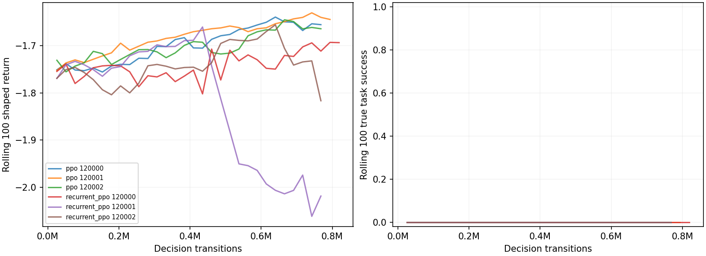

# Arm learning baselines under hidden disturbances

## Registered protocol (before training)

Compare full agent, no-adaptation agent, clipped PPO MLP and recurrent PPO GRU for
on(red,plate), in the five standard conditions. Privileged object tokens are given,
through the same default camera-frame observation used by the published arm, alongside
q/dq and wrist force. Policy inputs exclude event logs, disturbance labels/parameters,
true predicates, and the arm's authored subgoal phase. Derived relative positions and
fixed physical input scaling are given. PPO outputs continuous Cartesian velocity and
gripper commands; no scripted controller, demonstrations or action residual are supplied.

Dense potential shaping is given, based only on perceived reach, soft grasp, lift and
alignment; it is not learned. The policy learns its entire action mapping. Termination
uses perceived placement with an open hand, or the same 150-decision cap as the slice;
25 passive settling controls precede the unchanged true task success test. The arm's
own subgoal termination differs in detail; all use the same physics, action rate/limits,
maximum time and success predicate. Realized disturbance exposure is reported, including
scheduled disturbances that occur after an early finish.

Each learned baseline has three optimizer seeds120000–120002, at most1,000,448
decision transitions per seed (4 environments,256-step rollouts). Standard PPO settings:
Adam3e-4 linearly annealed,6 epochs,minibatch256,clip.2,gamma.99,GAE.95,
entropy.01,value coefficient.5,gradient clip.5,target approximateKL.03. Recurrent
BPTT uses32-step chunks with stored initial hidden states and explicit episode resets.
Training stops at budget or the registered rolling-return plateau after750592 steps.
No final-based tuning or checkpoint selection; the last completed update is frozen.
Detailed settings and exact stopping definition are in results/arm_baselines_plan.json.

Training layouts use disjoint ranges beginning10000000; the environment independently
draws each condition uniformly and uses the unchanged slice disturbance distribution.
Development layouts111000–111049 are reserved for diagnostics, not final scoring.
Final layouts110000–110099 are100 fresh episodes,20 per condition, identical for
every method and optimizer seed. Disturbance RNG base115000 plus episode index.
Independent nominal calibration112000–112007 is used only by the Bayesian agent.
Final policies are deterministic and all weights/settings freeze before final collection.

Report per-condition and overall success with Wilson95 intervals, learned mean±SD
over seeds, and exact paired sign tests against full on discordant episode outcomes,
separately per training seed. No pooling three predictions of the same episode as
independent observations. Full/no-adapt also have cause accuracy and their own English
episode explanations; PPO policies have no cause/explanation head. Keep all failures.

This is a comparison of whole systems, not an isolated test of cause representations:
the full agent has given relational subgoals, a learned model trained partly from
scripted demonstrations, authored likelihoods and adaptation rules. PPO receives a
given shaped reward and domain-randomized practice without demonstrations. A PPO
failure without adequate clean-task learning is an optimization/budget limitation,
not evidence that explicit causes are intrinsically superior. Count the world model's
training data and optimizer steps in sample efficiency, with provenance limitations.
Optional Dreamer/TD-MPC is not registered for this run. Laptop only; no git state changes.

## Interrupted execution (2026-10-28)

The continuation check found no live arm-baseline runner, trainer, or simulation worker.
The three progress files were unchanged during repeated checks; their latest logged
steps were PPO seed120000:409600, PPO seed120001:409600, and recurrent PPO
seed120000:332800. This is at least **1,152,000 decision transitions** of partial
training (plus any unlogged transitions). All three latest rolling100 task-success
rates were zero. These are training diagnostics, not final evaluation results.

No trial completed and no model checkpoint exists. The registered trainer writes
weights only at trial completion, so optimizer/model/environment state cannot be
reconstructed from progress JSON. The process-exit cause is unknown; it is not
established that the service error caused it. The previous runner session is also
unavailable. No process was stopped by this continuation check.

No restart, retuning, freeze, or final collection was performed. The instruction
against restarting requires explicit authorization before repeating these trials.
Any authorized restart must preserve these partial logs and count discarded
experience separately; it cannot be described as resuming the lost weights.
Final seeds110000-110099 remain unused by this study. The stored pre-training test
record has35 passing tests, including slice and cognition checks; tests were not
rerun merely for this documentation-only update.

Evidence: `results/arm_baselines_interruption_20261028.json`, including timestamps,
progress hashes, empty process/checkpoint/completion lists, and unchanged registered
agent/world-model hashes. There are **no final success tables, paired tests, or
scientific verdict yet**. The registered experiment remains incomplete.

## Authorized unchanged restart and operational recovery

The interrupted trials were restarted, with no change to the
registered learning configuration, seeds, budgets or stopping rule. The interrupted
run is discarded experience: at least 1,152,000 decision transitions, with an unknown
unlogged remainder. It contributes to no reported training curve, success estimate,
checkpoint selection or comparison. Its progress and worker/trainer logs are copied
to `results/arm_baselines_discarded_20261028_*`; original interruption evidence is
unchanged. The restart authorization manifest lists archive hashes.

Atomic recovery checkpoints are saved every25 updates (25,600 decision transitions,
less than50,000) and at completion. They include model and optimizer, CPU/CUDA/Python/
NumPy RNGs, shuffle generator, observations, recurrent hidden/reset states, episode
summaries, step counters, plateau history and accumulated runtime. Simulator workers
save their sampling RNG/counter plus current episode seed, disturbance configuration
and executed actions. Restore replays only that episode to reconstruct simulator state
and verifies bit-exact observations; a test compares subsequent transitions across
process recreation and an episode boundary. This operational state is never exposed
to the policy. Recovery replay is additional simulator work, not additional learning
experience. A crash may require re-executing at most24,576 completed decisions plus
the in-flight update after the last checkpoint; these are not new optimizer steps in
the resumed trajectory and must be disclosed separately if recovery occurs.

Launch from the repository root:

```powershell
$env:PYTHONPATH='.;scripts'
$env:OMP_NUM_THREADS='1'
$env:OPENBLAS_NUM_THREADS='1'
$env:PYTHONIOENCODING='utf-8'
.venv/Scripts/python.exe scripts/arm_baseline_launch.py
```

The launcher uses independent redirected handles and Windows DETACHED_PROCESS,
CREATE_NEW_PROCESS_GROUP and CREATE_BREAKAWAY_FROM_JOB, so the runner does not depend
on the interactive command session. It records its PID and command. The unchanged
runner then performs training, calibration, freezing, registered final evaluation,
reporting and audit. No final episodes are used to select settings.

### Checkpoint recovery 1

Five trials completed before recurrent PPO seed120002 failed during a worker reset
with MuJoCo `Could not allocate memory`. The unchanged runner was relaunched to
resume that trial from its332800-transition recovery checkpoint. The lost in-flight
work is unknown (at most25599 decision transitions); it is re-executed from saved
weights/optimizer/RNG/environment state, not included as additional learned steps.
Failure logs and checkpoint hash are retained in `results/arm_baselines_recovery1.json`.
No reward, budget, seeds, hyperparameters or stopping rule changed.

## Frozen results

| Method | Overall | Clean | Push | Heavier | Slippery | Camera shift | Explanation |
|---|---:|---:|---:|---:|---:|---:|---|
| ppo | 0.0% ± 0.0% | 0.0% ± 0.0% | 0.0% ± 0.0% | 0.0% ± 0.0% | 0.0% ± 0.0% | 0.0% ± 0.0% | None |
| recurrent_ppo | 0.0% ± 0.0% | 0.0% ± 0.0% | 0.0% ± 0.0% | 0.0% ± 0.0% | 0.0% ± 0.0% | 0.0% ± 0.0% | None |
| full_agent | 92/100 (85.0–95.9%) | 20/20 (83.9–100.0%) | 20/20 (83.9–100.0%) | 20/20 (83.9–100.0%) | 13/20 (43.3–81.9%) | 19/20 (76.4–99.1%) | Own Bayesian cause/parameters/actions |
| no_adapt | 75/100 (65.7–82.5%) | 20/20 (83.9–100.0%) | 20/20 (83.9–100.0%) | 20/20 (83.9–100.0%) | 11/20 (34.2–74.2%) | 4/20 (8.1–41.6%) | Own Bayesian cause/parameters/actions |

| Learned method / seed | Condition | Success | Wilson95 |
|---|---|---:|---|
| ppo / 120000 | overall | 0/100 | [0.0%, 3.7%] |
| ppo / 120000 | none | 0/20 | [0.0%, 16.1%] |
| ppo / 120000 | push | 0/20 | [0.0%, 16.1%] |
| ppo / 120000 | heavier_object | 0/20 | [0.0%, 16.1%] |
| ppo / 120000 | slippery_object | 0/20 | [0.0%, 16.1%] |
| ppo / 120000 | camera_shift | 0/20 | [0.0%, 16.1%] |
| ppo / 120001 | overall | 0/100 | [0.0%, 3.7%] |
| ppo / 120001 | none | 0/20 | [0.0%, 16.1%] |
| ppo / 120001 | push | 0/20 | [0.0%, 16.1%] |
| ppo / 120001 | heavier_object | 0/20 | [0.0%, 16.1%] |
| ppo / 120001 | slippery_object | 0/20 | [0.0%, 16.1%] |
| ppo / 120001 | camera_shift | 0/20 | [0.0%, 16.1%] |
| ppo / 120002 | overall | 0/100 | [0.0%, 3.7%] |
| ppo / 120002 | none | 0/20 | [0.0%, 16.1%] |
| ppo / 120002 | push | 0/20 | [0.0%, 16.1%] |
| ppo / 120002 | heavier_object | 0/20 | [0.0%, 16.1%] |
| ppo / 120002 | slippery_object | 0/20 | [0.0%, 16.1%] |
| ppo / 120002 | camera_shift | 0/20 | [0.0%, 16.1%] |
| recurrent_ppo / 120000 | overall | 0/100 | [0.0%, 3.7%] |
| recurrent_ppo / 120000 | none | 0/20 | [0.0%, 16.1%] |
| recurrent_ppo / 120000 | push | 0/20 | [0.0%, 16.1%] |
| recurrent_ppo / 120000 | heavier_object | 0/20 | [0.0%, 16.1%] |
| recurrent_ppo / 120000 | slippery_object | 0/20 | [0.0%, 16.1%] |
| recurrent_ppo / 120000 | camera_shift | 0/20 | [0.0%, 16.1%] |
| recurrent_ppo / 120001 | overall | 0/100 | [0.0%, 3.7%] |
| recurrent_ppo / 120001 | none | 0/20 | [0.0%, 16.1%] |
| recurrent_ppo / 120001 | push | 0/20 | [0.0%, 16.1%] |
| recurrent_ppo / 120001 | heavier_object | 0/20 | [0.0%, 16.1%] |
| recurrent_ppo / 120001 | slippery_object | 0/20 | [0.0%, 16.1%] |
| recurrent_ppo / 120001 | camera_shift | 0/20 | [0.0%, 16.1%] |
| recurrent_ppo / 120002 | overall | 0/100 | [0.0%, 3.7%] |
| recurrent_ppo / 120002 | none | 0/20 | [0.0%, 16.1%] |
| recurrent_ppo / 120002 | push | 0/20 | [0.0%, 16.1%] |
| recurrent_ppo / 120002 | heavier_object | 0/20 | [0.0%, 16.1%] |
| recurrent_ppo / 120002 | slippery_object | 0/20 | [0.0%, 16.1%] |
| recurrent_ppo / 120002 | camera_shift | 0/20 | [0.0%, 16.1%] |

Learned entries are mean ± sample SD over3 training seeds. Full per-run Wilson intervals and paired tests by condition are retained in arm_baselines_summary.json. These intervals describe episode uncertainty separately from training-seed variability. All per-episode failures remain in final JSON.

| Candidate | Seed | Candidate-only success | Full-only success | Exact two-sided sign p |
|---|---:|---:|---:|---:|
| ppo | 120000 | 0 | 92 | 4.03897e-28 |
| ppo | 120001 | 0 | 92 | 4.03897e-28 |
| ppo | 120002 | 0 | 92 | 4.03897e-28 |
| recurrent_ppo | 120000 | 0 | 92 | 4.03897e-28 |
| recurrent_ppo | 120001 | 0 | 92 | 4.03897e-28 |
| recurrent_ppo | 120002 | 0 | 92 | 4.03897e-28 |
| no_adapt | n/a | 0 | 17 | 1.52588e-05 |

Paired tests are per training seed, with no pooling the same physical layout across three policies; multiple descriptive comparisons are not multiplicity-corrected. Assigned-condition scores include episodes that finished before a scheduled event. Realized-event counts are in the summary.

| Agent | Cause correct overall |
|---|---|
| full_agent | 91/100; Wilson95 [83.8%, 95.2%] |
| no_adapt | 94/100; Wilson95 [87.5%, 97.2%] |

### Unedited own causal reports, next to scoring truth

full_agent, first slippery_object episode, layout 110060; scorer condition slippery_object, true task success True. Own report:
```text
  Surprise: my predictions failed at 1 steps, most at 1.9 s (surprise 35; spikes start at 14).
  My explanation: the object is sliding in my hand, probability 1.00 (onset=4, sink_mm=-0.0, slide_mm=[16.4, -0.1], weight_lost_N=-0.0).
  What I changed: at 2.6 s, carry it low, grasped at its centre.
```
full_agent, first camera_shift episode, layout 110080; scorer condition camera_shift, true task success True. Own report:
```text
  Surprise: my predictions failed at 1 steps, most at 4.0 s (surprise 911; spikes start at 14).
  My explanation: my camera moved: everything I see jumped while my hand did not, probability 1.00 (onset=40, camera_offset_mm=[41.1, -20.1, -2.5], seen_jump=[-0.0411, 0.0201, 0.0025]).
  What I changed: at 4.0 s, recalibrated the camera (correction_mm=[41.099998474121094, -20.100000381469727, -2.5]).
```
no_adapt, first slippery_object episode, layout 110060; scorer condition slippery_object, true task success True. Own report:
```text
  Surprise: my predictions failed at 1 steps, most at 1.9 s (surprise 35; spikes start at 14).
  My explanation: the object is sliding in my hand, probability 1.00 (onset=4, sink_mm=-0.0, slide_mm=[16.4, -0.1], weight_lost_N=-0.0).
```
no_adapt, first camera_shift episode, layout 110080; scorer condition camera_shift, true task success True. Own report:
```text
  Surprise: my predictions failed at 1 steps, most at 4.0 s (surprise 911; spikes start at 14).
  My explanation: my camera moved: everything I see jumped while my hand did not, probability 1.00 (onset=40, camera_offset_mm=[41.1, -20.1, -2.5], seen_jump=[-0.0411, 0.0201, 0.0025]).
```

## Training and sample efficiency

The current nominal world-model corpus contains 180000 decision transitions in 1500 episodes (900000 controlled50Hz steps). Checkpoint settings record8000 optimizer steps, batch512,5 ensemble members. This is not zero-shot or zero-training-data planning: data generation mixes70% scripted pick/place and30% exploration. Historical corpus hashes were not stored, so current corpus counts are a provenance-qualified estimate of the checkpoint experience. Reset settling is additional simulator work, not a learned transition.

| Baseline | Seed | Decision transitions | Controlled50Hz steps | Wall seconds | Stop |
|---|---:|---:|---:|---:|---|
| ppo | 120000 | 768000 | 3840000 | 7060.6 | registered plateau |
| ppo | 120001 | 793600 | 3968000 | 7176.5 | registered plateau |
| ppo | 120002 | 768000 | 3840000 | 4751.3 | registered plateau |
| recurrent_ppo | 120000 | 819200 | 4096000 | 9370.4 | registered plateau |
| recurrent_ppo | 120001 | 768000 | 3840000 | 6932.4 | registered plateau |
| recurrent_ppo | 120002 | 768000 | 3840000 | 5451.9 | registered plateau |

Before learning, Windows denied multiprocessing named pipes. A four-thread fallback worked; the final implementation uses independent CPU processes over ordinary anonymous stdio pipes. Physics workers load the exact slice disturbance function through AST extraction to avoid unnecessary Torch imports. Tests verify identical sampled disturbances. Up to3 independent training trials run concurrently, with4 one-thread simulation workers per trial (12 workers total on14 physical/20 logical CPU cores); PPO minibatches remain256 and GRU sequences32. Wall times are measured under this shared-resource schedule. Three1024-decision timing probes used no learning updates and separate layouts19000000+; all probe records and the pretraining I/O failure are retained.

Training curves (given shaped return and score-only true success) are retained per seed; passive and reset controls are counted separately in the sample-efficiency JSON. Four CPU simulation workers use one BLAS/OpenMP thread each; policy training runs on the laptop GPU.

## Verdict and limitations

On these100 frozen episodes the full agent succeeds in 92/100, compared with PPO 0.0% ± 0.0% and recurrent PPO 0.0% ± 0.0%. The paired table states the observed differences without assuming that the explicit-cause system must win. This comparison is conditional on the registered budgets and given priors; it does not isolate explicit causes from the arm's authored subgoals/demonstration-trained model or PPO reward/optimization choices. Low PPO clean-task success would indicate incomplete skill learning and cannot establish inherent superiority of cause inference. The full/no-adapt pair is the more direct adaptation ablation. Neither PPO has an explanation head; no model-based RL baseline was run.

## Reproduce

```powershell
$env:PYTHONPATH='.;scripts'
$env:OMP_NUM_THREADS='1'
$env:OPENBLAS_NUM_THREADS='1'
.venv/Scripts/python.exe scripts/arm_baseline_plan.py
.venv/Scripts/python.exe scripts/arm_baseline_tests.py --basetemp data/pytest_arm_baselines_final_20261028 --output results/arm_baselines_tests_final.json
.venv/Scripts/python.exe scripts/arm_baseline_run.py
```
The runner logs exact training/evaluation commands, freezes all checkpoints/sources before final evaluation, and resumes only completed episode keys/models. Use a fresh temporary test directory for any repeat. No final-based tuning, cloud compute or git state changes.



## Additional final diagnostics

The development layouts111000-111049 were reserved and not used for tuning. All final layouts110000-110099 were scored after freezing; each method has20 episodes per condition. Optimizer seeds120000-120002 are not additional independent physical layouts.

| Condition | No-adapt only | Full only | Paired sign p | Full cause correct | No-adapt cause correct |
|---|---:|---:|---:|---:|---:|
| none | 0 | 0 | 1 | 19/20 | 19/20 |
| push | 0 | 0 | 1 | 20/20 | 20/20 |
| heavier_object | 0 | 0 | 1 | 20/20 | 20/20 |
| slippery_object | 0 | 2 | 0.5 | 12/20 | 15/20 |
| camera_shift | 0 | 15 | 6.10352e-05 | 20/20 | 20/20 |

For either PPO architecture and each of its three seeds separately, candidate-only wins are0; full-only wins are20,20,20,13,19 in clean/push/heavier/slippery/camera order. Exact paired p values are1.90735e-6,1.90735e-6,1.90735e-6,0.000244141,3.81470e-6 respectively. These are descriptive comparisons against policies that failed to acquire the clean task, not evidence of intrinsic representational superiority.

| Method | Push events | Heavier events | Slippery events | Camera events |
|---|---:|---:|---:|---:|
| ppo | 20,20,20 | 20,20,20 | 20,20,20 | 20,20,20 |
| recurrent_ppo | 20,20,20 | 20,20,20 | 20,20,20 | 20,20,20 |
| full_agent | 20 | 20 | 20 | 20 |
| no_adapt | 20 | 20 | 20 | 20 |

Event counts are scorer-side realized disturbance starts; comma-separated values follow optimizer seeds120000,120001,120002. Clean episodes contain no disturbance starts. This documents injection exposure, not proof that a policy grasped or carried the block.

## Summary

The registered comparison completed: six frozen learned policies and two agent variants,800 per-episode records on100 paired layouts. Full task success92%, no-adapt75%; both learned baselines0% for every seed. Because the learned policies also fail all clean episodes, this run establishes a failure of skill acquisition under the registered reward/budget, not superiority over competent PPO baselines. The direct full/no-adapt comparison yields17 additional successes, with no reverse discordances (exact two-sided p=0.0000152588).

## Files changed

New baseline modules under `pai/baselines/`, `scripts/arm_baseline_*.py`, `tests/test_arm_baselines.py`, this document, and `results/arm_baselines_*`. No other stage was edited. The registration and interruption evidence were retained. Recovery checkpoints and independent launch handles were the two authorized operational changes.

## Commands run (tests and evaluations)

```powershell
.venv/Scripts/python.exe scripts/arm_baseline_tests.py --basetemp data/pytest_arm_baselines_resume_20261028 --output results/arm_baselines_tests_resume.json
.venv/Scripts/python.exe scripts/arm_baseline_launch.py
```
The detached launch was invoked twice: initial authorized restart, then checkpoint recovery after a memory-allocation failure. Exact child commands and exit codes are retained in `results/arm_baselines_command_*.json`; the failed exit record is archived under `results/arm_baselines_recovery_failure1_*`. The runner trained both kinds with `--seed 120000`, `120001`, `120002`, then ran `scripts/arm_baseline_eval.py calibration`, `freeze`, and `evaluate --method METHOD` (with `--seed SEED` for policies), followed by `scripts/arm_baseline_report.py` and its audit. Scoped tests:37 passed.

## Measured results (with seeds)

Final layouts110000-110099, disturbance RNG115000-115099; independent nominal calibration112000-112007. Full92/100 (Wilson95 85.0-95.9%), no-adapt75/100 (65.7-82.5%). PPO and recurrent PPO each0.0% +/-0.0% over three training seeds; each seed0/100 (Wilson95 0.0-3.7%). Agent cause accuracy91/100 full,94/100 no-adapt. All six trials stopped by the registered plateau after768000-819200 decision transitions; aggregate retained learning experience4,684,800. Reported trial wall times sum40,743.1 seconds under concurrent shared-resource execution; this sum is not elapsed experiment time. The world-model corpus estimate is180000 decisions, with historical provenance limitations stated above. Discarded interruption experience is at least 1,152,000 decisions and is excluded from reported model budgets/results; it remains additional experiment cost. Timing probes add3072 non-learning decisions.

## What is not done / known problems

Neither PPO policy acquired the clean placement skill, so the mainstream comparison is not yet a comparison against competent learned controllers. No tuning was performed after registration or on final episodes. The cause advantage against learned policies remains unresolved. The full/no-adapt gain is concentrated in camera shifts (15 discordant successes) and slippery objects (2); the latter condition is still only13/20 for the full agent. The baselines have no explanation head. No optional model-based RL baseline was built. World-model historical corpus membership cannot be verified from the old checkpoint. One memory-allocation failure and all interrupted experience are retained. Recovery replay and any unlogged lost updates are additional simulator cost; they do not change the retained optimizer trajectory. All800 records and frozen source/checkpoint hashes pass the final audit.
