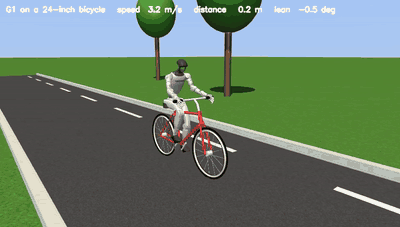

# The Unitree G1 rides a bicycle (Stage 2 body on Stage 7)

`media/bike/g1_riding.mp4`: the G1 rides 30 m on a fresh start (seed 3301; of three starts never used
anywhere, 3300-3302, two rode the full 30 m and one fell, in line with the final rate below).

## The bicycle and the scene

`pai/bike/real_bike.py` builds a realistic 24-inch bicycle sized for the 1.32 m G1: standard geometry
(73 degree seat tube, 70 degree head angle, 0.42 m chainstays, 0.98 m wheelbase), a diamond frame,
torus tyres and rims with 16 spokes per wheel, a saddle on a seat post, a stem and handlebar with
grips, a chainring, crank arms and pedals, 11.4 kg in total; on an asphalt road with a dashed centre
line and kerbs, grass, trees, a sky and sunlight with shadows (`media/bike/real_bike.png`). The
detailed shapes are visual; each wheel touches the ground through a thin cylinder of the tyre's
radius, as in the first Stage 7 bicycle. No ready-made bicycle model for MuJoCo was found, and no
published work on a humanoid learning to ride a bicycle (the nearest: a humanoid on a two-wheeled
scooter, Sensors 2026; see the comparison below).

## The G1 on the bike

`pai/bike/g1_rider.py`: the G1 (MJX model, 33 kg, position servos on its 29 joints) without its
floating base, its pelvis fixed on the saddle; its palms held to the grips and its soles to the pedals
by equality constraints; the crank is geared to the rear wheel (crank angle = 0.5 x wheel angle), so
the legs pedal as the bike rolls (leg servos are soft and follow the pedals). The seated posture is
solved by least squares over the G1's joint angles within their limits, so the hands and feet start on
the grips and pedals (residual gaps 2-16 mm, under 1 mm after settling). Total mass 44.8 kg.

**Stated simplifications:** the drive torque acts at the rear wheel (the legs follow the pedals rather
than producing it); steering is a servo on the fork that the hands hold (later the arms steer:
[BIKE_TOWN.md](BIKE_TOWN.md), "The G1's own arms steer"); the G1 does not collide with the bike; the rider rides straight (no heading changes; corners,
U-turns and deliveries in a town: [BIKE_TOWN.md](BIKE_TOWN.md)).

## Learning to balance by practice

The steering law is the Stage 7 linear balance rule (steer against roll, roll rate and heading; drive
torque toward a target speed). Its gains were tuned for the first, lighter-looking bike; on this bike
with the G1 they almost never succeed. The rider improves the five gains by **practice**
(`scripts/bike_g1_practice.py`): a cross-entropy search on practice starts 3000-3011 (tilt up to
+-0.1 rad, 2.5-4 m/s, 30 m), keeping only improvements; the mean practice distance rose from 7.2 m
to 17.8 m. Development starts 3100-3119 only checked (9/20). Final, once, on new starts 3200-3239:

| Balance control (same 40 starts) | Reached 30 m (Wilson 95%) | Mean distance |
|---|---:|---:|
| **Practised gains** | **23/40** [42.2, 71.5] | 19.9 m |
| The first bike's gains (untuned) | 0/40 [0, 8.8] | 8.2 m |
| No steering | 0/40 [0, 8.8] | 3.9 m |

Practice turns a rule that never succeeds into one that succeeds more than half the time; a linear
rule with five gains is the limit here, and a richer learned policy is the next step.
`results/bike_g1_practice.json`.

    python scripts/bike_g1_practice.py --output results/bike_g1_practice.json
    python scripts/bike_g1_video.py --gains-from results/bike_g1_practice.json --seed 3301 --out docs/media/bike/g1_riding

## How this compares with published work

| Work | Robot | Control | Result |
|---|---|---|---|
| Scooter-driving humanoid (MDPI Sensors, 2026) | full-size real humanoid on a two-wheeled scooter | deep RL; operator gives heading and speed | success 0.96 straight, 0.92 light turns, 0.72 sharp turns, 0.88 over a 60 mm bump, 0.73 with a 70 kg passenger; 0.8-3.0 m/s |
| Baltes et al. (2023) | simulated humanoid on a scooter | deep RL | simulation |
| PRIMER V2 / KHR3HV (2011) | small real hobby humanoid on a real bicycle | gyro-to-handlebar rule, real pedalling, remote-controlled direction | rides up to about 10 km/h |
| Ultra Mobility Vehicle (2026) | a bicycle robot (not a humanoid) | RL (PPO, Isaac Lab) | driving 1.00, 1 m table jumps 0.94, flips 0.97, on hardware |
| Randlov and Alstrom (ICML 1998) | simulated bicycle, no body | Sarsa(lambda) with shaping | balance and ride to a goal about 1 km away |
| **This work** | **G1 on a realistic bicycle (simulation)** | **linear balance rule, gains learned by practice** | **23/40 fresh 30 m rides**; straight only |

Where this is new: a humanoid seated on a bicycle of real geometry, pedalling with its legs, with
balance learned by practice. Where the published work is ahead: real hardware, heading tracking and
sharp turns, bumps, and passengers. A fair comparison with the scooter humanoid needs steering by the
G1's own arms, heading commands with turns, and success rates per manoeuvre.
