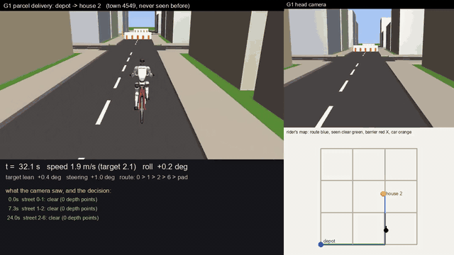

# The G1 delivers parcels by bicycle in a town it has never seen

`media/bike/delivery.mp4`: a delivery in town 4549 (one of the final evaluation towns) from the depot
to house 2. Top left the chase camera; top right the G1's head camera (it turns toward the street it
is checking); bottom right the rider's own map (its route, the streets it has seen clear, the barriers
and parked cars it has seen; nothing it has not seen); bottom left its speed, roll, target lean and
steering, and every look with what the camera saw and what it decided.

## Results (final towns 4540-4559, never used before; 40 deliveries)

| Rider (same towns, same houses, same steering) | Delivered (Wilson 95%) | Collisions | Falls | Left the road |
|---|---:|---:|---:|---:|
| **Looking and replanning** | **36/40** [76.9, 96.0] | **0** | 2 | 2 |
| Blind (shortest route on the map, no looking) | 21/40 [37.5, 67.1] | 19 (12 barriers, 7 cars) | 0 | 0 |

Paired over the 40 deliveries: 15 delivered only by the looking rider, 0 only by the blind one
(sign test p = 0.0001). The head camera read 178 of 178 streets correctly against the hidden truth
(17 replans, many lane changes). Delivered rides: 45.8 s and 89.7 m on average (the detours), mean
heading error 3.7 degrees, mean distance from the lane line 0.14 m. All four failures are one case:
a barrier on a side street seen only 5 m before the intersection that leaves a U-turn as the only way
(three at the town's corner intersection); the loop then starts too sharply and the rider falls or
runs wide. `results/bike_g1_delivery.json`.

    python scripts/bike_g1_delivery_eval.py --towns 4540 4560 --output results/bike_g1_delivery.json
    python scripts/bike_g1_delivery_video.py --town 4549 --house 2 --out docs/media/bike/delivery

**Earlier evaluations (kept, each on its own new towns):** after each, the failures were studied and
the next evaluation used towns never seen before.

| Evaluation | Rider | Looking delivered | Blind delivered | Failures of the looking rider |
|---|---|---:|---:|---|
| 1: towns 4500-4519 | v2 steering; no U-turn manoeuvre; looks 3 m before every intersection | 33/40 | 24/40 | 6 left the road and 1 fell, all where a U-turn was needed (the path reversed on the spot) |
| 2: towns 4520-4539 | v3 steering with U-turn loops | 34/40 | 20/40 | 4 falls, 2 off the road: barriers straight ahead seen only 4 m before the intersection, too late to turn |
| 3 (final): towns 4540-4559 | v3; the street straight ahead is checked from 10 m | 36/40 | 21/40 | 4 late U-turns (above) |

`results/bike_g1_delivery_first.json`, `results/bike_g1_delivery_second.json`.

## Learning to corner by practice

`scripts/bike_g1_turn_practice.py`: routes of 3-4 streets with at least one 90-degree corner, in
practice towns 4000-4003 (2 routes each); a cross-entropy search over the steering law's gains keeps
only improvements of the practice score; development towns 4100-4104 only check; each final check on
its own new towns. A ride ends with a fall, or when the rider is more than 3 m from its route.

| Stage | What was practised | Final towns | Practised | Before this practice | Untuned law |
|---|---|---|---:|---:|---:|
| v1 | progress along the route | 4200-4209 | 20/20 routes; heading error 24.8 deg, 0.99 m from the lane (max 2.95 m) | - | 0/20 |
| v2 | progress minus 0.3 x distance from the lane, from v1 | 4210-4219 | **20/20; heading error 3.9 deg, 0.14 m (max 0.38 m)** | v1: 19/20, 0.99 m | 0/20 |
| v3 | as v2, plus 2 U-turn routes per town and a U-turn speed, from v2 | 4220-4229 | **40/40 including 20 U-turns**; 5.8 deg, 0.16 m (max 0.91 m) | v2: 20/40 (falls in every U-turn) | 0/40 |

v1 rode without falling but drifted wide in corners and wove back (it was scored on progress only);
adding the distance from the lane to the score (as CycleRL rewards tracking) made it ride the lane.
Many final routes are the same shape in different towns (the grid repeats), so the number of truly
different routes is smaller than the count. `results/bike_g1_turns_v1.json`, `_v2.json`, `_v3.json`.

    python scripts/bike_g1_turn_practice.py --output results/bike_g1_turns_v1.json
    python scripts/bike_g1_turn_practice.py --start-from results/bike_g1_turns_v1.json --track-weight 0.3 --iterations 10 --final-towns 4210 4220 --output results/bike_g1_turns_v2.json
    python scripts/bike_g1_turn_practice.py --start-from results/bike_g1_turns_v2.json --u-turns 2 --track-weight 0.3 --iterations 12 --final-towns 4220 4230 --output results/bike_g1_turns_v3.json

(The v1 file was produced before the `--start-from`, `--track-weight` and `--u-turns` options existed;
its command is the first line with those options at their defaults.)

## The task

`pai/bike/town.py` builds a town in MuJoCo: a 4 x 4 grid of intersections 25 m apart (24 streets),
asphalt streets 4 m wide with a dashed centre line, pavements, buildings on every block, a blue depot
pad and eight numbered houses with orange drop-off pads and posts. Obstacles stand on about 45% of the
streets (none next to the depot):

- **barriers** (a white barrier and cones across the street, about 20% of streets): the street cannot
  be passed;
- **parked cars** (one lane, about 25%): passable in the other lane.

A delivery starts at the depot and ends at a house's pad. The rider is given the **street map** (the
intersections and streets, as a map app would) but **not the obstacles**: they are hidden state it can
only learn by looking. The obstacles are drawn for the camera; contact with them is checked
geometrically (inside a barrier's line or a car's footprint plus 0.3 m is a collision).

## What the rider does (and what is given or learned)

| Part | How | Given or learned |
|---|---|---|
| Steering and cornering | `pai/bike/riding.py` `LeanFollower`: lean into the curve ahead (the lean a steady turn needs, plus a heading correction), steer to reach and hold that lean (the countersteer comes out by itself), slow before corners; the lane is rounded to 3.4 m at corners; a U-turn is a 2.4 m loop round the intersection | the law's form is given; its 9 gains and speeds are **learned by practice** (`scripts/bike_g1_turn_practice.py`) |
| Seeing obstacles | `pai/bike/navigation.py` `inspect_street`: before each intersection the G1 turns its head toward the street it plans to take (10 m before when it is straight ahead, 4 m when it is around a corner, where the corner buildings hide it until then); the head camera's depth image becomes 3-D points, and points standing 0.2-2 m above the road inside that street are an obstacle: a barrier if they span more than 2.3 m of the street, else a parked car, placed in the lane its points are in and taken to be about 4 m long | the reading rule is given |
| Belief and route | a belief P(blocked) per street, starting from the rate of blocked streets **counted in the practice towns** (0.125); routes minimise length + P(blocked) x 60 m and are replanned whenever a look changes the belief, avoiding a U-turn when another way exists; after a replan the new street is checked at once | the prior is counted; the planner is given |
| Parked cars | the planned lane path moves into the other lane past a car in the rider's lane (smooth 3.5 m ramps), and keeps 0.5 m more room from a car in the other lane | given |

**Stated simplifications:** the head turn is a camera direction, not a G1 neck motion (the G1 has no
neck joint); the drive torque is applied at the rear wheel and the steering is a servo on the fork
held by the G1's hands (as in `docs/BIKE_G1.md`); for cornering the G1's arm servos are softened so the
arms follow the handlebar, and the steering servo is stronger (with the stiff arms of the
straight-riding work the handlebar could not turn past about 0.2 rad, too little for a corner);
there is no other traffic.

## Findings on the way

- The first cornering attempt (the straight-riding balance rule plus pure-pursuit steering) stalled
  at 66% of the practice routes, and its "final" result looked like 4/20 completed routes with no
  falls. That was reward hacking: the progress measure took the nearest path point within the
  next 40, so a rider far off the route still "advanced" (mean cross-track error 49 m, max 186 m). The
  measure now ends a ride that leaves the route by more than 3 m; that result is discarded
  (`data/bike_g1_turns_linear_invalid.json`, local).
- The rule's form was the problem: steering toward the target heading makes a bicycle lean outward.
  Leaning first and steering to hold the lean (how riders corner) fixed it.
- With the G1's arm servos as stiff as in the straight riding, the handlebar could not turn past about
  0.2 rad, too little for a 3.4 m corner; with soft arms and a stronger steering servo it reaches
  about 0.52 rad.
- Camera reading was checked first standing at the approach to every street of two test towns (4300,
  4301; all approach directions): house posts on the road edge were read as parked cars (they were
  moved onto the pavement); barriers seen at an angle could look narrower than a street (threshold
  2.3 m; a car covers at most 1.85 m); parked cars seen at an angle show mostly their near side, close
  to the centre line, so their lane is taken from the side their points are on.
- Bugs found in the test town before the evaluations: after a replan the rider did not look down its
  new street (it rode into a parked car on the detour); the lane change was decided per path point,
  which misfired on curves.

## How this compares with published work

| Work | Robot | Navigation | Obstacles | Result |
|---|---|---|---|---|
| CycleRL (Liu et al., Sun Yat-sen University, arXiv 2603.15013, 2026) | a bicycle robot (no rider), Isaac Sim and hardware | heading and speed commands; PPO | none | balance success 99.9% sim, 95% real; heading error 1.15 deg sim, 2.04 deg real; names vision-based navigation as future work |
| Scooter-driving humanoid (MDPI Sensors, 2026) | real full-size humanoid on a two-wheeled scooter | operator heading and speed; deep RL | a 60 mm bump | 0.96 straight, 0.92 light turns, 0.72 sharp turns |
| Ultra Mobility Vehicle (2026) | bicycle robot | RL (PPO, Isaac Lab) | jumps onto tables | driving 1.00, jumps 0.94, flips 0.97 |
| Randlov and Alstrom (ICML 1998) | simulated bicycle, no body | ride to a goal ~1 km away; Sarsa(lambda) | none | reaches the goal after learning |
| **This work** | **G1 humanoid on a realistic bicycle (simulation)** | **street map + head camera, belief over blocked streets, replanning; corners and U-turns** | **barriers and parked cars, unknown in advance** | **36/40 deliveries in new towns vs 21/40 blind; 0 collisions; heading error 3.7 deg, 0.14 m from the lane** |

Where this goes past the published work: a humanoid rider on a bicycle that plans a delivery route
in a town, discovers obstacles with its own head camera and replans (CycleRL's stated next step).
Where it is behind: real hardware; heading accuracy (CycleRL 1.15 deg in simulation on straight
heading commands, here 3.7 deg over town routes with corners); a richer learned policy (CycleRL's
PPO) instead of a law with 9 gains learned by practice; the arms do not produce the steering torque;
U-turns decided late; no other traffic.
