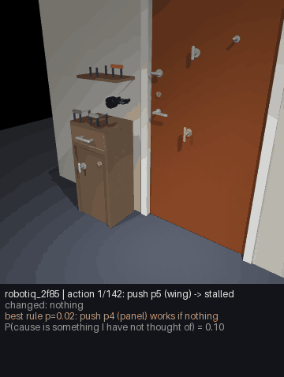
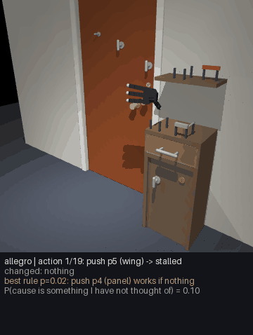

# Discovering how to open a locked door (no scripted solution)

The goal: the agent is asked to open a door. The door may be latched (turn the knob first), bolted
from the inside (a thumb-turn), or locked with a key that lies somewhere in the scene, possibly
inside a drawer. **Nothing tells the agent what a key is, what a keyhole is for, or that knobs turn.**
It has to work this out from its own attempts, the way a child does, and then reuse what it learned.

## What is given and what is learned

| Given (built in) | Learned (by the agent, from experience) |
|---|---|
| A body and a handful of motor skills that act on *any* part or object: reach, grasp, release, turn about an axis, push and pull along an axis, insert (bring a held object to a part and push along its axis) | Which skill, on which object or part, changes what |
| A world model of its own body and of rigid objects (already trained) | That turning the knob releases the door; that a thumb-turn or a key in the keyhole is what the lock depends on; which key fits which lock |
| Surprise, cause inference and curiosity (expected information gain) | Where keys tend to be (on tables, in drawers) and that containers can hide things |
| Episodic memory and recipes | A recipe "open a locked door" with its preconditions, and the *order* of the steps |

The motor skills are generic: "turn" works on a knob, a thumb-turn, a key, a jar lid. What makes
the difference between a door that opens and one that does not is **not** coded anywhere.

## The loop (design)

What the current code implements is summarised under "What is implemented" below; items 2 and 5
are only partly built.


1. **Try the obvious.** The agent grasps the handle and pulls (or pushes). Its experience with
   ordinary doors predicts the door moves. It does not.
2. **Surprise, then a hidden cause.** The prediction error is large and structured: the handle
   is grasped, force goes up, nothing moves. Cause inference compares "blocked by something
   visible", "stuck (needs more force)", and "held by something I cannot see" (locked/latched).
   A harder pull tests "stuck" cheaply.
3. **Explore on purpose.** The agent now has many possible interventions: every skill applied to
   every part it can see (knob, thumb-turn, keyhole, hinges, the bar) and every movable object
   (keys, blocks, the drawer). It keeps a belief over **causal rules** of the form
   *"doing skill S on thing X (while holding Y) makes the door openable"* and picks the next
   intervention by **expected information gain** about those rules, discounted by effort: the
   epistemic value of active inference. After each intervention it probes the door again.
   Cheap, informative things come first (turn the knob, turn the thumb-turn); composite ones
   (hold a key, insert it, turn it) become worth trying when simple ones have been ruled out, and
   because holding an object near the part that sticks out is itself informative.
4. **Search when an object is missing.** If rules involving a key look promising but no key is
   visible, "find a key" becomes a subgoal. Containers that have not been looked into carry
   information, so opening drawers scores high: search emerges from curiosity, not from a
   "search for keys" routine.
5. **Explain the success.** When the door opens, counterfactual replay (pai.causes.credit) asks
   which steps were necessary: was it the key or the knob? Did the key have to be turned? Did
   the wrong key matter? The necessary steps and their order become a **recipe** with
   preconditions (a key that fits; the bolt state), stored in memory.
6. **Reuse and transfer.** Next time: a new layout, a different lock position, the key in another
   drawer, a different body. The recipe is recalled by goal and preconditions, and the agent goes
   straight to "find key, insert, turn, turn knob, pull". Wrong keys are recognised by the
   surprise they cause (inserted but will not turn) and a different key is tried.

## What is implemented (pai/discovery)

- A belief over rules "the goal is reached by probe P on the goal part while conditions C hold"
  (up to 2 conditions), with an Occam prior, a learned action model (which action changes which
  feature), action choice by expected information gain per second of effort, planning (A*) once a
  rule is likely, a catch-all "a cause I have not thought of", and a stopping rule for no solution.
- Explanations come from contrast rules over the agent's own log (`explain.py`), not yet from
  counterfactual replay; the "stuck / blocked / hidden" cause comparison of the slice is not wired in.
- The body model is hand-written (skill durations, hand speed), not the learned world model.
- Where keys are is not learned as such: there is a generic prior that opening things reveals
  things, and recipes bias the search towards containers after a success.
- **Locality is a switch.** `agent.Locality(radius=0.7, probe_prior=1.0, lit_prior=1.0, explain="near")`
  holds the built-in locality assumptions: probes only on parts within 0.7 m of the door, a distance
  penalty in the prior over probes and over conditions, and explanations that keep only conditions near
  the door. `Locality.off()` removes all four: probes on any part in view, no distance penalties, and
  the evidence-based explanation filter (`explain.py`: a condition is kept only if the same probe failed
  without it and either the contrast is clean or the belief puts more than half its mass on it).
- **Decoys.** MockWorld with `shared_shapes=True` adds decoys shaped like the mechanisms: a
  non-graspable disc on the cabinet like the lock cylinder, a wing on the leaf that turns and stays
  turned like the thumb-turn, and a door dial shaped like the handle. The MuJoCo scene has physical
  decoys (`home_doors.DECOYS`, `decoys=True`): a dial on the leaf shaped like the handle, a thumb-turn
  copy on the leaf, a coat hook, a disc with a keyhole and a wing on the cabinet front, and a free peg
  about a key's length on the shelf. None of them is connected to anything, and nothing in their ids
  or attributes tells them apart from mechanisms.
- **Other bodies.** `bodies.py` runs the same PhysicsWorld with any embodiment and records the
  ground truth after every action (`TracedWorld`), so a door that stayed shut can be put down to the
  body (skills that did not execute or stalled) or to the agent (`failure_cause`).

## How it is evaluated

- **Trials to first success** on each door type, against (a) random exploration over the same
  skills, (b) curiosity without the causal-rule belief (novelty only), (c) an oracle that knows the
  solution (the scripted solver; physics check only, never used by the agent).
- **Trials on the second encounter** (one-shot reuse), on held-out door types, and with other
  embodiments (Panda, dexterous hands, the G1 humanoid).
- **Explanation accuracy:** the agent's stated reason ("the door was locked; the brass key in the
  top drawer unlocked it") against the simulator's event log (key_inserted, key_turned,
  bolt_retracted, latch_released).
- **No-solution cases:** the key is behind the locked door. The agent should conclude it cannot
  open it and say why, instead of trying forever.
- **Ablations:** locality off, decoys shaped like the mechanisms, and both together.

## Build order

1. Home-door physics (turning knob with latch, thumb-turn deadbolt, key lock with matching keys,
   push/pull, closer, push bar), keys placed on tables, hooks or in drawers; a scripted solver
   that proves each variant is physically solvable. (In progress.)
2. Generic skills over the embodiment interface (reach, grasp, turn, push/pull, insert), usable
   by every body.
3. Causal-rule belief and information-gain exploration (the core of this document).
4. Recipes with order and preconditions; reuse and transfer experiments.
5. Explanations and the no-solution case.

## Results

These are the results of a clean re-run on fresh seeds. The agent's parameters were frozen before
it, and every scene seed and agent seed is offset by 100000 from the development seeds. Full tables
with 95% bootstrap intervals (2000 resamples) are in
[results/discovery_v2/eval.md](../results/discovery_v2/eval.md) and the raw numbers in
`results/discovery_v2/*.json`. The other-bodies run is in
[results/discovery_bodies/report.md](../results/discovery_bodies/report.md). In the mock all agents
get the same skills and a budget of 1000 actions, and a failure counts as 1000.

```
.venv/Scripts/python scripts/discovery_eval.py mock --seed-offset 100000 --out results/discovery_v2 --processes 8 --config default
.venv/Scripts/python scripts/discovery_eval.py mock ... --config shared --reuse 0
.venv/Scripts/python scripts/discovery_eval.py mock ... --config loc_off --agents discovery --reuse 0
.venv/Scripts/python scripts/discovery_eval.py mock ... --config both_off --agents discovery
.venv/Scripts/python scripts/discovery_eval.py physics --seed-offset 100000 --decoys --config default|loc_off --budget 300 --limit 3000 --out results/discovery_v2
.venv/Scripts/python scripts/discovery_eval.py report2 --out results/discovery_v2
.venv/Scripts/python scripts/discovery_bodies_eval.py oracle | agent --seeds 2 --processes 6 | report
```

**MockWorld, 200 scenes per case and split, default agent** (test = the 3 held-out door types).
Mean actions until the door opens, and in brackets the success rate when it is below 100%:

| case | discovery (train) | novelty (train) | random (train) | discovery (test) | novelty (test) | random (test) |
|---|---|---|---|---|---|---|
| unlocked | 1.6 | 24.6 | 5.6 | 1.6 | 24.3 | 8.7 |
| latch | 5.9 | 45.9 | 38.1 | 7.0 | 109.6 (99.5%) | 87.1 (99.5%) |
| deadbolt | 31.2 | 95.9 | 75.9 | 35.4 | 135.7 (99.5%) | 96.8 (99.5%) |
| key on the table | 165.0 | 531.1 (63%) | 545.1 (69.5%) | 209.4 (99.5%) | 559.3 (64.5%) | 675.8 (60%) |
| key in the drawer | 186.1 (99.5%) | 597.5 (51.5%) | 726.4 (52%) | 202.2 | 635.3 (52.5%) | 784.2 (48.5%) |
| thumb-turn + key | 208.1 | 577.8 (62.5%) | 680.6 (61.5%) | 214.2 | 529.7 (69.5%) | 688.7 (57%) |
| all solvable | 99.7 (99.9%) | 312.1 (79.5%) | 345.3 (80.5%) | 111.6 (99.9%) | 332.3 (80.9%) | 390.2 (77.4%) |

(Cells without a rate succeeded in every scene.) The 95% interval of the discovery agent over all
solvable scenes is [93.6, 105.8] on train and [105.1, 117.8] on test.

- **Explanations.** Accuracy against the simulator's truth is 1.00 on unlocked and latched doors,
  0.959 / 0.974 (train / test) on deadbolts, 0.993 / 0.975 with the key on the table, 0.985 / 0.978
  with the key in the drawer, 0.929 / 0.927 with both locks, and 1.000 / 0.999 on no-solution doors.
  All false claims are on key-locked doors: 10 and 35 (key on the table, train and test) and 18 and
  36 (key in the drawer) over 200 scenes each.
- **No solution** (the key is in the other room). The discovery agent stops and says so in 200/200
  train and 199/200 test scenes, after a mean of 330.6 (train) and 366.2 (test) actions. It gave up
  wrongly on 1 of the 1200 solvable train scenes and none of the test ones. The baselines have no
  stopping rule and run to the budget.
- **Second encounter.** A recipe from one solved train scene, then a new scene of the same lock state
  (100 pairs each, same agent seed, paired difference). Mean actions without and with the recipe, on
  a new train scene and on a held-out type:

  | lock | train scene | held-out type | paired difference (held-out) | more actions with the recipe (held-out) |
  |---|---|---|---|---|
  | latch | 5.5 -> 4.7 | 7.5 -> 2.9 | -4.7 [-6.0, -3.3] | 3% |
  | deadbolt | 29.6 -> 19.0 | 36.3 -> 24.1 | -12.2 [-15.5, -8.8] | 8% |
  | key | 173.4 -> 113.9 | 210.2 -> 150.8 | -59.4 [-87.7, -26.0] | 17% |
  | both | 207.0 -> 136.8 | 214.7 -> 127.8 | -87.0 [-110.3, -68.4] | 9% |

  On train latch scenes the mean barely changes (paired difference -0.9 [-2.1, 0.4]) though the
  median halves (6 -> 3): some recipes mislead it, and it needed more actions in 18% of those pairs.

**Ablations (MockWorld, discovery agent, same scenes).** `loc_off` is `Locality.off()`; `shared` is
MockWorld with decoys shaped like the mechanisms; `both_off` is both. Mean actions on the held-out
test types (success rate when below 100%):

| case | default | loc_off | shared | both_off |
|---|---|---|---|---|
| unlocked | 1.6 | 3.2 | 1.6 | 11.1 |
| latch | 7.0 | 37.0 | 9.4 | 23.2 |
| deadbolt | 35.4 | 66.8 (99%) | 83.2 (98.5%) | 150.5 (98.5%) |
| key on the table | 209.4 (99.5%) | 286.6 (99%) | 287.1 (99%) | 415.4 (94.5%) |
| key in the drawer | 202.2 | 278.9 (97.5%) | 280.3 | 389.6 (96.5%) |
| thumb-turn + key | 214.2 | 280.6 (97.5%) | 282.9 (99.5%) | 373.5 (98.5%) |
| all solvable (test) | 111.6 (99.9%) | 158.8 (98.8%) | 157.4 (99.5%) | 227.2 (98.0%) |
| all solvable (train) | 99.7 (99.9%) | 144.7 (98.9%) | 144.9 (99.8%) | 202.4 (99.0%) |
| wrongly gave up (train / test, of 1200) | 1 / 0 | 7 / 7 | 1 / 1 | 0 / 1 |
| no solution: gave up (train / test, of 200) | 200 / 199 | 200 / 200 | 200 / 200 | 125 / 107 |

- **Solving does not depend on the locality prior, but it costs.** With locality off, or with decoys
  shaped like the mechanisms, the agent needs 41-45% more actions over all solvable scenes. With both,
  it needs about twice as many (202.4 train, 227.2 test). That is still fewer than the default-config
  novelty baseline (312.1, 332.3). With decoys shaped like the mechanisms, the baselines also get
  worse (all solvable: novelty 339.8 / 386.9, random 408.2 / 419.4, train / test), and the discovery
  agent keeps its lead.
- **Explanations get worse under every ablation.** On held-out deadbolts, accuracy is 0.974 under
  default, 0.886 with locality off, 0.884 with shared shapes and 0.909 with both. False claims on
  held-out latched doors go from 0 to 35 with locality off.
- **Giving up needs a larger budget under both_off**: the no-solution stop fired within 1000 actions
  in only 125 of 200 train and 107 of 200 test scenes.
- **Recipes help more when the prior helps less.** Under both_off the paired saving on held-out types
  is -14.0 [-19.1, -8.2] actions for latch, -93.9 [-123.7, -70.9] for deadbolt (142.8 -> 48.9),
  -158.1 [-198.2, -120.4] for the key and -153.7 [-185.3, -123.2] for both locks.

**PhysicsWorld with physical decoys** (MuJoCo, Robotiq gripper, 2 keys, decoys on, the same agent
unchanged; 2 train types x 6 cases x 2 seeds and the held-out hd_knob_pull_right x 6 cases x 1 seed;
budget 300 actions and 3000 s wall per episode):

| config | latch | deadbolt | key on the table | key in the drawer | both | opened (solvable) | no solution: gave up |
|---|---|---|---|---|---|---|---|
| default | 5/5 | 5/5 | 1/5 | 0/5 | 1/5 | 12/25 | 0/5 |
| locality off | 5/5 | 2/5 | 0/5 | 0/5 | 1/5 | 8/25 | 0/5 |

- Under default the successes took a mean of 70.7 actions (629 s simulated), and the explanation
  accuracy over successes is 0.93.
- **The deadbolt 5/5 is not a discovery of the bolt** (independent review): each deadbolt episode
  has exactly the same action sequence as the latch-only episode with the same type and seed. An
  exploratory `turn_push` of the thumb piece retracted the bolt by chance (replayed:
  hd_knob_pull_left, seed 100000, action 18), the door then opened on the handle, and every
  deadbolt explanation says only "latched" (accuracy 0.857, the bolt missed). With locality off
  the episodes differ and 2/5 open.
- 3 of the 15 key-locked physics episodes are on hd_knob_pull_right, where the scripted oracle
  also fails to turn the key with this gripper: they may be physically unreachable.
- pai/discovery/physics.py changed after these runs (recorded code hash 30b85911b1f7); one
  replay under the current file reproduced the recorded episode exactly, but no wider check was
  made, and results/discovery_bodies records no code hashes.
- **Decoys take about half the actions:** 3213 of 6248 under default and 2972 of 7328 with locality
  off (`decoy_actions_*.json`).
- **The key cases are budget-limited.** Every default episode that failed stopped at the 300-action
  budget, and no no-solution door was given up within it.
- No episode went unstable or hit the wall limit. The longest took 1354 s wall. The two runs took
  3748 s (5 processes) and 1550 s (8 processes). These are 30 episodes per config, so the physics
  rows are indicative.



The agent with the Robotiq gripper and decoys on (hd_lever_pull_right, deadbolt, seed 200000, 142
actions, success). Each frame shows the action, what changed, its most probable rule and the mass it
still gives to a cause it has not thought of; the last frame is its explanation: "The door was
latched: it opens when I keep turning the bar part p10 while pulling. It was also bolted: it only
moved after I turned the wing part p3."

**Other bodies** (PhysicsWorld with decoys on, 2 keys, the same agent unchanged; types
hd_knob_pull_left and hd_lever_pull_right, seeds 200000 and 200001, 24 episodes per body; budget 300
actions or 600 s wall per episode). Here "unlocked" has no working latch and "latch" is the spring
latch only. The oracle is the scripted solver on the same scenes.

| body | unlocked | latch | deadbolt | key on the table | key in the drawer | opened (of 20) | oracle (of 20) | actions whose skill did not execute |
|---|---|---|---|---|---|---|---|---|
| Robotiq 2F-85 (reference) | 4/4 | 4/4 | 2/4 | 0/4 | 0/4 | 10 | 15 | 2% of 3714 |
| Panda | 0/4 | 0/4 | 0/4 | 0/4 | 0/4 | 0 | 3 | 100% of 4974 |
| Allegro | 4/4 | 2/4 | 2/4 | 0/4 | 0/4 | 8 | 3 | 55% of 4869 |
| LEAP | 3/4 | 2/4 | 1/4 | 0/4 | 0/4 | 6 | 2 | 20% of 3130 |
| Shadow | 4/4 | 0/4 | 0/4 | 0/4 | 0/4 | 4 | 5 | 94% of 4990 |
| G1 (Dex3 hand) | 0/4 | 0/4 | 0/4 | 0/4 | 0/4 | 0 | 0 | 74% of 1305 |

No body gave up on a no-solution door (0/4 each).

Why solvable doors stayed shut (`bodies.failure_cause`, from the ground-truth trace):

| body | not executed | stalled | reasoning | timeout |
|---|---|---|---|---|
| Robotiq 2F-85 | 0 | 0 | 3 | 7 |
| Panda | 20 | 0 | 0 | 0 |
| Allegro | 7 | 3 | 1 | 1 |
| LEAP | 11 | 1 | 1 | 1 |
| Shadow | 14 | 0 | 2 | 0 |
| G1 | 10 | 1 | 0 | 9 |

- **On the hands, most failures are the body's.** Their skills do not execute (mostly failed grasps).
  With the Robotiq gripper, 7 of the 10 failures were the 600 s wall limit running out at the key
  insert. All 24 G1 episodes hit that limit.
- **It is also an agent problem.** A skill that does not execute gives the agent no evidence, so the
  part it rates most informative stays on top. Panda spent all 4974 of its actions on failed grasps of
  the fixed door hook, up to 300 in a row. Shadow's grasp of the handle failed 2999 of 3006 times.
- **The oracle is no upper bound for hands.** The agent opened more doors than the scripted oracle
  with Allegro (8 against 3) and LEAP (6 against 2): it also opens doors through decoys and leaf
  parts (Shadow opened unlocked doors by pulling the wing decoy on the leaf), while the oracle always
  uses the handle.



The same agent with the Allegro hand (hd_knob_pull_left, latch, seed 200000, 19 actions, success):
"The door was latched: it opens when I keep turning the round part p10 while pulling." More clips:
`media/discovery/leap_deadbolt.gif`, `media/discovery/shadow_unlocked.gif`. Panda and G1 opened no
door, so they have no clip.

**First run (parameters set on overlapping seeds).** The first evaluation
([results/discovery_eval.md](../results/discovery_eval.md), `results/discovery_physics.json`) used
seeds 0-199. The parameters were set during development, the integration fixes to `belief.py` were
checked on the first 60 of those seeds, and the physics scene had no decoys. Over all solvable mock scenes it gave 101.1
(train) and 112.6 (test) actions, and every per-case interval of the clean re-run overlaps its
interval. In physics without decoys it opened 18 of 25 solvable doors (latched doors in 6.0 actions),
against 12 of 25 with decoys. Its clip is `media/discovery/key_in_drawer.gif`.

## Limits of this evaluation (from an independent review)

Addressed since the review: the numbers above come from fresh seeds with frozen parameters; the
physics scene has decoys; locality can be switched off and has been ablated; the mock has decoys
shaped like the mechanisms; other bodies have been measured, with failure causes from a ground-truth
trace. What is still open:

- **Locality is still the default, and it helps.** Removing it costs 41-45% more actions in the mock,
  and 12/25 -> 8/25 opened in physics. The baselines keep their 0.7 m probe radius in every config.
  The recipe role feature "near" (`recipes.NEAR` = 0.7 m, weight 0.3) is a locality cue learned from
  the first scene, and it has no switch.
- **Mock and physics decoys differ.** Mock hooks have the shape "peg", which physics never produces,
  and the mock has no cabinet wing. The mock pen is 0.14-0.16 long, while physics keys are about
  0.10-0.12, so its length gives it away. The mock's push-bar dial copies the bar's size. Decoy
  positions do not match.
- **Rule size** max 2 conditions is exactly what the hardest case needs.
- **Held-out door types** differ in swing, handle and knob direction; the lock mechanisms are the
  same. Held-out *mechanisms* are not tested.
- **Mixed code versions.** Other work changed `agent.py` between the v2 runs; each file records the
  code hash. A replay check found the shared-config means for unlocked, latch and deadbolt identical,
  and 41 of 42 both_off episodes identical (one went from 993 to 1000 actions). The default and
  loc_off mock runs were not cross-checked. In the bodies run, 3 short episodes replayed identically
  under the latest code; no long episode was replayed.
- **Physics is small and budget-bound.** There are 30 episodes per config and 24 per body. The key
  cases mostly stop at the 300-action budget, and about half of all actions go to decoys. No physics
  no-solution door was given up within 300 actions, against 199-200 of 200 in the mock at 1000. The
  bodies run used a 600 s wall limit, which ended 7 of the 10 Robotiq failures and every G1 episode.
  The v2 physics run used 3000 s.
- **Failed skills give no evidence**, so with bodies that cannot grasp a part the agent keeps
  choosing it (Panda: up to 300 failed grasps in a row). This needs an agent change, for example a
  cost for a skill that does not execute.
- **Thumb bolt under pull and push.** The bodies traces show the thumb bolt retracting under pull (20)
  and push (27) actions. Whether that matches the intended thumb-turn mechanics is not checked.

## Related work to position against

Interventional causal discovery and active learning of causal structure; curiosity and
information gain in active inference; object-centric world models with sparse interaction rules
(AXIOM); learned symbolic operators from interaction (VisualPredicator); and "tool use" and
lock-box puzzles from developmental psychology and animal cognition (e.g. the mechanical
puzzle-box tradition). These have to be cited carefully in the paper; see docs/LITERATURE.md.


## Stage 4 v2: an induced key-chain recipe

> **Files.** Result files larger than 1 MB are committed gzip-compressed (`results/key_chain_v2_*.json.gz`;
> read with `gzip.open(path, "rt")` then `json.load`). `key_chain_v2_final.partial.jsonl` (the
> run's incremental log, duplicated by `key_chain_v2_final.json`) is not committed. **Review summary
> (independent check of this work):** the 38/38/39/35 of 40 solvable fixture scenes (cold, warm,
> prior-only, scripted) recompute from the per-episode records; the recipe agent's evidence boundary
> removes role IDs, truth and event notes, and binds recipe roles by generic joint/graspability and
> metric offset only; 62 Stage 4 tests pass. The honest reading stands as written below: replaying a
> learned chain gave no reliable advantage over prior-only transfer, and explanations of failed
> openings remain weak for latches.

This CPU-only build addresses audit item 5 through a new entry point,
`pai.discovery.key_chain_recipe.RecipeDiscoveryAgent`. The old
`pai.maze.key_chain.run_key_chain` remains unchanged as a scripted comparison;
its historical results above are not evidence for the new agent.

### Measured results

The completed fixture gate contains **48 fresh valid scenes**, including **40 solvable scenes** and **8 permanently blocked scenes**. Cold and warm solve **38/40**; abstract-prior transfer alone solves **39/40**. The scripted reference solves **35/40** with its authored scoping and different per-fixture budget.

| Layout split | Mode | Solved (Wilson 95%) | Actions, successes only | Actions, all solvable attempts |
|---|---|---|---:|---:|
| All valid layouts | cold | 38/40 (83.5-98.6%) | 168.4 | 200.0 |
| All valid layouts | warm | 38/40 (83.5-98.6%) | 159.8 | 191.8 |
| All valid layouts | no_recipe | 38/40 (83.5-98.6%) | 168.4 | 200.0 |
| All valid layouts | prior_only | 39/40 (87.1-99.6%) | 134.9 | 151.6 |
| All valid layouts | scripted | 35/40 (73.9-94.5%) | 34.1 | 31.1 |
| Unseen layouts, trained lever type | cold | 19/20 (76.4-99.1%) | 168.0 | 199.6 |
| Unseen layouts, trained lever type | warm | 20/20 (83.9-100.0%) | 177.9 | 177.9 |
| Unseen layouts, trained lever type | no_recipe | 19/20 (76.4-99.1%) | 168.0 | 199.6 |
| Unseen layouts, trained lever type | prior_only | 19/20 (76.4-99.1%) | 133.4 | 166.8 |
| Unseen layouts, trained lever type | scripted | 18/20 (69.9-97.2%) | 37.3 | 34.4 |
| Unseen layouts, held-out knob type | cold | 19/20 (76.4-99.1%) | 168.9 | 200.4 |
| Unseen layouts, held-out knob type | warm | 18/20 (69.9-97.2%) | 139.7 | 205.7 |
| Unseen layouts, held-out knob type | no_recipe | 19/20 (76.4-99.1%) | 168.9 | 200.4 |
| Unseen layouts, held-out knob type | prior_only | 20/20 (83.9-100.0%) | 136.3 | 136.3 |
| Unseen layouts, held-out knob type | scripted | 17/20 (64.0-94.8%) | 30.8 | 27.9 |

Warm-minus-cold effort is **-8.2 actions**, paired whole-scene bootstrap 95% **[-77.9, 57.6]**; warm is faster on **21/40** solvable scenes. This does **not** establish a reliable action saving. Warm-minus-prior-only is **+40.3 actions** with interval **[-6.0, 88.9]**. Prior-only transfer has the strongest observed solve count and lowest learned-agent effort.

All **48/48** warm scenes reject some guard or predicted transition and invoke repair; only **108** actions in total are taken in direct replay. The prototype learns and stores a sequence, but **reliable end-to-end sequence transfer is not established**. Guarded replay often gives way to ordinary discovery with abstract priors. The eight permanently blocked scenes remain unopened in every mode; they are not mixed into the 40-scene solvable denominator.

| Scenario | Cold | Warm | Prior only | Scripted reference |
|---|---:|---:|---:|---:|
| unlocked | 8/8 | 8/8 | 8/8 | 7/8 |
| latched | 8/8 | 8/8 | 8/8 | 8/8 |
| locked | 6/8 | 8/8 | 8/8 | 6/8 |
| key | 8/8 | 8/8 | 8/8 | 7/8 |
| both | 8/8 | 6/8 | 7/8 | 7/8 |
| blocked | 0/8 | 0/8 | 0/8 | 0/8 |

No execution exception occurred in the completed gate. The pre-rollout plan rejected two geometrically invalid seeds before any policy acted. The frozen gate took **26.0 minutes** on this shared laptop. Its original source/model hashes still match; all 48 pairs were checkpointed. The earlier aborted attempt and its captured failures remain separately recorded.


The separate maze bridge requires opening the fixture **and entering the exit**.

| Mode | Entered exit (Wilson 95%) | Actions, successes only | Actions, all attempts | Maze moves, all attempts |
|---|---|---:|---:|---:|
| cold | 7/8 (52.9-97.8%) | 349.9 | 406.1 | 1089.6 |
| warm | 8/8 (67.6-100.0%) | 267.9 | 267.9 | 1311.5 |
| no_recipe | 7/8 (52.9-97.8%) | 349.9 | 406.1 | 1089.6 |
| scripted | 7/8 (52.9-97.8%) | 30.4 | 27.8 | 85.0 |

Eight bridge scenes are a small sample. All accepted layouts in this run were valid; no scene was dropped. Warm reuse reduced manipulation effort but **increased mean maze movement**. The agent still estimates effort from fixture/hand distances, not learned maze travel cost.

Expanded explanation scores below include matching-key direction/end-stop stalls. The same frozen likelihood is used for every mode; differences reflect the trajectories each policy collected.

| Task policy | Correct / scored failures | Accuracy (whole-scene bootstrap 95%) | False wrong-key claims / all wrong-key claims |
|---|---:|---|---:|
| cold | 4023/5254 | 76.6% (69.4-82.0%) | 52/74 |
| warm | 3791/5328 | 71.2% (63.7-77.6%) | 49/87 |
| prior_only | 3619/5029 | 72.0% (63.1-78.5%) | 30/70 |

For the warm task policy, each true cause has fresh support:

| True cause | Correct / failures | Accuracy (Wilson 95%) | Abstentions |
|---|---:|---|---:|
| locked | 1029/2163 | 47.6% (45.5-49.7%) | 903 |
| latched | 46/343 | 13.4% (10.2-17.4%) | 167 |
| wrong_key | 38/38 | 100.0% (90.8-100.0%) | 0 |
| key_not_turned | 17/46 | 37.0% (24.5-51.4%) | 29 |
| blocked | 2661/2738 | 97.2% (96.5-97.7%) | 9 |

Warm macro-average class accuracy is **59.0%**. Its wrong-key precision is only **43.7%**, because matching-key limits are confused with incompatible objects. Scoring is restricted to actual door-opening probes and inserted-object turn failures; predictions on unrelated parts remain in the raw files but are not graded as door-opening claims. A higher pooled score dominated by blocked cases is not evidence of reliable diagnosis across causes.


The fresh randomized diagnostic audit gives support for all five causes. After including matching-key direction/end-stop stalls, its accuracy is **61.4%** (whole-scene bootstrap 95% **59.6-63.3%**), with **29.1% abstention**. The original narrower score was 62.1%; both denominators are retained. The wrong-key precision is **490/637 = 76.9%**, despite 100% recall on the true wrong-key turn events.

| True failure cause | Correct / failures | Accuracy (Wilson 95%) | Abstentions |
|---|---:|---|---:|
| locked | 612/4409 | 13.9% (12.9-14.9%) | 2967 |
| latched | 276/1055 | 26.2% (23.6-28.9%) | 584 |
| wrong_key | 490/490 | 100.0% (99.2-100.0%) | 0 |
| key_not_turned | 48/207 | 23.2% (18.0-29.4%) | 156 |
| blocked | 6458/6676 | 96.7% (96.3-97.1%) | 28 |

Expanded diagnostic denominator: **12,837** failed openings/inserted turns; balanced class accuracy **52.0%**. The categorical learner performs poorly on locked, latched and key-not-turned failures. Its direction/end-stop false wrong-key claims expose an incomplete teaching curriculum; these failures remain, with no post-final fitting.

### Example induced recipe and explanations

The recipe from seed **710044** is stored with anonymous variables and eight learned operators. It compresses a 261-action experimental episode. The machine does not receive the readable fixture-role names.

| Step | Learned action | Selected observed preconditions |
|---:|---|---|
| 1 | `pull, r1` | `part:r1.open=closed; body:hand=empty` |
| 2 | `turn_pull, r3, -1` | `body:hand=empty; part:r3.angle=pos` |
| 3 | `pick, r0` | `body:hand=empty; obj:r0.where=free; obj:r0.angle=rest` |
| 4 | `insert, r0, r4` | `body:hand=r0; obj:r0.where=held; part:r4.angle=rest; obj:r0.angle=rest` |
| 5 | `turn_held, r0, 1` | `body:hand=r0; obj:r0.where=in:r4; part:r4.angle=rest; obj:r0.angle=rest` |
| 6 | `release, r0` | `part:r4.angle=pos; obj:r0.angle=pos; body:hand=r0; obj:r0.where=in:r4` |
| 7 | `pull, r6` | `body:hand=empty; part:r6.angle=rest` |
| 8 | `turn_pull, r5, -1` | `body:hand=empty; part:r5.angle=rest; obj:r0.angle=pos; part:r3.angle=rest; part:r4.angle=pos; part:r2.open=open; obj:r0.where=in:r4` |

Object visibility is also a precondition: the pick-role is bound only after the learned revealing action. The seventh operator opens an empty cabinet in the teaching scene; it is retained because of a conservative contextual guard, **not established as necessary**. The recipe therefore is not claimed to be a minimal causal explanation.

The following are structured agent outputs, next to scoring-only simulator events. Posterior values are model outputs, not calibrated frequencies.

| Fresh diagnostic seed / step | Agent output | Simulator failure event |
|---|---|---|
| 730100 / 18 | `locked`; P=0.668 | `locked`; action `['turn_pull', 'p2', 1]` |
| 730102 / 16 | `latched`; P=0.796 | `latched`; action `['turn_pull', 'p7', -1]` |
| 730100 / 156 | `wrong_key`; P=1.000 | `wrong_key`; action `['turn_held', 'o3', 1]` |
| 730100 / 646 | `key_not_turned`; P=0.789 | `key_not_turned`; action `['turn_pull', 'p1', -1]` |
| 730100 / 0 | `blocked`; P=0.999 | `blocked`; action `['push', 'p11']` |
| 730100 / 480 | **Wrong:** `wrong_key`; P=1.000 | matching key, stalled turn: `blocked` |
| 730100 / 29 | `unknown` (abstain); best P=0.649 | `locked` |

Machine-readable records include every prediction, its posterior, own-evidence tokens, action/state trace and separate scoring events. The expanded-scoring file also gives the additional matching-key stalls and false claims.


### Design and the truth boundary

The policy receives a narrow `EvidenceWorld`: copied generic entities, discrete
observed features, offered motor actions, and executed/stalled/changed/revealed
outcomes. Shape, size, colour and semantic outcome notes are removed. It receives
no fixture membership lists, `pid`, matching-key flags, lock state or event log.
It observes the supplied goal feature. The interface exposes every visible part
and object, including decoys; there is no smallest-first insertion order, special
elongated-object selection, shape-sorted fallback, or two-stalled-turn key rule.
The API boundary is tested, not a Python security sandbox.

The existing discovery agent supplies Bayesian beliefs over `(probe, conditions)`,
expected information gain per effort, a learned contextual action model, and
planning. Locality priors/radius filtering are disabled, and its optional scripted
object-trial controller is disabled. A successful episode is backward-sliced from
the observed goal transition, the agent's inferred conditions, and observed action
contexts. Reveal dependencies connect newly visible objects to the action that
revealed them. A shortest-path search over the demonstrated transition operators
removes exploratory loops. The sequence and contextual preconditions are stored
with anonymous `r0`, `r1`, ... variables, rather than fixture IDs. Hidden roles
are bound only after their demonstrated reveal step. Binding compares generic
joint/graspability and exemplar metric offsets, not authored shape names.

The posterior MAP rule can omit a real condition after only one success. Therefore
the last operator also keeps observed changes from the initial state as conservative
contextual guards. These are demonstrated contexts, **not proven necessary causal
conditions**. Recipes may retain irrelevant interventions; this is measured rather
than called perfect causal discovery. Abstract causal-rule priors from the existing
`RecipeBook` are also reused, with shape weight zero. A separate prior-only ablation
measures their contribution without transition replay.

`Locality.off()` removes exploration's spatial penalties and probe filtering.
Warm exemplar matching still uses the existing given near/offset similarity
thresholds and weights; it does not establish learning those weights from data.

A mismatched precondition stops sequence replay. An outcome contradicting a predicted
transition additionally withdraws transferred causal priors, rebuilds the ordinary
belief and replays its own evidence. The contextual action model is retained. If a
failed transfer cycles through the same observable state at least three times in
20 steps, the agent chooses an untried action/context as a repair experiment. This
is generic novelty, not an inverse-key, release-after-turn, or fixture-specific
repair program. Recipe parameters remain frozen across final scenes; within-scene
belief and action-effect learning continues.

Failed-opening explanations use a separate, learned categorical likelihood over
`locked`, `latched`, `wrong_key`, `key_not_turned`, `blocked`, with `unknown` as an
abstention when the maximum posterior is below .65. Features are anonymous tokens
from the agent's own episode: action kind, observed insertion/angle/hand state,
other observed joint changes, and subsequent intervention/goal outcomes. These
are **retrospective** explanations, not online diagnoses. Teacher labels fit only
the development likelihood counts. Predictions are generated for every executed,
stalled probe or held-object turn before joining to the simulator failure events
for scoring. Changing/removing that scoring log cannot change the predictions.

`ScoredMock` retains the original mock mechanics and adds a truth-only failure
log. It also supplies a permanently obstructed-door case. Causes can overlap;
the scoring convention prioritizes wrong-direction/ungraspable-panel blocking,
then bolts (matching inserted key at rest and no thumb bolt gives key-not-turned),
then an unreleased latch, then an external obstruction. Wrong-key labels refer to
failed turns of an inserted incompatible object. A failed probe with that object
still in place is labelled locked under this convention. Blocked includes an
incorrect opening direction, not only external jams. These are simulator-defined
labels, not inferred physical necessities. No first object is forced wrong.

The original logger omitted stalled turns of a **matching** inserted key (wrong
turn direction or a joint end stop). The postprocessing scorer includes these as
blocked failures, using the simulator's `key_inserted.matches` event, and scores
the already-saved prediction. It neither refits nor reruns the agent. Both narrow
and expanded denominators are retained; the expanded score is the explanation
headline. In the random diagnostic audit this adds 147 failed turns, all falsely
called wrong-key: recall of true wrong-key turns is 100%, but wrong-key precision
is **76.9%**. Thus the narrower score must not be described as perfect wrong-key
diagnosis. This scoring correction does not enter the agent's words or beliefs.

### Learned versus given

| Given | Learned from the agent's observations/experiments |
|---|---|
| Generic motor/composite skills, one-hand affordances, supplied goal, discrete joint/open/insertion observations | Contextual action effects, what probes attain the goal, Bayesian conditions and reveal dependencies |
| Existing hypothesis family (at most two literals), Occam/error/unknown priors and information-rate objective | Posterior weights from successes and failures; no named fixture priors in the new agent |
| Backward slicing, 10,000-state operator search cap, generic variable matching algorithm and metric similarity | The successful sequence, its entity-role exemplars, observed preconditions/effects and action order |
| Existing generic recipe similarity weights, with shape weight zero | Recipe probe/condition exemplars from one successful both-lock episode, seed 710044 |
| Failure vocabulary, token design, symmetric Dirichlet smoothing .5, uniform class prior and .65 abstention threshold | Per-cause categorical likelihood counts: locked 5,488; latched 1,400; wrong key 457; key not turned 202; blocked 7,915 |
| Symbolic mock observations; fixture positions visible without maze occlusion | No visual model or new body policy is trained in this build |

The discovery policy almost always turns inserted objects before probing. Its
24 development episodes supplied **zero** key-not-turned labels. Consequently a
separate development curriculum uses uniformly random offered motor actions,
without selecting keys or forcing failures. Its 120 scenes supply all five
classes. Both curricula fit the frozen likelihood (15,462 labelled failures in
total); final labels never update it. The threshold was given, not calibrated.

The reused discovery defaults are also given: two-literal rules, error rate
.005, unknown prior .1, exploitation threshold .8, Beta(1,3) reveal prior,
reveal bonus .3 and novelty bonus .01. Abstract recipe biases are 1.5 for
released probes, .5 for action family, .3 for direction, 1.5 for role similarity,
3.0 for literals and .4 for container reveal; shape weight is zero. The role
matching threshold is .7 m and the offset similarity scale is .1 in normalized
units. Generic motor times and hand-travel costs are the existing supplied body
self-model. These weights are not learned in this build; the exemplars,
transitions, rule evidence and likelihood counts are learned. Exact
implementations are source-snapshotted.

### Maze bridge

`SituatedChainBody` is a skill-level bridge over the existing maze and fixture
mocks. The learned agent selects the next generic manipulation. L0 navigation
reaches that entity's observed workspace using one persistent `Explorer` map.
Scene construction supplies a remote workspace and a door approach, with a given
.8 m metric discretisation assigning generic observed positions to workspaces.
It never uses fixture role IDs or tells the policy which parts belong together.
Geometry is read during scene construction, not given as a map to the navigator.
A requested final traversal is an L0 navigation skill guarded by the fixture's
observed goal condition. The adapter has no writable door-open flag: the fixture's
own rules must open it before the exit can be entered.

This is not a learned mobile manipulator. Navigation/reaching and final guarded
traversal are given primitives; the discovered part is their manipulation target
order and opening dependencies. The same symbolic hand is carried between sites;
walking does not advance fixture dynamics or a door closer. Global fixture
observations, two-workspace discretisation and privileged symbolic geometry remain
limitations. No walking, maze-walker, environment-physics, policy or body-model
file was changed.

### Seeds, protocol and retained failures

- Exploratory development: 710001-710002 and 710020-710031. The initial result is
  retained as exploration; it does not supply final model counts or recipes.
- Discovery teaching: **710040-710063**, 24 scenes (four per scenario).
  The first successful both-lock episode, 710044, supplies the one-shot recipe.
- Uniform development experiments: **711000-711119**, 120 scenes.
- Paired development validation: **712000-712011**; repair development rechecks
  **712008**. Validation found an 800-action oscillation; withdrawing contradicted
  priors plus generic novelty repaired that scene in **44 actions**. Earlier
  failed versions remain in `key_chain_v2_validation.json` and the two repair
  development files. No final scene was used for that change. The separate
  `key_chain_v2_validation_provenance.json` corrects the validation's at-end hash:
  that development process loaded the earlier frozen class before the repair
  edits, as checked at startup. Final processes use the refrozen model and
  unchanged inference sources; exact source text is retained separately.
- Aborted first final attempt: **730000-730047**. The unchanged scripted
  baseline rejected layout **730019** (the generated drawer cell equalled the
  start). The original harness propagated that exception without checkpointing
  in-memory results. Nineteen captured stdout summaries and the error are kept
  in `key_chain_v2_aborted_gate_730000.json`; this is not a complete result set.
  Neither the agent nor the fitted likelihood was changed after this attempt.
- Replacement final task gate: fresh valid scenes starting at **736000**,
  eight layouts per scenario,
  four per type. Scenarios are unlocked, latched, thumb-locked, key-in-drawer,
  both-locks/key-in-drawer, and permanently blocked. All modes share each initial
  scene, two keys, an elongated decoy, look-alike fixture decoys and .03 skill
  failure probability. One type is trained (`hd_lever_pull_right`); the other
  (`hd_knob_pull_right`) is registry-held-out. This is a new door **type**, not a
  held-out lock mechanism. No warm memory updates cross final episodes.
  The hardened harness validates fixture placement before any rollout, records
  geometry-only rejections, checkpoints every completed pair, and retains
  execution failures. Its pre-rollout plan contains the exact accepted seed IDs.
  The frozen agent, likelihood, budgets and original inference sources match the
  aborted attempt. This replacement study is disclosed; it is not presented as
  an uninterrupted single attempt.
  The fixed pre-rollout plan accepts **736000-736049 except 736039 and 736045**;
  those two seeds fail geometric placement validation. No policy outcome was
  inspected to choose or reject any replacement-gate layout.
- Separate final randomized diagnostic audit: **730100-730219**, 120 scenes,
  half of each type. This is a uniform-experiment distribution, not the task
  policy success rate. It provides fresh support for all five failure classes.
- Initial bridge probes **734000-734001** are development, not a successful final
  gate: workspace placement accidentally used a path through the closed exit;
  the old baseline also crashes on the second layout. Their summaries, exception
  and original adapter source are retained. The repair constructs furniture only
  in the component reachable without crossing the exit. Invalid layouts are
  recorded as failures rather than silently resampled. Fresh bridge gate:
  **735000-735007**.

Prior `results/key_chain_*` and recursively nested `results/discovery_*` JSON seed
metadata were inventoried before the final gate. The fitted model records that
inventory and input/source SHA256 hashes. V2 diagnostic/bridge checks also check
prior v2 episode IDs. Unit-test seeds 710900-710904 and 734001 are development.
The new data are CPU-only, two threads for the paired task gate and one for the
bridge/diagnostic audit; they do not use the shared GPU.

Learned modes have an 800-manipulation-action budget; the historical script retains
its original **per-fixture** budget and can exceed 800 in total. Thus it is a
reference with different authored action scoping, not a perfectly matched
information/budget ablation. Cold and no-recipe are exactly the same deterministic
algorithm after removing recipe memory: the no-recipe records are explicit copies,
not independent trials. Prior-only removes the stored sequence but keeps learned
abstract priors. Success-only action averages exclude failures and are accompanied
by success counts and all-attempt effort/paired failure penalties in the JSON
analysis. Blocked cases are reported separately from solvable task denominators.
Wilson intervals describe binomial scene success or individual explanation
correctness. Repeated explanations within a scene are correlated; 5,000 whole-scene
bootstrap replicates provide an additional accuracy interval (analysis RNG 714000;
randomized audit RNG 714001).

### Reproduce

The primary [per-episode bundle](../results/key_chain_v2_final.json) was compacted
from 130,013,983 to 58,702,900 bytes by removing JSON whitespace only. Every parsed
record is unchanged. `key_chain_v2_final_format.json` records both hashes and the
exact reconstruction of its original pretty/CRLF rendering. Earlier analysis
files retain the original byte hash. The refreshed
[analysis](../results/key_chain_v2_analysis_final.json),
[expanded scoring](../results/key_chain_v2_expanded_final_scoring_review.json) and
[audit](../results/key_chain_v2_audit_final.json) reference the current bundle.

Across the three final studies, the record audits reproduced **50,595 predictions
from 280 non-baseline records** using only their own-evidence fields. This checks
the truth boundary and saved-data consistency, not behavioral accuracy. Final
test-file hashes are recorded in `key_chain_v2_test_results_final.json`; later
evaluator/scorer source text is also retained in `key_chain_v2_evaluator_sources.json`.

Run from the main checkout with the project interpreter. The commands refuse to
overwrite existing result paths and reject previously used evaluation seeds.
Use new paths and unused seeds for a new independent evaluation. To reproduce
the exact measured seeds, use a clean copy of this code with these generated
final-result files absent; do not present repeated seeds as fresh evaluation.
Inference/collector source hashes must match the frozen model. Development raw
records collected before the repair change remain valid: that change only affects
failed warm transfer, not the cold collection or likelihood feature extraction.

Episode RNG seeds are recorded, but `PYTHONHASHSEED` was not pinned in these
runs. The existing planner uses set iteration when breaking some planning ties,
so an exact action-by-action replay in another interpreter process is not
guaranteed. Saved traces and frozen parameters document the actual measured
runs. This is a reproducibility limitation, not a reason to discard failures.

```powershell
$env:PYTHONPATH='.'
$env:OPENBLAS_NUM_THREADS='1'
$env:OMP_NUM_THREADS='1'
$py='C:\projects\pixel-active-inference\.venv\Scripts\python.exe'
& $py scripts/key_chain_v2_eval.py develop --seed 710040 --layouts 4 --budget 800 --output results/key_chain_v2_development.json
& $py scripts/key_chain_v2_eval.py teacher --seed 711000 --layouts 120 --budget 800 --output results/key_chain_v2_random_teacher.json
& $py scripts/key_chain_v2_eval.py freeze --seed 710040 --model results/key_chain_v2_development.json --teacher results/key_chain_v2_random_teacher.json --output results/key_chain_v2_model_final_frozen.json
& $py scripts/key_chain_v2_gate.py --seed 736000 --layouts 8 --budget 800 --workers 2 --model results/key_chain_v2_model_final_frozen.json --output results/key_chain_v2_final.json
& $py -c "import json; from pathlib import Path; p=Path('results/key_chain_v2_final.json'); d=json.loads(p.read_bytes()); p.write_bytes((json.dumps(d,separators=(',',':'))+'\n').encode())"
& $py scripts/key_chain_v2_diagnostic.py --seed 730100 --episodes 120 --budget 800 --model results/key_chain_v2_model_final_frozen.json --output results/key_chain_v2_diagnostic_final.json
& $py scripts/key_chain_v2_situated.py --seed 735000 --layouts 4 --budget 800 --model results/key_chain_v2_model_final_frozen.json --output results/key_chain_v2_situated_final.json
& $py scripts/key_chain_v2_report.py --input results/key_chain_v2_final.json --output results/key_chain_v2_analysis_final.json
& $py scripts/key_chain_v2_scoring.py --inputs results/key_chain_v2_diagnostic_final.json results/key_chain_v2_situated_final.json --output results/key_chain_v2_expanded_completed_scoring.json
& $py scripts/key_chain_v2_scoring.py --inputs results/key_chain_v2_final.json --output results/key_chain_v2_expanded_final_scoring_review.json
```

### Tests and audit

All **62** tests in `tests/test_key_chain*.py` and `tests/test_discovery*.py`
passed in **399.74 s**, including ten new fast tests (the latter also passed
separately in 1.58 s). `results/key_chain_v2_test_results_final.json` records the interpreter,
files and counts. The initial unmodified run had 57 passes and one Windows
runtime error: multiprocessing named-pipe creation was denied. Its same 50-scene
comparison passed serially. The final full-group run uses that serial scheduling
workaround; no scene, seed or assertion is removed or weakened. No pytest
permission/temporary-directory error occurred for this group.

```powershell
@'
from pathlib import Path
import pytest
import pai.discovery.agent as agent
original = agent.evaluate
def serial(*args, **kwargs):
    kwargs['processes'] = 1
    return original(*args, **kwargs)
agent.evaluate = serial
files = sorted({str(p) for pat in ['test_key_chain*.py', 'test_discovery*.py']
                for p in Path('tests').glob(pat)})
raise SystemExit(pytest.main([*files, '-q', '-p', 'no:cacheprovider',
                             '--basetemp=data/pytest_key_chain_v2_harness_final_20261028']))
'@ | & $py -
```

The tests cover learned order and loop removal, anonymous-variable serialization,
a seven-step successful replay, contradicted-prior withdrawal, generic cycle repair,
a truth-raising world, event-log mutation invariance, learned-label permutation,
unknown abstention, real closed-passage guarding, map persistence and unreachable
workspace rejection. The audit script recomputes saved predictions from an
explicit own-evidence allowlist and checks that truth joins happen after prediction.
The final added regression test also verifies that a failing baseline retains
the other modes' results and is recorded as failure rather than discarded.
Exact frozen source text and hashes are in `results/key_chain_v2_frozen_sources.json`;
the diagnostic/bridge audit is in `results/key_chain_v2_completed_studies_audit.json`.

```powershell
& $py scripts/key_chain_v2_audit.py --model results/key_chain_v2_model_final_frozen.json --inputs results/key_chain_v2_diagnostic_final.json results/key_chain_v2_situated_final.json --output results/key_chain_v2_completed_studies_audit.json
& $py scripts/key_chain_v2_audit.py --model results/key_chain_v2_model_final_frozen.json --inputs results/key_chain_v2_final.json --output results/key_chain_v2_audit_final.json
```

### Remaining research limits

No new physics gate was run. The primary paired gate measures fixture manipulation;
the separate bridge gate additionally requires reaching and entering the exit in
a maze. Neither is a humanoid-with-hands evaluation. A recipe is learned from one
successful episode, retains conservative/possibly irrelevant contextual guards,
and may hurt transfer. Anonymous geometric binding can select a wrong object or
a look-alike part. Explanation posteriors are not empirically calibrated; the
categorical independence assumption is imperfect. Locked versus latched can be
observationally ambiguous and generates errors and abstentions. High wrong-key
accuracy does not establish reliable diagnosis of all classes. No evidence here
establishes new-mechanism transfer, real contact reasoning or hardware success.
