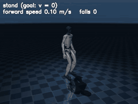

# Stage 2: a humanoid that learns to stand, walk, turn and run

The Unitree G1 humanoid (MuJoCo Menagerie, `scene_mjx.xml`) learns locomotion from its own
exploration and practice, on this laptop (one RTX 5060, CPU simulation of 2048 bodies at once).
Goals are velocity and heading commands, so the maze and the bike stages can reuse the controller
through `pai/locomotion/skill.py` (`move(velocity, heading)`, `turn`, `stop`).


*Released controller (v1) on a fresh body (seed 50100): stand, walk 0.8 m/s, turn to +90°, run
2.0 m/s, slow down, take a push; 0 falls ([MP4](media/locomotion/g1_locomotion.mp4)).*

## What is learned and what is given

| Part | Learned or given | Where |
|---|---|---|
| Body model (predicts the next proprioceptive state from the motor command; 5-member ensemble) | **learned** from motor babbling, then from all practice | `world_model.py`, `babble.py` |
| Leg controller (12 servo targets every 20 ms) | **learned** by PPO practice | `ppo.py`, `policy.py` |
| Curiosity: ensemble disagreement as an exploration bonus, annealed to zero | **learned** model, given weight | `ppo.py` |
| Curriculum stand → balance (pushes) → walk → turn → run | given order, **automatic** advancement on practice performance | `ppo.py:ready_to_advance` |
| Preferences (the goal): command tracking, upright, smooth, a foot-height rhythm from a clock whose frequency and duty factor scale with the commanded speed | **given** (authored preference terms) | `env.py:_reward` |
| Waist and arms | **given**: held at the default posture | `body.py` |
| Randomised dynamics (friction, masses, payload, servo strength) | given ranges, sampled per body | `env.py` |
| Fall-cause inference (push / slip / own gait error) from unexplained body-model surprise | **learned** body model, given hypotheses | `falls.py` |

The rhythm preference is a stated simplification: it tells the body *that* feet should alternate
at a speed-dependent tempo, not which joint angles to use. Removing it is open work.

## Motor babbling: curiosity explores better

Two explorers with the same budget (307,200 transitions each, `results/locomotion/babble.json`):

| Explorer | State spread | Model error on random data | Model error on curious data |
|---|---|---|---|
| random (smooth noise) | 0.86 | 0.200 | 0.324 |
| **curious** (picks the action the ensemble disagrees about most) | **1.10** | **0.139** | 0.183 |

The curious explorer covers more of the body's states, and the model it learns predicts the random
explorer's data better than the random explorer's own model does.

## Results on fresh seeds

Training: seed 0. Development checks: seeds 777, 51000+, 52000+. **Final gates: v1 and v2 seeds
50000–50006, v3 seeds 54000–54006, each never used before**; videos 50100 (v1) and 54100 (v3). Each
test uses 20 bodies with randomised dynamics.

| Test | Gate | v1 | v2 (push-trained) | **v3** (released, 2026-10-28) |
|---|---|---|---|---|
| Stand 30 s | stands | ✅ 20/20, drift 0.11 m | ✅ 20/20, drift 0.76 m | ✅ 20/20, drift 0.57 m |
| Walk 10 m at 0.8 m/s | ≥ 90% at ≥ 0.5 m/s | ✅ 20/20, 0.77 m/s | ✅ 20/20, 0.71 m/s | ✅ 20/20, 0.74 m/s |
| Turn to a commanded heading | within 15° | ✅ 20/20, median 2.5° | ❌ 10/20, median 15.8° | ✅ 20/20, median 1.6° |
| Run at 2.0 m/s | ≥ 1.5 m/s | ✅ 20/20, 1.99 m/s | ❌ 3/20, 1.29 m/s | ✅ 20/20, 1.95 m/s |
| Push recovery, 0.5 m/s (83 N) | — | 93% | 100% | 100% |
| Push recovery, 1.0 m/s (167 N) | — | 53% | **100%** | **100%** |
| Push recovery, 1.25 m/s (208 N) | — | 17% | **93%** | **93%** |
| Push recovery, 1.5 m/s (250 N) | — | 0% | 60% | 33% |

Files: `results/locomotion/final_v1.json`, `final_v2.json`, `final_v3.json` (30 pushed bodies per row).

 v3 on a fresh body (seed 54100):
stand, walk, turn to +90°, run, and a 1.25 m/s side push, no fall
(`media/locomotion/g1_locomotion_v3.mp4`).

**v1** trained 92 minutes (125 M steps) through the whole curriculum. It passes every gate.
**v2** continued v1 for 57 minutes with pushes up to 1.25 m/s (v1 had practised up to 0.6 m/s).
It became far more robust to pushes but **forgot part of its heading and speed control**
(catastrophic forgetting): practice dominated by large pushes crowded out precise tracking. v1 is
the released controller; v2 is kept as the push-robust variant.

**v3 keeps both.** It continued v1 in three phases (`configs/locomotion_v3a/b/c.yaml`, 297 M steps,
3.5 h in total): A with pushes up to 0.9 m/s, B up to 1.25 m/s, both with the speed and heading
preferences weighted higher (lin 2.5, yaw 1.6, defaults 2.0 and 0.8); after B the development check
(seeds 52000+) kept every gate except headings (14/20), so C practised heading commands 60% of the
time (was 30%) with yaw weight 2.2 and half the learning rate. The development check after C passed
everything (`results/locomotion/dev_v3.json`, `dev_v3c.json`), and the final gates were then run once
on new seeds 54000+: every gate passes, and push recovery at 1.0 m/s rises from 53% (v1) to 100%,
at 1.25 m/s from 17% to 93%. It is weaker than v2 at 1.5 m/s (33% vs 60%). v3 is the released
controller.

## Fall causes

**Fresh gate (v3, seed 54006, calibration seed 64000): 40% accuracy** (balanced 43%) on 153 scored
falls. Own gait error is recognised 96%, push 19%, slip 13%: the cause model still attributes most
pushed and slipped falls to the body's own error. It needs better evidence (e.g. sole forces).

Development check (v1):

On 180 injected falls (60 each, seed 51006, calibration on 90 undisturbed falls, seed 61000):
accuracy **59%**. Own gait error is recognised 97%, push 42%, slip 38%. Pushes and slips are often
taken for the body's own error, so the cause model needs better evidence (e.g. sole forces). This
has not been run on fresh seeds.

## Reproduce (laptop GPU)

```powershell
.venv\Scripts\python.exe scripts/locomotion_babble.py --config configs/locomotion.yaml
.venv\Scripts\python.exe scripts/locomotion_train.py --config configs/locomotion.yaml
.venv\Scripts\python.exe scripts/locomotion_eval.py --config configs/locomotion.yaml --policy runs/locomotion/policy_v1/policy.pt --ckpt runs/locomotion/policy_v1/ckpt_last.pt --name final_v1
.venv\Scripts\python.exe scripts/locomotion_video.py --policy runs/locomotion/policy_v1/policy.pt --seed 50100
.venv\Scripts\python.exe -m pytest -q tests/test_locomotion.py
```

v1 was trained with the curriculum's default pushes (`run` stage `push_dv` 0.6); v2 with the
`stages` block in `configs/locomotion.yaml` (`run` stage `push_dv` 1.25). Checkpoints are in
`runs/` (not in git).
