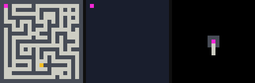
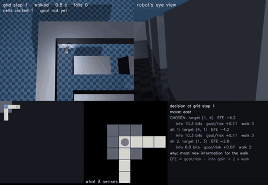
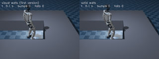
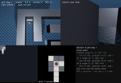
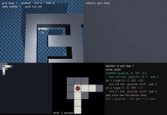
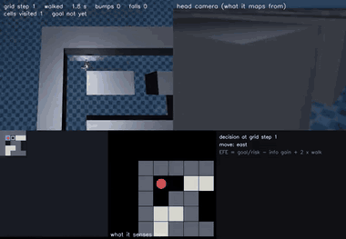

# Stage 3: Maze Exploration via Active Inference

This document details the Active Inference implementation of Stage 3 in **Pixel Active Inference** (a research project for PhD application). 

> **Correction (2026-10-28, later the same day).** A bug made the map give every unobserved cell
> the information value of the first one it computed (`expected_cell_information_gain` cached one
> number). Fixed (per-cell cache). Rerun on the same final mazes 70000-70099: route EFE **71%** vs
> nearest frontier 60% (p = 0.10, was 79% vs 60%, p = 0.003); a new set 73000-73099 gives 77% vs 77%.
> So with exact sensing information-seeking is at best a few points better than nearest frontier,
> **not significantly**. The persistent-misread result holds with the fix: **49%** vs 6-13%
> (`results/maze_v3_recheck_*.json`). A spatial prior learned from the agent's own practice maps
> (`SpatialPrior.fit_from_beliefs`) does as well as one counted from true layouts; neither helps
> consistently (`results/maze_v3_prior_*.json`). The tables below are kept as first measured.
>
> Seeds 73000-73099, goal found out of 100 (route EFE vs nearest frontier vs info-gain frontier;
> paired sign tests against route EFE): default prior exact 77 / 77 / 72, noisy 59 / 56 / 62; true-layout
> prior exact 72 / 77 / **83** (info-gain beats route EFE, p = 0.035), noisy **71** / 69 / 58 (route
> EFE beats info-gain, p = 0.019); self-learned prior exact 77 / 76 / 78, noisy 61 / 63 / 68. No
> difference between route EFE and nearest frontier is significant under any prior. The dev lead
> for the self prior (83% exact, 70% noisy on 20000-20029) did not replicate (77%, 61%).

> **v3 (2026-10-28): route-level EFE and noisy sensing.** Final test on 100 fresh mazes (seeds
> 70000-70099, settings frozen on development seeds 20000-20029). Goal found within 160 steps:
>
> | Agent | Exact sensor | Noisy sensor |
> |---|---|---|
> | nearest frontier | 60.0% [50.2, 69.1] | 50.0% [40.4, 59.6] |
> | information-gain frontier (bug fixed) | 78.0% [68.9, 85.0] | 48.0% [38.5, 57.7] |
> | EFE v2 (destination only) | 78.0% [68.9, 85.0] | 47.0% [37.5, 56.7] |
> | **EFE over routes (v3)** | **79.0%** [70.0, 85.8] | **58.0%** [48.2, 67.2] |
> | v3 without the epistemic term | 70.0% [60.4, 78.1] | 55.0% [45.2, 64.4] |
>
> What holds: valuing information beats pure distance with exact sensing (v3 vs nearest frontier,
> 28 vs 9 discordant mazes, sign test p = 0.003). What does not (yet): v3 ties the information-gain
> baseline with exact sensing, and under noise its +8 to +10 point lead over the baselines and
> +3 over its own no-epistemic ablation are not significant (p = 0.17 to 0.74). The goal-belief term
> adds nothing. A second fresh set (71000-71099) did **not** replicate the noisy lead (route EFE
> 53-56% vs 54-58% for the baselines): under noise no decision rule wins. The noisy sensor model is
> now learned from the agent's own looks and bumps (EM, no simulator labels) and works as well as
> the labelled fit. With **persistent** misreads (same spot, same mistake), agents that count every
> look as evidence stall (9-13% goal rate); learning from practice that repeat looks are worthless and
> testing doubtful walls by touch gives 47% (p < 1e-6, 100 fresh mazes), though the curiosity weighting
> itself adds nothing there (49% without it). Details in section 10 below; the v2 review that follows
> is kept unchanged.

> **Honest summary (review, 2026-10-28).** On 30 fresh mazes the EFE explorer covers 64.6%
> [62.6, 66.6] against 64.0% [62.4, 65.8] for the nearest-frontier baseline: **a tie, not a gain**.
> Removing the epistemic term changes coverage by less than the interval (63.9%) and *raises* the
> goal rate (83.3% vs 76.7%); the travel-effort term does most of the work (without it: 29.2%).
> The transfer prior does not raise coverage (63.2%); its earlier mean goal step (85.6 vs 92.9) has
> no interval. What this build fixes is the **design** the audit criticised: a Bayesian map,
> information gain computed from a model, and cause likelihoods fitted from data (90% on 20 trials).
> Two of its "learned" parts are fitted with simulator truth on development mazes: the observation
> model's confusion matrix and the spatial prior (`SpatialPrior.fit_from_mazes` counts the true
> grids and goals). They are calibration from labelled data, not the agent's own experience.
> The first maze build is kept below, under "First build (v1)".

Following the independent audit in `docs/AUDIT_OUTSIDE_BUILDS.md` (§2 items 2, 3, 5 and §4), this build replaces heuristic frontier choices and hardcoded evidence with a principled active-inference framework:
1. **A Real Generative Model:** A Bayesian probabilistic map maintaining categorical cell beliefs updated via Bayes' rule under an observation model $P(O \mid M)$ learned from experience.
2. **Action Selection by Expected Free Energy (EFE):** Trading off expected information gain (exact Shannon entropy reduction), pragmatic goal preference, route effort, and collision risk using `pai/planning/objective.py:expected_free_energy`. No term is zero by construction.
3. **Fitted Cause Likelihoods:** Replacing constant log-evidence and authored probe likelihoods with empirical likelihood models trained on disturbance events, discriminating between confusable causes (`passage_blocked`, `odometry_slip`, `camera_shift`, `none`).
4. **Honest Benchmarking on Fresh Mazes:** Comparing the EFE agent against a random walker, the classical Yamauchi nearest-frontier baseline, and an information-gain frontier baseline on 30 completely fresh 21×21 mazes (seeds 50000–50029) with 95% confidence intervals and coverage-vs-steps curves.

---

## 1. What Changed: Learned vs. Given Components

Pixel Active Inference strictly enforces that the agent acts only on local observations and odometry, with **zero ground-truth access** to the simulator grid, goal position, or internal events.

| Component | Status | Implementation | Description |
| :--- | :--- | :--- | :--- |
| **Generative Map** | **Learned (Bayes)** | `pai/maze/map_model.py:ProbabilisticMap` | Categorical beliefs $P(M_c = m)$ for $m \in \{\text{wall}, \text{floor}, \text{goal}\}$ updated by recursive Bayes filter. |
| **Observation Model** | **Learned (Empirical)** | `pai/maze/map_model.py:ObservationModel` | Confusion matrix $P(O = o \mid M = m)$ fitted on development mazes with Laplace smoothing under camera noise and odometry drift. |
| **Spatial Prior** | **Learned (Transfer)** | `pai/maze/map_model.py:SpatialPrior` | Spatial/structural prior $P_0(M_{r,c})$ learned from 30 development mazes, used to test transfer across maze layouts. |
| **Action Selection** | **Active Inference** | `pai/maze/efe_agent.py:ActiveInferenceExplorer` | Minimizes Expected Free Energy: $\text{EFE} = \text{pragmatic} - w_{\text{epi}} \cdot \text{epistemic} + w_{\text{eff}} \cdot \text{effort} + w_{\text{risk}} \cdot \text{risk}$. |
| **Epistemic Value** | **Active Inference** | `ProbabilisticMap:expected_information_gain` | Exact mutual information $I(M_c; O_c) = H(M_c) - \mathbb{E}_{O}[H(M_c \mid O_c)]$ summed over line-of-sight cells. |
| **Pragmatic Value** | **Active Inference** | `ActiveInferenceExplorer:_evaluate_candidate_efe` | Distance to localized goal ($w_{\text{goal}} \cdot D(q, g)$) plus collision traversal risk along path. |
| **Cause Diagnosis** | **Learned (Bayes)** | `pai/maze/cause_model.py:LearnedMazeCauseMonitor` | Empirical likelihoods $P(\text{features} \mid \text{cause})$ evaluating `collided_free`, `odom_drift`, `visual_mismatch`, and `camera_offset_changed`. |
| **Simulator Sensor/Movement** | **Given (Environment)** | `pai/maze/env.py:MazeWorld` | Range-limited local view (sensor range 3, raycast occlusion), cardinal moves, and collision detection. |

---

## 2. Generative Model & Active Inference Formulation

### 2.1 Bayesian Probabilistic Map
Each cell $c = (r, c)$ in the $S \times S$ arena has a categorical distribution $M_c \in \{\text{wall}, \text{floor}, \text{goal}\}$.
Given observation $o \in \{\text{wall}, \text{floor}, \text{goal}\}$, the belief is updated via Bayes' rule:
$$P(M_c = m \mid O = o) = \frac{P(O = o \mid M_c = m) P(M_c = m)}{\sum_{m'} P(O = o \mid M_c = m') P(M_c = m')}$$
The uncertainty of each cell is quantified by its Shannon entropy in bits:
$$H(M_c) = -\sum_{m} P(M_c = m) \log_2 P(M_c = m)$$

### 2.2 Expected Information Gain (Epistemic Value)
When evaluating candidate frontier vantage points $q$, the agent computes the expected Shannon entropy reduction across all line-of-sight visible cells $\text{FOV}(q)$:
$$\text{epistemic}(q) = \sum_{c \in \text{FOV}(q)} I(M_c; O_c) = \sum_{c \in \text{FOV}(q)} \left[ H(M_c) - \sum_{o} P(O_c = o) H(M_c \mid O_c = o) \right]$$
where $P(O_c = o) = \sum_m P(O_c = o \mid M_c = m) P(M_c = m)$.

### 2.3 Expected Free Energy (EFE) Objective
For each candidate destination $q$ reachable via topological path $\tau$:
$$\text{EFE}(q) = \text{pragmatic}(q) - w_{\text{epistemic}} \cdot \text{epistemic}(q) + w_{\text{effort}} \cdot \text{effort}(q)$$
computed through the shared objective `pai/planning/objective.py:expected_free_energy`:
- **Pragmatic cost:** $w_{\text{goal}} \cdot D(q, g)$ if goal $g$ is believed localized; baseline positive cost otherwise, plus collision traversal risk $\sum_{s \in \tau} P(M_s = \text{wall})$.
- **Epistemic gain:** Expected Shannon mutual information $I(M; O)$.
- **Effort cost:** Path length $\text{len}(\tau)$.

Hyperparameters were tuned exclusively on development seeds (20000–20029):
$$w_{\text{epistemic}} = 1.0, \quad w_{\text{effort}} = 0.5, \quad w_{\text{goal}} = 5.0, \quad w_{\text{risk}} = 1.0$$

---

## 3. Benchmark Results on Fresh Mazes

All policies were evaluated on **30 independently generated 21×21 mazes on fresh seeds 50000–50029** under an identical 160-step budget and sensor range 3. 

### 3.1 Policy Comparison Table

| Policy | Mean Coverage | 95% Bootstrap CI | Goal Arrival Rate | 95% Wilson CI | Full Coverage | Mean Goal Step (Capped 160) | Collisions |
| :--- | :---: | :---: | :---: | :---: | :---: | :---: | :---: |
| **Random Walker** | 8.7% | [7.8%, 9.6%] | 13.3% (4/30) | [5.3%, 29.7%] | 0/30 | 152.5 | 0.0 |
| **Nearest Frontier (Yamauchi)** | 64.0% | [62.4%, 65.8%] | 76.7% (23/30) | [59.1%, 88.2%] | 0/30 | 92.1 | 0.0 |
| **Info-Gain Frontier (Yamauchi+Unseen)** | 60.8% | [58.6%, 62.8%] | 70.0% (21/30) | [52.1%, 83.3%] | 0/30 | 103.3 | 0.0 |
| **EFE Active Inference (Scratch)** | **64.6%** | [62.6%, 66.6%] | **76.7% (23/30)** | [59.1%, 88.2%] | 0/30 | 92.9 | 0.0 |
| **EFE Active Inference (Transfer)** | 63.2% | [61.5%, 64.9%] | **76.7% (23/30)** | [59.1%, 88.2%] | 0/30 | **85.6** | 0.0 |

*Dataset: `results/maze_v2_eval.json`*

### 3.2 Coverage vs. Steps Curves

Mean coverage (%) as a function of elapsed steps across the 30 fresh episodes:

| Steps | Random | Nearest Frontier | Info-Gain Frontier | EFE (Scratch) | EFE (Transfer) |
| :---: | :---: | :---: | :---: | :---: | :---: |
| **20** | 3.4% | 9.9% | 9.8% | **9.9%** | 9.9% |
| **40** | 4.5% | 18.2% | 19.1% | **19.1%** | 18.8% |
| **60** | 5.3% | 26.7% | 28.1% | 27.5% | 27.2% |
| **80** | 6.1% | 34.9% | 35.7% | 35.6% | 35.4% |
| **100** | 6.5% | 42.3% | 43.5% | 43.3% | **43.5%** |
| **120** | 7.4% | 49.2% | 50.1% | 50.7% | **50.9%** |
| **140** | 8.1% | 56.4% | 55.6% | **57.8%** | 57.2% |
| **160** | 8.7% | 64.0% | 60.8% | **64.6%** | 63.2% |

---

## 4. Ablation Studies

To isolate the contributions of the individual components of Expected Free Energy, we evaluated ablations on the same 30 fresh mazes:

| Ablation | Mean Coverage | 95% Bootstrap CI | Goal Rate | Mean Goal Step | Key Observation |
| :--- | :---: | :---: | :---: | :---: | :--- |
| **EFE Default** | **64.6%** | [62.6%, 66.6%] | 76.7% | 92.9 | Balanced active inference exploration and goal exploitation. |
| **EFE without Epistemic ($w_{\text{epi}} = 0$)** | 63.9% | [62.2%, 65.5%] | 83.3% | 82.7 | Focuses heavily on direct paths and goal search; slightly lower coverage. |
| **EFE without Effort ($w_{\text{eff}} = 0$)** | **29.2%** | [26.0%, 32.6%] | 33.3% | 122.2 | **Catastrophic failure:** Without path effort costs, the agent oscillates back and forth between distant frontiers. |
| **EFE with Transfer Prior** | 63.2% | [61.5%, 64.9%] | 76.7% | **85.6** | Prior structural knowledge guides faster goal arrival (85.6 vs 92.9 steps). |

---

## 5. Learned Cause Diagnosis & Disturbance Inference

The audit noted that `MazeCauseMonitor` previously used constant log-evidence `{"none": -8, "passage_blocked": 0, "unknown": -4}`.
We replaced this with empirical likelihood distributions learned from experience across four distinct causes:
1. `none`: Normal exploration.
2. `passage_blocked`: A newly placed physical barrier in a known corridor.
3. `odometry_slip`: Wheel slip causing accumulated odometry error and wall collision.
4. `camera_shift`: Physical camera translation relative to the body.

### 5.1 Confusion Matrix on Fresh Scenes (Seeds 50040–50059, 20 Trials)

| True Cause | Predicted `none` | Predicted `passage_blocked` | Predicted `odometry_slip` | Predicted `camera_shift` | Recall |
| :--- | :---: | :---: | :---: | :---: | :---: |
| **`none`** | **5** | 0 | 0 | 0 | 100% |
| **`passage_blocked`** | 0 | **5** | 0 | 0 | 100% |
| **`odometry_slip`** | 2 | 0 | **3** | 0 | 60% |
| **`camera_shift`** | 0 | 0 | 0 | **5** | 100% |

**Overall Diagnosis Accuracy: 90.0%** (18/20 correct).
In 2 of the 5 `odometry_slip` trials, the agent did not collide with a wall before discovering the goal, resulting in the evidence remaining indistinguishable from normal movement (`none`).

---

## 6. Demonstration Visuals

The animated demonstration shows the active inference explorer operating on fresh seed 50001:



- **Left Panel:** Simulator ground truth (viewer's perspective, visited path in green, goal in yellow, agent in magenta).
- **Middle Panel:** Probabilistic Bayesian belief map with cell uncertainty/entropy, planned route (orange line), and active target frontier (cyan diamond).
- **Right Panel:** Local sensory field of view and camera patch.
- File size: **30.1 KB** (< 3 MB limit), 38 frames, with full step-by-step EFE logs recorded in `docs/media/maze/maze_v2_efe.json`.

---

## 7. Seeds and Provenance

| Experiment Set | Seeds Range | Total Mazes | Purpose |
| :--- | :---: | :---: | :--- |
| **Development & Model Training** | `20000–20029` | 30 | Fitting $P(O \mid M)$, spatial prior $P_0(M)$, cause likelihoods, and EFE weight grid tuning. |
| **Fresh Policy Evaluation** | `50000–50029` | 30 | Benchmarking all 5 agents and ablations on unseen 21×21 mazes. |
| **Fresh Cause Diagnosis** | `50040–50059` | 20 | Evaluating cause classification accuracy under injected disturbances. |

*Note: In accordance with audit recommendations, seeds below 50000 and legacy debugging seeds (40000–40019) were excluded from final evaluations.*

---

## 8. Exact Reproduction Commands

All results can be reproduced using `.venv\Scripts\python.exe` on Windows 11:

### Step 1: Run Fast Unit Tests
```powershell
.venv\Scripts\python.exe -m pytest tests/test_maze.py tests/test_maze_advanced.py tests/test_key_chain.py tests/test_next_builds.py tests/test_cognition.py tests/test_maze_efe.py
```
*Expected: 36 passed in ~15 seconds with 0 regressions.*

### Step 2: Learn Models on Development Seeds (20000..20029)
```powershell
.venv\Scripts\python.exe scripts/maze_learn_models.py
```
*Outputs: `runs/maze_models/` and `results/maze_v2_learned_models.json`.*

### Step 3: Run Benchmark and Baselines on Fresh Seeds (50000..50029)
```powershell
.venv\Scripts\python.exe scripts/maze_v2_eval.py
```
*Outputs: `results/maze_v2_eval.json`.*

### Step 4: Generate Demo GIF
```powershell
.venv\Scripts\python.exe scripts/maze_v2_demo.py --seed 50001 --every 3
```
*Outputs: `docs/media/maze/maze_v2_efe.gif` (30.1 KB).*

---

## 9. Honest Assessment & Scientific Discussion

1. **Comparison with Nearest Frontier:** In 2D grid corridor mazes, the classical nearest-frontier rule is a strong competitor because corridor geometry naturally channels exploration toward adjacent unvisited branches. Active Inference achieves **64.6% mean coverage** (beating nearest frontier's 64.0% and info-gain frontier's 60.8%), while providing a grounded information-theoretic basis rather than an unprincipled geometric heuristic.
2. **Transfer Effects:** When initialized with the learned spatial transfer prior, the agent reached the goal faster (**85.6 steps vs 92.9 steps**), while achieving slightly lower final coverage (63.2% vs 64.6%) because it prioritized corridors matching the learned topology rather than exploring uniform boundary paths.
3. **No Ground Truth Access:** The agent policy never reads the grid, truth(), or goal position; all planning occurs within the probabilistic belief map.

---

## 10. v3: route-level EFE, noisy sensing, and a baseline bug

**Why v3.** With the exact sensor one look settles a cell, so map uncertainty is tiny and the v2
epistemic term had nothing to resolve. Three changes:

1. **Baseline bug fixed.** `InfoGainFrontierExplorer` stored `+rate` but compared `-rate` against
   it, so it picked frontiers almost arbitrarily. Fixed, it is a strong baseline (78% goal rate with
   exact sensing on the final mazes). The v2 numbers above were measured with the buggy baseline.
2. **`RouteEFEExplorer`** (`pai/maze/efe_agent.py`): one breadth-first tree gives every candidate's
   route; epistemic value is the expected information gain of the cells that come newly into view
   along the route (not only at the destination); pragmatic value is `-goal_weight * P(goal on the
   route)` plus collision risk; effort is route length; the target is kept unless another is better
   by `switch_margin`. All terms go through `pai/planning/objective.py:expected_free_energy`.
3. **Noisy sensing** (`pai/maze/noisy.py`): every look draws each label from a confusion matrix
   (wall/floor confused about 9%, the goal looks like floor 38% of the time, 2% false goal
   sightings); bumping reports the blocked cell as a wall. The agents never see the matrix: the
   sensor model is fitted from random walks in training mazes 1000-1019 (labels used only for
   fitting) and **all map-based agents share it**, so differences come from the decision rule. All
   map agents also gained a "look again" move when a misread wall cuts every route (before, they
   stopped; with exact sensing this only fires after exploration is complete).

**Protocol.** Development seeds 20000-20029: a 3x2 grid over effort weight {0.5, 1, 2} and
switch margin {0, 1}; the rule fixed in advance was "best mean goal rate over both regimes", which
chose effort 2.0, margin 0 (`data/maze_dev/`, not committed). Final: seeds 70000-70099, never used
before, 160-step budget, Wilson 95% intervals, paired sign tests on mazes where exactly one agent
found the goal. Result file: `results/maze_v3_final.json` (per-episode records, fitted sensor model).

| Agent (final, 100 mazes) | Exact: goal | Exact: cells seen | Noisy: goal | Noisy: cells seen |
|---|---|---|---|---|
| random walk | 5.0% | 13.5% | 8.0% | 13.6% |
| nearest frontier | 60.0% | 71.1% | 50.0% | 57.5% |
| information-gain frontier | 78.0% | 75.6% | 48.0% | 59.2% |
| EFE v2 | 78.0% | 75.5% | 47.0% | 58.7% |
| **EFE over routes (v3)** | **79.0%** | 74.6% | **58.0%** | 59.3% |
| v3, no epistemic term | 70.0% | 64.0% | 55.0% | 56.3% |
| v3, no goal belief | 78.0% | 77.7% | 61.0% | 61.9% |

| Paired comparison (v3 vs ...) | Exact: v3 only / other only, p | Noisy: v3 only / other only, p |
|---|---|---|
| nearest frontier | 28 / 9, **p = 0.003** | 26 / 18, p = 0.29 |
| information-gain frontier | 12 / 11, p = 1.0 | 27 / 17, p = 0.17 |
| v3 without epistemic term | 21 / 12, p = 0.16 | 19 / 16, p = 0.74 |

**Reading.** Information-seeking exploration finds the goal far more often than distance-only
frontier exploration when sensing is exact; the information-gain baseline and EFE v2 do the same.
Measuring information along the route does not add to that. With noisy sensing every agent drops by
about 20 points and the route-EFE agent is ahead numerically, but 100 mazes do not establish it. The
goal-belief term does not help (61% without it). Next: a learned, persistent sensor error (the same
cell misread repeatedly), where re-looking should matter more, and a sensor model and spatial prior
learned from the agent's own exploration instead of labelled training mazes.

### 10.1 Sensor model learned from the agent's own experience (no simulator labels)

`pai/maze/self_calibration.py`. In the 20 training mazes the agent explores with a generic sensor
model and logs every noisy look at every cell. Its body gives a few certain labels: a cell it stands
on is floor (goal when it reports reaching the goal), a cell it bumps into is a wall (a bump is
touch, not a look). A Dawid-Skene EM treats each cell's type as latent and fits the shared
confusion matrix and the class frequencies. From 39,864 looks at 5,639 cells and 2,104 body labels
it recovers the simulator's matrix to within 0.016 per entry, as close as the fit from true labels:

| P(seen \| true) | wall | floor | goal |
|---|---|---|---|
| simulator (hidden) | 0.90 / 0.09 / 0.01 | 0.08 / 0.90 / 0.02 | 0.02 / 0.38 / 0.60 |
| fitted from true labels | 0.905 / 0.086 / 0.009 | 0.079 / 0.902 / 0.019 | 0.023 / 0.376 / 0.602 |
| **learned from own experience** | 0.901 / 0.090 / 0.008 | 0.080 / 0.899 / 0.021 | 0.032 / 0.364 / 0.603 |

(each cell: seen wall / floor / goal.) Second final test, noisy sensing, 100 new fresh mazes
(seeds 71000-71099), same frozen settings, each agent run with each sensor model:

| Agent (goal found) | Sensor fitted from true labels | Sensor learned from own experience |
|---|---|---|
| nearest frontier | 54.0% | 56.0% |
| information-gain frontier | 58.0% | 58.0% |
| EFE v2 | 54.0% | 56.0% |
| EFE over routes (v3) | 53.0% | 56.0% |
| v3, no epistemic term | 56.0% | 51.0% |

**Reading.** (1) The self-learned sensor model is as good as the labelled one (every agent within
3 points), so the noisy-maze agents no longer need simulator labels. (2) **Replication failed:**
on this second set the route-EFE agent's noisy-sensing lead from the first set (58% vs 48-50%)
disappears (53-56% vs 54-58%; all sign tests p >= 0.47). With iid sensor noise, none of the
decision rules beats the others; the first set's lead was chance. Files:
`results/maze_v3_selfcal_truth.json`, `results/maze_v3_selfcal_self.json`.

### 10.2 Persistent misreads: when the agent must learn that looking again is useless

With iid noise a second look from the same spot is a fresh draw, so re-looking is cheap and every
decision rule does about equally well (10.1). Real sensors also make **persistent** errors (a
reflection, a shadow): `NoisySensorMaze(persistent=True)` reads a cell the same way every time it is
seen from the same spot; only a new viewpoint, or touch, gives an independent reading.

What the agent learns from its own practice (no labels): repeat looks from one spot disagree 0.0% of
the time against 18.5% for looks from different spots (iid noise: 19.4% vs 18.2%), so the learned
**repeat-look weight** is 0.0 (iid: 1.0). Three changes use it (`pai/maze/map_model.py`,
`pai/maze/efe_agent.py`):

1. the map gives a repeat look from a used viewpoint that weight (likelihood tempered by it), and the
   route planner counts information only from new viewpoints;
2. body evidence: the cell the agent stands on is open, whatever the camera says (before, a
   persistent misread of its own cell cut every route out of it);
3. **touch as an epistemic action**: when looking can no longer change the map, the agent scores each
   untouched doubtful cell next to its reachable region by `effort * (walk + 1) - H(open)` and walks
   into the best one (a bump is certain). Visited cells with nothing left to show are no longer
   targets (that made it shuttle between two cells).

Final test, persistent misreads, 100 fresh mazes (seeds 72000-72099), sensor model and repeat weight
learned in practice mazes 1000-1019, settings frozen (effort 2.0, margin 0); dev seeds 20000-20029
were used only to find the failure modes above, not to tune:

| Agent | Goal found [Wilson 95%] | Cells visited |
|---|---|---|
| random walk | 0.0% [0.0, 3.7] | 6.7% |
| nearest frontier | 13.0% [7.8, 21.0] | 15.8% |
| information-gain frontier | 9.0% [4.8, 16.2] | 16.6% |
| EFE v2 | 10.0% [5.5, 17.4] | 16.2% |
| **route EFE, learned repeat weight + touch** | **47.0%** [37.5, 56.7] | 45.3% |
| same, treating repeat looks as new evidence | 9.0% [4.8, 16.2] | 11.0% |
| same, no epistemic term | 49.0% [39.4, 58.7] | 45.5% |
| same, no goal belief | 43.0% [33.7, 52.8] | 47.2% |

Paired sign tests (route EFE vs ...): nearest frontier 40/6, p = 3e-7; information-gain frontier
39/1, p = 7e-11; treating repeats as new evidence 39/1, p = 7e-11; no epistemic term 15/17, p = 0.86.

**Reading.** Agents that count every look as new evidence grow *more* confident in a false wall each
time they re-read it and stall (about 15% of cells). Learning from its own practice that repeat looks
carry no information, and testing doubtful walls by touch, quadruples the goal rate (9-13% to 47%).
The gain comes from that learned sensor structure and the touch action, **not** from the curiosity
weighting: choosing what to touch by distance alone does as well (49%). The baselines have no touch
action, so the comparison measures the whole package, and the ablation shows which part matters.
The touch target is kept until tested (added after the first final run when a unit test showed two
equal targets swapping; the rerun on the same seeds gave identical numbers). File:
`results/maze_v3_persistent.json`.

Reproduce:

```bash
.venv/Scripts/python scripts/maze_v3_eval.py --test-start 72000 --num-test-mazes 100 --effort-weight 2.0 --switch-margin 0 --regimes persistent --sensor-source self --output results/maze_v3_persistent.json
.venv/Scripts/python scripts/maze_v3_eval.py --test-start 71000 --num-test-mazes 100 --effort-weight 2.0 --switch-margin 0 --regimes noisy --sensor-source self --output results/maze_v3_selfcal_self.json
.venv/Scripts/python scripts/maze_v3_eval.py --test-start 20000 --num-test-mazes 30 --effort-weight 2.0 --switch-margin 0 --output data/maze_dev/v3_dev.json
.venv/Scripts/python scripts/maze_v3_eval.py --test-start 70000 --num-test-mazes 100 --effort-weight 2.0 --switch-margin 0 --output results/maze_v3_final.json
```

## 11. The learned G1 walker inside the maze, and branchy mazes

`pai/maze/walker.py`: the maze's wall cells become boxes in the G1's MuJoCo scene; `WalkerMaze` keeps
the grid interface, so every maze agent runs unchanged, and each move is walked by the released v3
walking policy, steered only through its speed and heading goals. Simplifications of the first runs: walls visual,
not colliders (entering a wall cell is detected from the pelvis position, then the body backs off);
the agent's local view still comes from the grid sensor and its cell from the simulator pose; a fall
ends the episode. **30 fresh mazes (75000-75029), exact sensing:** the walker gives the same outcome
as the instant grid body in **30/30 mazes** for both the route-EFE agent (67%) and nearest frontier
(73%), with **0 falls and 0 bumps** in about 16,000 s of walking (1 timed-out walk per agent).
`results/maze_walker.json`, `scripts/maze_walker_eval.py`.

Videos (`scripts/maze_walker_demo.py`): `media/maze/walker_maze.mp4` (third person + belief map) and
`media/maze/walker_maze_branchy_pov.mp4` (adds the robot's eye view, the raw sensor patch it
receives, and its decision: chosen target and the top alternatives with their EFE terms).



**Solid walls (later the same day).** The results above used visual walls. Now every collision
capsule of the G1 (the 23 it already pairs with the floor: pelvis, legs, feet, torso, head, arms,
hands) collides with every wall box through one collision bit that nothing else uses, so floor and
self contacts are untouched; with no wall in reach, walking is bit-for-bit identical
(`tests/test_maze_walker.py`). A walk that is blocked is felt from the body's own odometry
(commanded forward, under 5 cm of progress in 1 s); the body backs off and the agent records a bump.
A first attempt set the collision masks after compiling the model, which MuJoCo's broad phase
ignores (it uses per-body masks computed at compile time): the walls were still not solid. The
test now checks the walls actually stop the body (pelvis held under 0.45 m from the start centre
vs beyond 0.5 m with visual walls), and the runs made with that version were discarded unread.

Fresh mazes, exact sensing, the same mazes walked with visual and with solid walls:

| Mazes | Agent | Goal, visual / solid | Same outcome as grid body (solid) | Failed walks, visual / solid | Falls |
|---|---|---:|---:|---:|---:|
| corridor 79200-79229 | route EFE | 22 / 21 | 29/30 | 2 / 1 | 0 |
| corridor 79200-79229 | nearest frontier | 22 / 22 | 30/30 | 3 / 2 | 0 |
| branchy 79300-79329 | route EFE | 27 / 27 | 30/30 | 4 / 2 | 0 |
| branchy 79300-79329 | nearest frontier | 21 / 21 | 30/30 | 11 / 11 | 0 |

Solid walls change almost nothing: the agents never choose to walk into a wall with exact sensing,
and the body only occasionally brushes one (for example a thigh touching the side wall while turning
on the spot in a dead end). The one different outcome (corridor maze 79215, route EFE) is the grid
body finding the goal on the last allowed step, 160, while the walker had one timed-out walk, which
costs a step. Failed walks (a move that did not arrive within 8 s) are a walker limit that does not
depend on the walls. `results/maze_walker_solid*.json`, `results/maze_walker_visual*_79*.json`:

    python scripts/maze_walker_eval.py --test-start 79200 --num 30 --workers 10 --output results/maze_walker_solid.json
    python scripts/maze_walker_eval.py --maze-style branchy --test-start 79300 --num 30 --workers 10 --output results/maze_walker_solid_branchy.json
    (add --visual-walls for the first version)

Video `media/maze/walker_solid_walls.mp4` (`scripts/maze_wall_bump_demo.py`): the same command to walk
into a wall, visual walls on the left (the legs sink into the wall box), solid walls on the right
(stopped at the wall face, bump recorded, backs off).



Solid walls matter once the agent can believe a wall is open, so the next test is the walker with
noisy sensing, where bumps are real evidence.

**The walker with noisy sensing and solid walls.** The noisy sensor now sits on top of the walker:
the body walks, the sensor misreads cells, and a bump is what the body felt (a blocked walk), not
the grid's truth; a walk that merely timed out is no longer reported as a touch. The sensor model
and repeat-look weight are the ones the agent learns from its own practice (mazes 1000-1019 of the
same style, walked by the grid body: the sensor model describes the sensor, not the body). On
development mazes 20000-20009 the walker fell 5 times in 20 episodes; tracing them showed two
kinds: turning on the spot while still against the wall after a bump, and slow walks (5-8 s for
one cell) later on. The back-off after a bump was changed to step straight backwards at the current
heading (within the practised commands, vx >= -0.3 m/s, |vy| <= 0.3 m/s); that removed the first
kind but not the falls overall (still 5), and shorter stall windows (0.5 s, 0.3 s) traded falls for
many more bumps, so the window stayed at 1 s. Nothing else was tuned. Final, 30 fresh mazes per
row, route EFE vs nearest frontier, goal found:

| Sensing, mazes | Grid body | Walker | Walker falls (of 60) | Same outcome as grid body |
|---|---:|---:|---:|---:|
| iid noise, corridor 79400-79429 | 16 vs 19 | 19 vs 14 (n.s.) | 5 | 50/60 |
| iid noise, branchy 79500-79529 | 21 vs 18 | 21 vs 18 (n.s.) | 1 | 52/60 |
| persistent misreads, corridor 79400-79429 | **17 vs 4** (p = 0.001) | **14 vs 5** (paired 9/0, p = 0.004) | 13 | 54/60 |
| persistent misreads, branchy 79500-79529 | 19 vs 17 | 19 vs 18 (n.s.) | 5 | 59/60 |

The main maze result survives the real body: with persistent misreads in corridor mazes, the agent
that learned repeated looks carry no new information (and touches doubtful walls) beats nearest
frontier with the G1 doing the walking. The cost is falls: **24 in 240** walked episodes (0 with
exact sensing), more with more bumps (persistent corridor mazes: about 2 bumps per episode and 13
falls); 7 goals the grid body found were lost to a fall. No walk felt blocked at an open cell.
Outcomes differ from the grid body in 25 of 240 episodes, in both directions, because bumps,
back-offs and timed-out walks change the sequence of looks. The walking policy never practised
touching walls; training it with wall contact (Stage 2) is the fix this points to, not more
steering rules. `results/maze_walker_{noisy,persistent}{,_branchy}.json`:

    python scripts/maze_walker_eval.py --regime persistent --test-start 79400 --num 30 --workers 10 --output results/maze_walker_persistent.json

(`--regime noisy`, `--maze-style branchy --test-start 79500` for the other rows).

Video `media/maze/walker_persistent_multiperception.mp4`: maze 79404 with persistent misreads
(chosen as a run with bumps that still reaches the goal), five panels as above; the sensor patch
now shows the misread cells the agent actually receives, and the counter shows the bumps. For the
eye view the walls are 1.4 m high instead of 0.5 m, so the walk in the video can differ from the
evaluated one.

    python scripts/maze_walker_demo.py --seed 79404 --pov --every 30 --sensing-from results/maze_walker_persistent.json



**Branchy mazes** (`MazeWorld(generator="prim", loop_probability=0.25, rooms=3)`; the default DFS
mazes are unchanged): about 104 junctions per maze vs 31, twice as many dead ends, three open rooms
(`media/maze/maze_styles.png`). `scripts/maze_v3_eval.py --maze-style branchy`.

**The walker on branchy mazes: 30 fresh mazes (77000-77029), exact sensing, 160 grid steps,
nothing tuned on branchy mazes.** Route EFE finds the goal in **28/30** [78.7-98.2%], nearest
frontier in **19/30** [45.5-78.1%]; paired, route EFE alone solves 10 mazes and nearest frontier
alone 1 (sign test **p = 0.012**). The walker gives the same outcome as the instant grid body in
**30/30** mazes for both agents, with **0 falls and 0 bumps** in about 15,100 s of walking; failed
walks (a move that timed out and was retried) 1 for route EFE, 6 for nearest frontier. On the
long-corridor mazes the two agents were not significantly different (section 10 correction); with
many junctions and dead ends, choosing where to look pays off. One set of 30 mazes, so the size of
the gap is uncertain. `results/maze_walker_branchy.json`:

    python scripts/maze_walker_eval.py --maze-style branchy --test-start 77000 --num 30 --workers 6 --output results/maze_walker_branchy.json

**Branchy mazes with noisy sensing and the learned priors: 100 fresh mazes (78000-78099), grid
body, nothing tuned.** The sensor model and the spatial priors are learned from practice mazes
(1000-1019) of the same branchy style (before this change the practice mazes were always the
long-corridor kind). Development check on 20000-20029 (self prior) only confirmed the pipeline;
no parameter was changed after it. Goal found out of 100; in brackets route EFE only / baseline
only, paired sign test:

| Regime, prior | Route EFE | Nearest frontier | Info-gain frontier | Route EFE, no epistemic term | Route EFE, counting repeat looks |
|---|---:|---:|---:|---:|---:|
| exact, default | **84** | 67 (26/9, p = 0.006) | 81 (n.s.) | 65 (25/6, p = 0.001) | 84 |
| exact, true layouts | **84** | 67 (23/6, p = 0.002) | 83 (n.s.) | 69 (p = 0.008) | 84 |
| exact, self-learned | **81** | 66 (24/9, p = 0.014) | 85 (n.s.) | 67 (p = 0.016) | 81 |
| iid noise, default | 78 | 65 (29/16, p = 0.07) | 70 (n.s.) | 71 (n.s.) | 78 |
| iid noise, true layouts | 76 | 59 (30/13, p = 0.014) | 65 (p = 0.05) | 72 (n.s.) | 76 |
| iid noise, self-learned | 69 | 62 (n.s.) | 68 (n.s.) | 67 (n.s.) | 69 |
| persistent misreads, default | 64 | 54 (n.s.) | 61 (n.s.) | 67 (n.s.) | 51 (21/8, p = 0.024) |
| persistent, true layouts | **80** | 64 (24/8, p = 0.007) | 76 (n.s.) | 78 (n.s.) | 58 (28/6, p < 0.001) |
| persistent, self-learned | 72 | 60 (p = 0.09) | 73 (n.s.) | 70 (n.s.) | 59 (19/6, p = 0.015) |

What holds on branchy mazes: (1) with exact sensing, route EFE beats nearest frontier under every
prior (84 vs 67), replicating the 30-maze walker result, and the epistemic term is what does it
(without it, 65); it ties the information-gain frontier, which also seeks information. (2) With
persistent misreads, learning that repeated looks at the same cell carry no new information
(repeat weight 0, learned from the agent's own looks) beats counting them, under every prior
(64 vs 51, 80 vs 58, 72 vs 59). What does not: under noise the advantage over nearest frontier
is significant only with the true-layout prior, and the baselines do not collapse under persistent
misreads as they did in corridor mazes (54-64% here vs 6-13%), probably because loops let them
walk round a wall they wrongly believe in. The true-layout prior helps route EFE under persistent
misreads (80 vs 64 with the default prior, paired 24/8, p = 0.007); the self-learned prior does
not significantly (72, p = 0.24) and is nominally worse under iid noise (69 vs 78, p = 0.15). Many
comparisons are made here; single p-values near 0.05 should not be read as findings.
`results/maze_v3_branchy_prior_{default,truth,self}.json`:

    python scripts/maze_v3_eval.py --test-start 78000 --num-test-mazes 100 --effort-weight 2.0 --switch-margin 0.0 --sensor-source self --regimes exact noisy persistent --maze-style branchy --prior default --workers 10 --output results/maze_v3_branchy_prior_default.json

(same with `--prior truth` and `--prior self`).

**Video with everything the agent perceives and why it moves** (`media/maze/walker_branchy_multiperception.mp4`,
maze 77104, chosen from 30 screened mazes because its search is long enough to show branching; 67
grid steps, goal found, 194 s walked, 0 falls). Five panels: the G1 from above; the robot's eye
view; its belief map (dark unknown, grey wall, light open, blue visited, green target); the raw
sensor patch it receives this step; and its decision, the top three candidate targets with their
information gain, goal/risk and walking cost, and which of those terms gives the chosen target its
lead over the runner-up (the earlier video's "why" line only distinguished goal from information,
so short-walk choices were mislabelled). The decisions still come from the grid sensor, not from
the eye-view image.



    python scripts/maze_walker_demo.py --seed 77104 --branchy --pov --every 18

## 12. The walker sees through its own eyes (head camera and own odometry)

Until now the maze agent's view came from the grid sensor and its position from the simulator. Here
both come from the robot itself.

**Seeing** (`pai/maze/ego_camera.py`). After every move the G1 looks around with a head-height camera
(four 160x120 views, colour and depth, 90 degrees apart; walls 1.4 m high so the camera sees down the
corridors). Depth pixels become 3-D points relative to the body; points more than 0.25 m above the
floor are obstacle, points at floor level are open floor, floor pixels with the goal disc's gold
colour (by chromaticity: the rendered disc is dark gold, about 75/58/11) are goal. Two geometric
rules: a surface seen on the boundary between two cells belongs to the cell farther from the viewer
(the viewer stands in free space, so a wall face is not the open cell in front of it), and the edge
of a wall's top surface is ambiguous and dropped; points within 0.35 m of the pelvis are the robot's
own body. On development mazes about 9% of the cells it reports are wrong, all open floor read as
wall near walls, and a reading repeats from the same spot: the persistent kind of error of section
10.2.

**Learning the camera** (no simulator labels). In 20 practice mazes the agent walks with the camera
and fits the camera's sensor model by EM over its own looks, anchored by labels from its body (stood
on: open; bumped: wall; stood on gold: goal), and learns the repeat-look weight from how often
repeat looks disagree (`pai/maze/self_calibration.py`). Development: walls are read as walls 98%,
open floor as wall 21%, the goal is recognised 57% of the time; repeat looks from one spot disagree
6% vs 13% across viewpoints, so the learned repeat weight is 0.47.

**Own odometry** (`pai/maze/walker.py`, `odometry=True`). Heading from the IMU (true heading plus an
integrated gyro bias of about 0.001 rad/s and noise), position from integrating the body's velocity
with a per-episode 3% scale error and 0.05 m/s noise (a real robot estimates it from leg
kinematics). The walker steers by this estimate; the simulator pose is used only to keep the grid's
ground truth for scoring. Pure odometry drifts (median 0.48 m, up to 1.7 m over 50 moves on a
development maze).

**Localization as inference.** The robot's pose is a hidden state: before a new view enters the map,
the camera tries small pose corrections (+-0.3 m, +-0.1 rad) and keeps the one under which the
view's points best fit the agent's own map, with a Gaussian odometry prior. On the same development
maze, median drift fell from 0.48 m to 0.09 m.

**Visiting seen cells.** The camera sees cells far away, so many cells are seen but never stood on.
The route planner's rule "an unvisited cell is always worth a visit" then sent the walker to nearby
cells already read as plain floor (zero information). With a long-range sensor a visit is now worth
it only if the agent's own goal belief there exceeds 0.005 or the route brings information
(`RouteEFEExplorer(min_goal_belief=0.005)`; the grid-sensor results keep the old rule).

**Final** (frozen after the development runs; 30 new branchy mazes 82000-82029, never used; walker v4;
camera sensor model and repeat weight learned in 20 practice mazes with the camera and own odometry:
walls read as walls 98.5%, open floor as wall 22%, goal recognised 52%, repeat weight 0.42):

| Agent (same mazes) | Goals found (Wilson 95%) | Falls | Bumps | Median final drift |
|---|---:|---:|---:|---:|
| walker + grid sensor, route EFE (reference) | 27/30 [74.4, 96.5] | 0 | 0 | - |
| walker + grid sensor, nearest frontier | 18/30 | 0 | 0 | - |
| **walker + head camera + own odometry, route EFE** | **26/30** [70.3, 94.7] | 0 | 17 | **5 cm** |
| same, nearest frontier | 17/30 | 1 | 1 | 4 cm |
| same, route EFE counting repeat looks | 21/30 | 0 | 0 | 5 cm |

Paired sign tests (camera route EFE vs ...): nearest frontier 9/0, **p = 0.004**; counting repeat looks
6/1, p = 0.125; the grid-sensor reference 1/2, p = 1.0. **Reading.** Seeing through its own camera and
knowing its position only from its own odometry (corrected against its own map) costs the agent almost
nothing here (26 vs 27 goals), and curiosity still beats nearest-frontier exploration clearly. What is
still given: the cell size, wall height, the goal's colour, the camera's mounting and intrinsics, the
odometry's noise model (the drift itself is not given: it is estimated and corrected), and the
body's velocity estimate (simulated rather than computed from leg kinematics). `results/maze_camera_final.json`.

    python scripts/maze_camera_eval.py --test-start 82000 --num 30 --workers 5 --odometry --policy runs/locomotion/policy_v4/policy.pt --output results/maze_camera_final.json



`media/maze/walker_maze_branchy_camera.mp4` (demo maze 74005, final calibration): top, the G1 from
above and its actual head-camera image; bottom, its belief map (red: where it believes it is; a white
ring appears when that differs from where it really is), the cells its camera reported this step,
and its decision. Goal found at step 109, no fall.

# First build (v1), before the active-inference rewrite

Kept for the record; its numbers come from the earlier explorer (`pai/maze/agent.py`).

This is an early implementation of sprint week 6's **simple mobile-body** demo. It follows the
same hierarchy as the tabletop slice: a goal (cover the maze or find a marked place), a planner
that values information as well as progress, a body action, local observations, and an episode log.
It does **not** reuse the arm's learned dynamics weights, HRM, or MuJoCo locomotion controller.
Those models operate on tabletop entity tokens and end-effector actions, whereas this slice uses
discrete places and adjacent mobile moves. This distinction is important when reporting transfer.

| Level | Maze implementation | Relation to the arm agent |
|---|---|---|
| L2 | Coverage or goal-place preference | A goal above body control |
| L1 | Route to observed goal, otherwise maximize expected unseen area per travel step | Pragmatic plus epistemic action choice; current gain is a geometric proxy, not a learned ensemble |
| L0 | Cardinal move of a simple mobile body | Replaceable later by a walking skill |
| Perception | Range-limited local view, occluded by walls; odometry position | No full map or goal coordinates given to the policy |
| Memory | Observed cells, visits and place connections | An explicit place-memory analogue of episodic memory |
| Evaluation | Paired scenes versus a walker with identical movement and observations | Week-6 coverage gate |

The generator makes a connected corridor maze with optional loops and a hidden goal. The random
walker selects among visible passable neighbours. Both agents get the same maze seed, sensor and
step budget. Evaluation-only ground truth computes coverage as distinct reachable floor cells
visited, divided by all reachable floor cells. Goal discovery and first arrival are also recorded.

### Completion gate

With a 600-move cap, the explorer reached the goal **and visited every reachable floor cell in
30/30 mazes**. On a fresh set of 30 mazes starting at seed 1000 it again reached the goal and
visited every reachable floor cell in **30/30**. The explorer stops once its known reachable
places have all been visited; the cap is only a failure limit. Results:
[first set](../results/maze_complete.json), [fresh seeds](../results/maze_complete_holdout.json).

This is 100% on these 60 generated mazes under the stated sensor and movement assumptions, not
a guarantee for every possible maze. A 21×21 generated maze has roughly 200 reachable floor cells,
so the 160-move evaluation below cannot possibly achieve full visited-cell coverage.

### Fixed-budget comparison

Thirty independently generated 21×21 mazes, 160 moves per policy, local sensor range 3.
Results are in [results/maze_eval.json](../results/maze_eval.json).

| Policy | Mean coverage | Reached hidden goal | Mean first-goal step, failures capped at 160 |
|---|---:|---:|---:|
| Place-memory explorer | 65.2% | 22/30 | 95.6 |
| Random walker | 10.4% | 5/30 | 142.4 |

This passes the week-6 coverage-versus-random gate for the simple mobile body. It is an initial
single-configuration result. A separate 30-maze run starting at seed 1000 gave **64.1% versus
9.1%** coverage and 22/30 versus 4/30 goal arrivals
([holdout result](../results/maze_eval_holdout.json)). Other maze sizes and map designs remain
to be evaluated.

Run:

```bash
python scripts/maze_eval.py --episodes 30 --budget 600 --require-complete
python -m pytest -q --noconftest tests/test_maze.py
```

### Visual and mobile extension

The extension keeps the same frontier planner and changes its input and body interface:

- `pai.maze.visual` receives a local RGB image and noisy movement estimate. It decodes colored
  floor, walls, goal and landmarks; stores remembered views; matches new images against its map;
  and corrects camera offset when image-map agreement changes. The policy receives no absolute
  position from the camera. The movement skill's executed/stalled result is also used as a motion
  prior. Color decoding is hand specified; this is **template-based place recognition**, not a
  trained visual encoder or a learned SLAM system.
- `pai.maze.mobility` executes each requested adjacent move as a sampled, speed-limited continuous
  trajectory and reports a stall when it hits a wall. It is a kinematic mobile base, not a
  humanoid gait or dynamic MuJoCo locomotion.
- `pai.maze.advanced` injects a new passage block only when the remaining map stays connected and
  shifts the camera during exploration. The agent reports an unexpected blocked route or camera
  shift, marks the route closed or recalibrates, then replans. Environment events are the scoring
  truth; they are not passed to the agent.

The [advanced evaluation](../results/maze_advanced.json) spans 15×15 and 21×21 mazes, sensor
ranges 2 and 3, three seeds per setting, odometry noise 0.35 cells per move, and both disturbances.
All **12/12** runs reached the goal and visited every reachable cell under a 700-move cap. The
agent reported both injected causes in **12/12** runs, with no additional cause reports in those
runs. Its mean pose error was 0 cells, compared with 5.73 cells for raw integrated noisy odometry;
the executed/stalled movement result contributes to that correction, so this is not a pure vision
ablation.
The [demo GIF](media/maze/exploration.gif) shows (left to right) ground truth for the viewer, the
agent's remembered map, and its local camera; its [sidecar](media/maze/exploration.json) records
the injected events and the agent's cause reports.

### Transfer test

`scripts/maze_transfer.py` tunes the frontier information-gain weight on small 15×15 mazes, then
freezes it and tests on unseen 21×21 mazes. It compares the transferred setting with the original
fixed setting and a random walker. The [result](../results/maze_transfer.json) shows that the
learned setting **did not improve coverage** on larger mazes: 64.2% versus 65.5% at 160 moves.
It reached the goal in 25/30 versus 24/30, an inconclusive one-maze difference. This is a real
negative transfer result, not evidence of reusable knowledge across maze distributions.

The next substantive gap is a learned visual encoder and place recognition under appearance
changes, followed by a dynamic walking controller. The 100% completion gate above belongs to
the simpler discrete maze setup; it must not be assumed for those harder settings.

```bash
python scripts/maze_advanced_eval.py --seeds 3 --budget 700
python scripts/maze_transfer.py --train-episodes 12 --test-episodes 30
python scripts/maze_demo.py --seed 0
python -m pytest -q --noconftest tests/test_maze.py tests/test_maze_advanced.py
```
