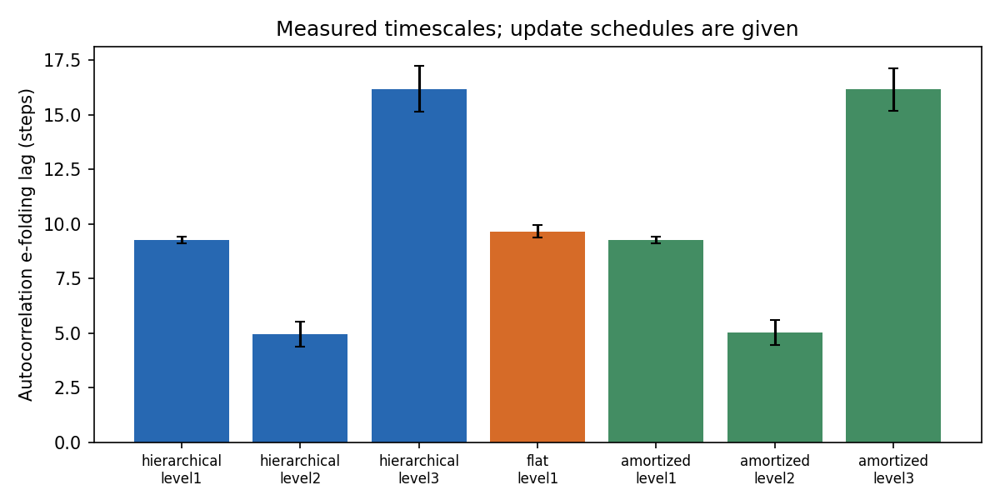
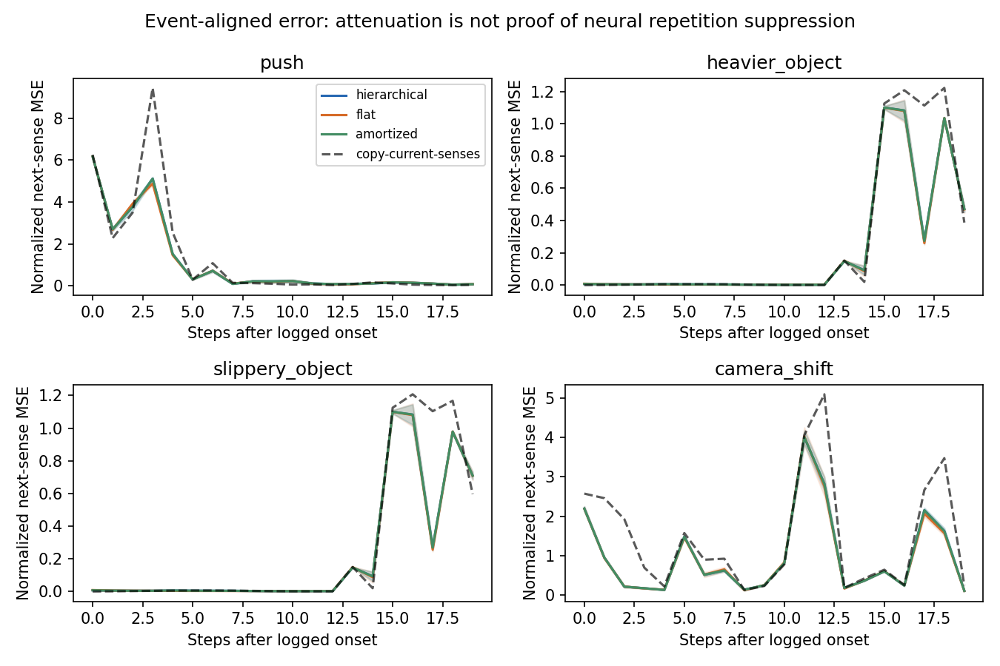
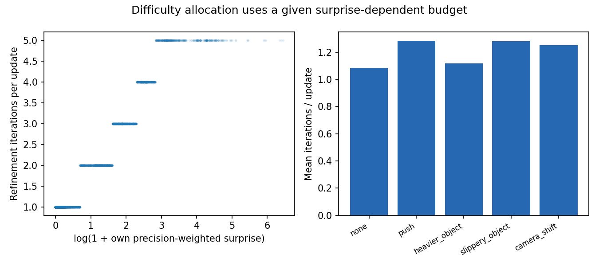

# A predictive hierarchy through RGB and proprioception: registered go/no-go

## Design and truth boundary

This is an offline predictive/cause-discovery experiment on a fixed arm behavior policy, not an end-to-end replacement of the arm controller. L1 is a 48-unit GRU predicting the next 19-dimensional sensory vector. Learned per-channel Gaussian precision weights its error. L2 contains eight categorical logits (softmax code) plus eight continuous coordinates, with an amortized update every four steps or on a large own prediction error. The iterative version minimizes the completed previous transition’s prediction error plus a weak proximity-to-prior penalty using latent-only gradients (1–5 updates). It then predicts the next observation; it never refines using that future target. A first-order straight-through path trains amortization and prediction without second-order differentiation. L3 is a learned 16-unit episode/goal-context GRU updated every 16 steps and reset per episode; it conditions L2. L3 is not a learned planner.

Flat: one 75-unit GRU. Amortized: exactly the hierarchical architecture, one inference pass, no latent gradient refinement. All see the same sensed features, actions, holding belief and phase; the latter two are the existing controller’s internal states, not cause labels. All train with the same Gaussian next-observation objective, optimizer steps, batch indices per seed and truncated windows. Hierarchical and amortized have 31,974 parameters; flat has 32,084 (0.34% difference). Training uses 1,200 AdamW steps, batch 16, windows 24, learning rate 0.001, fixed last checkpoint. No validation-label hyperparameter search or final-set tuning was performed. Truncated-window zero initialization may disadvantage long episode context; a negative result is specific to this small design and budget.

Learned: predictive/recurrent weights, L2 code/continuous representation, L3 context dynamics, and channel precisions, from senses only. Given: architecture, update periods, refinement learning rate/cap and surprise-budget rule, motor policy, object identities/colors/shapes, nominal camera calibration, and RGB geometric decoder. The decoder uses rendered RGB only for object positions, with proprioception/touch for the gripper and occluded grasp geometry; no `obs[state]`, simulator object positions, predicates, current camera pose or events enter it. Its estimates are noisy and its colored-object/known-geometry priors are authored. These are not learned visual representations. A sensory step is one 0.1-second planning interval, not every 50 Hz physics/sensor tick. The main predictors do not consume Bayesian residuals, HRM posteriors, labels, event onsets, row IDs or seeds. Raw proprioceptive joint streams are saved, although the compared input uses gripper position/force/opening, perceived target and mean scene position, RGB mean/std, action, holding and phase.

A single opt-in `sensory` collection argument was added to `run_episode`; default behavior is unchanged. Collection disables cause-driven adaptations and uses the existing world model/MPPI with samples=16, horizon=6, one optimizer iteration, an 80-step cap and no monitored settle tail. A passive monitor records reference residuals only; labels cannot influence motor adaptation. The exploratory controller is given, and curiosity/EFE acquisition is not learned by this new module. Student surprise allocates inference effort; training samples remain uniform.

## Data, seeds and registration

Pilot: seed 89800 under five conditions, 0/5 task successes, retained with noisy perception and incomplete manipulation. Training: 90000–90199, 200 layouts × five conditions = 1,000 episodes. Development: 91000–91039, 40 × five = 200. Frozen final: 92000–92039, 40 × five = 200. These are distinct layout ranges; the same layout is reused across five conditions within a split. Disturbance RNG is `layout_split_base + 10000 + condition_index*1000 + layout_index`, recorded by the collector; same-condition disturbance draws and physical episodes do not cross splits. Models use training seeds 93000, 93001, 93002. Every negative result/variant is retained.

Sensory `.npz` files contain only own streams, and separate truth/reference files hold events and old-world-model residuals for scoring. The loader rejects unexpected fields; training opens no truth/reference files. Normalization and PCA16/KMeans5 fitting use training data only, without labels. Cluster-to-cause Hungarian mapping and a fixed-C logistic probe are fitted on development labels only and frozen before final data collection. Episode embeddings are the mean/std of causal states over the full sensed trajectory; no logged onset selects an embedding. Prediction windows and adaptation alignment use event onsets only in scoring. Late pushes can leave fewer than 20 samples before the 80-step collection cap: such cases stay in overall prediction/discovery scores, but are excluded uniformly from complete-post20 MSE and the capped adaptation metric; their partial curves and available lengths remain in the records. This measurement correction was made before final collection and does not alter the registered primary go/no-go metrics.

Registered GO rule: hierarchy must gain at least five percentage points in mean cluster accuracy over flat, its paired training-seed Student-t 95% lower bound must exceed zero, and its mean overall prediction MSE must be lower. Otherwise NO-GO. The rule was registered before model training; the final set was not used for selecting models, thresholds, mappings, or stopping steps.

## Go/no-go results

Mean ± sample standard deviation over three training seeds. Individual seed count metrics retain Wilson 95% intervals in the JSON and table below; no false independence is claimed across training seeds or repeated layouts. MSE is in train-standardized sensory coordinates, averaged per episode; smaller is better.

| Model | Cluster accuracy % | NMI | Linear probe % | Overall MSE | First 20 after onset MSE | Capped return-to-clean steps |
|---|---:|---:|---:|---:|---:|---:|
| hierarchical | 28.8333 ± 2.5658 | 0.0699 ± 0.0139 | 37.8333 ± 1.5275 | 0.0878 ± 0.0012 | 0.0797 ± 0.0009 | 3.4271 ± 0.0361 |
| flat | 24.8333 ± 0.7638 | 0.0387 ± 0.0082 | 29.5000 ± 2.6458 | 0.0858 ± 0.0004 | 0.0789 ± 0.0008 | 3.4042 ± 0.0130 |
| amortized | 28.1667 ± 0.5774 | 0.0635 ± 0.0193 | 37.0000 ± 0.8660 | 0.0878 ± 0.0011 | 0.0798 ± 0.0009 | 3.4271 ± 0.0361 |
| hierarchical_test_amortized | 29.0000 ± 2.5981 | 0.0713 ± 0.0200 | 37.1667 ± 1.4434 | 0.0879 ± 0.0011 | 0.0799 ± 0.0009 | 3.4271 ± 0.0361 |

| Model | Seed | Cluster correct / n [Wilson 95%] | Probe correct / n [Wilson 95%] |
|---|---:|---|---|
| hierarchical | 93000 | 59/200 [23.6–36.2%] | 79/200 [33.0–46.4%] |
| hierarchical | 93001 | 52/200 [20.4–32.5%] | 75/200 [31.1–44.4%] |
| hierarchical | 93002 | 62/200 [25.0–37.7%] | 73/200 [30.1–43.4%] |
| flat | 93000 | 51/200 [20.0–32.0%] | 65/200 [26.4–39.3%] |
| flat | 93001 | 48/200 [18.6–30.4%] | 57/200 [22.7–35.1%] |
| flat | 93002 | 50/200 [19.5–31.4%] | 55/200 [21.8–34.1%] |
| amortized | 93000 | 57/200 [22.7–35.1%] | 73/200 [30.1–43.4%] |
| amortized | 93001 | 55/200 [21.8–34.1%] | 73/200 [30.1–43.4%] |
| amortized | 93002 | 57/200 [22.7–35.1%] | 76/200 [31.6–44.9%] |
| hierarchical_test_amortized | 93000 | 55/200 [21.8–34.1%] | 76/200 [31.6–44.9%] |
| hierarchical_test_amortized | 93001 | 55/200 [21.8–34.1%] | 76/200 [31.6–44.9%] |
| hierarchical_test_amortized | 93002 | 64/200 [25.9–38.8%] | 71/200 [29.2–42.3%] |

| Model | Seed | Initial detectable spikes | Censored returns / disturbed [Wilson 95%] |
|---|---:|---:|---|
| hierarchical | 93000 | 60 | 0/160 [0.0–2.3%] |
| hierarchical | 93001 | 60 | 0/160 [0.0–2.3%] |
| hierarchical | 93002 | 60 | 0/160 [0.0–2.3%] |
| flat | 93000 | 60 | 0/160 [0.0–2.3%] |
| flat | 93001 | 60 | 0/160 [0.0–2.3%] |
| flat | 93002 | 60 | 0/160 [0.0–2.3%] |
| amortized | 93000 | 60 | 0/160 [0.0–2.3%] |
| amortized | 93001 | 60 | 0/160 [0.0–2.3%] |
| amortized | 93002 | 60 | 0/160 [0.0–2.3%] |
| hierarchical_test_amortized | 93000 | 60 | 0/160 [0.0–2.3%] |
| hierarchical_test_amortized | 93001 | 60 | 0/160 [0.0–2.3%] |
| hierarchical_test_amortized | 93002 | 60 | 0/160 [0.0–2.3%] |

Categorical codes are not forced to match the five causes. Dominant-code counts below can reveal collapse even when a post-hoc continuous-feature probe separates classes.

| Model | Seed | Dominant-code counts (0–7) | Mean categorical entropy (nats) |
|---|---:|---|---:|
| hierarchical | 93000 | {'0': 0, '1': 166, '2': 2, '3': 3, '4': 0, '5': 19, '6': 0, '7': 10} | 2.05151 |
| hierarchical | 93001 | {'0': 0, '1': 83, '2': 5, '3': 0, '4': 0, '5': 104, '6': 8, '7': 0} | 2.05132 |
| hierarchical | 93002 | {'0': 43, '1': 10, '2': 0, '3': 15, '4': 0, '5': 0, '6': 132, '7': 0} | 2.05910 |
| amortized | 93000 | {'0': 0, '1': 170, '2': 1, '3': 2, '4': 0, '5': 17, '6': 0, '7': 10} | 2.05053 |
| amortized | 93001 | {'0': 0, '1': 70, '2': 6, '3': 0, '4': 0, '5': 119, '6': 5, '7': 0} | 2.04959 |
| amortized | 93002 | {'0': 48, '1': 9, '2': 0, '3': 18, '4': 0, '5': 0, '6': 125, '7': 0} | 2.05857 |
| hierarchical_test_amortized | 93000 | {'0': 0, '1': 166, '2': 2, '3': 3, '4': 0, '5': 19, '6': 0, '7': 10} | 2.05150 |
| hierarchical_test_amortized | 93001 | {'0': 0, '1': 83, '2': 5, '3': 0, '4': 0, '5': 104, '6': 8, '7': 0} | 2.05134 |
| hierarchical_test_amortized | 93002 | {'0': 43, '1': 10, '2': 0, '3': 15, '4': 0, '5': 0, '6': 132, '7': 0} | 2.05915 |

Hierarchy minus flat cluster accuracy: **4.00 pp**, paired training-seed t95 [-0.97, 8.97] pp; layout-cluster bootstrap95 [0.66, 7.67] pp (5,000 draws, seed 93400). Hierarchy/flat prediction-MSE ratio: **1.0228**.

Adaptation is the endpoint of the first completed three-consecutive-step moving mean below that model’s development clean mean, within 20 steps after a logged onset. On fully observed 20-step windows, missing returns are censored and contribute 20 to the capped comparative score; counts/initial-spike flags are preserved per episode. Payload/friction begin at episode start and may not become observable until a later grasp, so an early “return” does not prove adaptation. No detectable initial spike is explicitly marked.

## References using teacher supervision or authored cause likelihoods

Bayesian reference: 57/200, Wilson95 [0.2269500300461743, 0.35115346029604977]. It uses its authored likelihoods with residual-noise calibration fitted on training clean labels (reference only). Existing c1000 HRM imitation checkpoints are evaluated on the same final perceived residuals: [0.56, 0.475, 0.495]. They used cause labels/Bayesian teacher during their original training and are references, not unsupervised competitors. The present RGB decoder and behavior budget differ from c1000, so these are distribution-shift results, not a replacement of its original 89.7% result. The original 96.0% agreement vs transformer 95.8% does not establish a hierarchy advantage.

Copy-current-senses prediction reference: overall normalized MSE 0.122597, post-onset MSE 0.101650. This reference has no learned dynamics or cause representation and helps identify attenuation explained by sensory persistence alone.

## Measured signatures and their limits

| Model | L1 ACF time (steps) | L2 ACF time | L3 ACF time | Iterations / sensory step | Iterations / update | Past-error reduction / update |
|---|---:|---:|---:|---:|---:|---:|
| hierarchical | 9.1267 ± 0.5308 | 6.7517 ± 0.5637 | 15.0400 ± 0.7098 | 0.2790 ± 0.0002 | 1.0709 ± 0.0017 | 0.0032 ± 0.0004 |
| flat | 8.3867 ± 0.3034 | same hidden state | same hidden state | 1.0000 ± 0.0000 | 1.0000 ± 0.0000 | 0.0000 ± 0.0000 |
| amortized | 9.1317 ± 0.5450 | 6.7867 ± 0.2816 | 15.0067 ± 0.7474 | 0.2583 ± 0.0002 | 1.0000 ± 0.0000 | 0.0000 ± 0.0000 |
| hierarchical_test_amortized | 9.1283 ± 0.5332 | 6.7917 ± 0.5736 | 15.0400 ± 0.7134 | 0.2583 ± 0.0002 | 1.0000 ± 0.0000 | 0.0000 ± 0.0000 |

Autocorrelation time is the first lag with normalized state autocorrelation at most exp(-1), capped at min(40, episode length/2). Undefined constant traces and capped traces are recorded. Higher-level update schedules are authored, so slower measured states are not evidence that biological timescales emerged.


| Condition | Iterations/update, hierarchy | Early error (first 5) | Late error (15–20) |
|---|---:|---:|---:|
| none | 1.058 | — | — |
| push | 1.138 | 0.88214 | 0.02200 |
| heavier_object | 1.047 | 0.00615 | 0.01941 |
| slippery_object | 1.068 | 0.00596 | 0.01942 |
| camera_shift | 1.043 | 0.11859 | 0.03709 |


The event-aligned figure measures persistence/attenuation, not neural mismatch negativity or a demonstrated repetition-suppression mechanism. Each episode contains one injected event; a short push ends after three planning steps, and attenuation can reflect that external ending, the given motor policy, or simple sensory autocorrelation. Persistent mass/friction conditions can remain unexposed if the arm never grasps.

Spearman correlation of own surprise and iterations on hierarchy update steps: 0.3819789220233911. This relationship is partly imposed by the given budget rule, not a learned halting head. The separately trained amortized model and the same hierarchy weights with refinement disabled at test are both reported; past-error minimization is not itself proof of improved future prediction or discovered causes.


## Failures, data qualification, and scope

Low-quality perception, grasp failures, variable goal phases, and the authored collection controller can shape representations. Hungarian/probe accuracy is observational separability, not proof of causal identifiability or intervention discovery. The categorical code may collapse or encode pose/task progress rather than disturbance type; no labels were used to repair it. No local predictive-coding weight updates, learned visual encoder, new action planner, autonomous curiosity, or closed-loop student-control improvement is demonstrated. These remain outside this experiment. Per-episode errors, censored adaptations, code-independent readouts and all nine training histories are retained.

| Split | Condition | Episodes | Task successes | Holding belief present | Logged grasp present |
|---|---|---:|---:|---:|---:|
| train | none | 200 | 0 | 129 | 127 |
| train | push | 200 | 0 | 135 | 131 |
| train | heavier_object | 200 | 0 | 140 | 137 |
| train | slippery_object | 200 | 1 | 132 | 128 |
| train | camera_shift | 200 | 1 | 103 | 52 |
| development | none | 40 | 0 | 29 | 28 |
| development | push | 40 | 0 | 26 | 26 |
| development | heavier_object | 40 | 0 | 29 | 29 |
| development | slippery_object | 40 | 0 | 25 | 25 |
| development | camera_shift | 40 | 0 | 18 | 13 |
| final | none | 40 | 0 | 29 | 29 |
| final | push | 40 | 0 | 29 | 30 |
| final | heavier_object | 40 | 0 | 21 | 23 |
| final | slippery_object | 40 | 0 | 23 | 21 |
| final | camera_shift | 40 | 0 | 26 | 13 |

## Reproduce

Use the project `.venv/Scripts/python.exe`, repository root, `PYTHONPATH=.;scripts`, `OMP_NUM_THREADS=1`. All compute is local. Commands run:

```powershell
.venv/Scripts/python.exe scripts/thinker_hier_collect.py --split pilot
.venv/Scripts/python.exe scripts/thinker_hier_train.py --register
.venv/Scripts/python.exe scripts/thinker_hier_collection.py --split train
.venv/Scripts/python.exe scripts/thinker_hier_collection.py --split development
.venv/Scripts/python.exe scripts/thinker_hier_training.py
.venv/Scripts/python.exe scripts/thinker_hier_references.py calibration
.venv/Scripts/python.exe scripts/thinker_hier_evaluate.py development
.venv/Scripts/python.exe scripts/thinker_hier_evaluate.py freeze
.venv/Scripts/python.exe scripts/thinker_hier_collection.py --split final
.venv/Scripts/python.exe scripts/thinker_hier_evaluate.py final
.venv/Scripts/python.exe scripts/thinker_hier_references.py final
.venv/Scripts/python.exe scripts/thinker_hier_report.py
.venv/Scripts/python.exe scripts/thinker_hier_tests.py --basetemp data/pytest_thinker_hier_final_20261028 --output results/thinker_hier_tests_final.json
```

Collection resumes completed episode keys without repeating them. Frozen source/model/readout hashes are checked before final scoring. Existing result files must be retained; do not rerun final data to select a more favorable design. JSON paths are repository-relative. Windows tests use inherited permissions only for newly created test temporary directories and never delete existing directories.


## Audit, costs, and interpretation

The required gate passed **58 tests**. A read-only audit replayed all **2,400 final model/episode results** (four inference variants × three training seeds × 200 episodes) and obtained identical saved records. All 1,400 sensory streams have unique keys, finite values, and matching capture hashes. Frozen source, model, and readout hashes are unchanged. A guarded training reader loaded all 1,000 streams and sampled batches while reads of truth/reference files were forbidden. See `results/thinker_hier_completion_audit.json`, `_training_fairness_audit.json`, and `_seed_audit.json`. The seed scan found no overlaps with 98 prior arm/language artifacts or c1000 seeds 10000–10999; the two legacy slice/pixel evidence files lack seed fields, which limits mechanical verification against those files.

One Windows file-sharing violation interrupted a training-manifest replacement. A single uncommitted training episode (index 804) was retried; its two answer-key rows were identical. The original duplicate ledger is archived at `results/thinker_hier_io_original_truth0.json`; the scoring ledger was deduplicated before reference fitting. No final episode was repeated. The scoped file-replacement retry wrapper changes I/O only. Recovery command: `.venv/Scripts/python.exe scripts/thinker_hier_run.py scripts/thinker_hier_collect.py --split train --workers 2 --worker 0`. Scoring-only complete-window handling was corrected before the final freeze; neural training code, sample streams, and optimizer budgets were identical across all nine models.

| Model | Parameters | Training seconds, mean ± sample std |
|---|---:|---:|
| hierarchical | 31974 | 168.84 ± 11.61 |
| flat | 32084 | 47.14 ± 0.44 |
| amortized | 31974 | 84.15 ± 0.88 |

The iteration table uses different operational units: hierarchy entries count latent gradient/amortization updates (zero between context updates); flat entries count its ordinary recurrent pass per sensory step. These counts are not FLOPs and must not be read as a hierarchy speed advantage. The wall-time table measures the actual extra cost. Weight learning uses backpropagation; local predictive-coding weight learning was not implemented.

The expected strict autocorrelation ordering failed: hierarchy L1/L2/L3 means were **9.13 / 6.75 / 15.04 steps**. L2 was faster than L1 despite its scheduled slower updates. These are nonstationary trajectory autocorrelations, not measured neuronal intrinsic time constants. Surprise/iterations correlation was **0.382**, partly imposed by the given budget rule, with only **1.071 iterations per context update** on average.

Iterative refinement reduced its fitted past error, but switching refinement off on the same hierarchical weights gave **29.00%** cluster accuracy versus **28.83%** with it on; the neural prediction-MSE change was under 0.1%. The separately trained one-pass hierarchy scored 28.17% cluster and 37.00% probe accuracy. Thus there is no demonstrated cause-clustering gain attributable to the extra thinking. Push/camera errors attenuated, while early-to-late mass/friction errors increased; copy-current-senses curves and physical exposure timing explain why this is not evidence of general repetition suppression.

There is a positive secondary result: hierarchy linear-probe accuracy was **37.83% ± 1.53%** versus flat **29.50% ± 2.65%**. This is more decodable cause information, not evidence of an overall hierarchy win. Models predicted better than simple sensory persistence, but the flat predictor was best among the registered neural competitors on overall MSE. No outcome was used to retune, select a favorable seed, replace the final set, or alter the registered NO-GO. All three figures were visually inspected. Synthetic pipeline-smoke files are explicitly marked synthetic and excluded from every experimental table.

## Verdict

**NO-GO** under the registered rule. This particular three-level predictor changes final cluster accuracy by 4.00 percentage points relative to the same-size flat GRU, with paired training-seed 95% interval [-0.97, 8.97] pp and prediction-MSE ratio 1.0228 (2.28% worse). The secondary probe gain is +8.33 pp, but the pre-registered cluster/prediction requirements failed, and iterative inference did not improve cluster discovery. Placement success was 0/200 on the final exploration controller, so this is not evidence of a stronger closed-loop arm agent. The reported signatures are measurements under given update/effort schedules, not independent evidence of a brain mechanism. This result applies to the stated RGB decoder, data quality, and training budget; it neither establishes nor rules out a broader advantage of hierarchical active inference.

## Round 2: registered normal-behaviour replication

This section was registered before round-2 collection or model training. Round 1 and its
NO-GO remain unchanged above. The review identifies an observability confound: its poor
motor/perception performance means that result does not resolve the broader hierarchy thesis.

**Collection:** the `configs/tabletop.yaml` motor defaults used by `scripts/slice_eval.py`:
256 MPPI samples, horizon 10, two iterations, 150 planning steps, action repeat 5,
25 settle steps and `watch_settle=true`. Cause-driven adaptation remains off; a passive
monitor records residuals without inferring causes during behaviour. The RGB-only
`OwnPixelPerception` and its given color/shape geometry remain unchanged from round 1.
No privileged-state replacement is allowed to make the gate pass. Record the complete
monitored settle tail as sensory transitions as well as planning transitions.

**Pre-training gate:** calibrate the unchanged Bayesian reference on eight separate clean
episodes (95200–95207), using the standard calibration defaults. On all 200 development
episodes it must classify at least 160/200 (80%) assigned conditions correctly. Report
Wilson 95% intervals, placement, grasp/holding exposure, realized disturbance events and
post-onset coverage per condition. An absent scheduled event still counts against its
assigned condition. If the gate fails, stop without training or final collection; explain
the failure without changing perception, controller, calibration or threshold to pass it.

**Splits:** training layouts 94000–94199 (200/condition), development 95000–95039
(40/condition), final 93010–93049 (40/condition). The final layouts avoid 93000–93002,
which were round-1 optimizer initialization seeds, as well as all round-1 layout seeds.
Round-2 optimizer seeds are 96000/96001/96002. Disturbance RNG bases are 960000/970000/
980000 by split, plus 1000 × condition index + layout index. Calibration uses clean
episodes only and is separate from all three splits. Do not access final episodes before
models and development readouts are frozen.

**Comparison, conditional on passing the gate:** retain the exact round-1 model classes,
31,974/32,084/31,974 parameters, three paired optimizer seeds, 1,200 AdamW steps,
batch 16, windows 24, learning rate 0.001, and fixed last-step selection. Train only from
sensory streams, without labels or onset windows. Retain train-only PCA/KMeans, development
Hungarian mapping and fixed-C logistic probe. GO requires hierarchical minus flat mean
cluster accuracy ≥5 pp, paired training-seed Student-t 95% lower bound >0, **and** lower
overall prediction MSE. Otherwise report NO-GO. Report probe, NMI, full post-onset-20
MSE/adaptation censoring, same-weight refinement on/off, per-level autocorrelation,
attenuation, and iterations versus surprise/condition, with the round-1 caveats.

All new artifacts use `results/thinker_hier2_*`; round-1 files are hash-preserved.
No optional local weight-learning variant and no post-final tuning are planned.

## Round 2: registered normal-behaviour replication

This section was registered before round-2 collection or model training. Round 1 and its
NO-GO remain unchanged above. The review identifies an observability confound: its poor
motor/perception performance means that result does not resolve the broader hierarchy thesis.

**Collection:** the `configs/tabletop.yaml` motor defaults used by `scripts/slice_eval.py`:
256 MPPI samples, horizon 10, two iterations, 150 planning steps, action repeat 5,
25 settle steps and `watch_settle=true`. Cause-driven adaptation remains off; a passive
monitor records residuals without inferring causes during behaviour. The RGB-only
`OwnPixelPerception` and its given color/shape geometry remain unchanged from round 1.
No privileged-state replacement is allowed to make the gate pass. Record the complete
monitored settle tail as sensory transitions as well as planning transitions.

**Pre-training gate:** calibrate the unchanged Bayesian reference on eight separate clean
episodes (95200–95207), using the standard calibration defaults. On all 200 development
episodes it must classify at least 160/200 (80%) assigned conditions correctly. Report
Wilson 95% intervals, placement, grasp/holding exposure, realized disturbance events and
post-onset coverage per condition. An absent scheduled event still counts against its
assigned condition. If the gate fails, stop without training or final collection; explain
the failure without changing perception, controller, calibration or threshold to pass it.

**Splits:** training layouts 94000–94199 (200/condition), development 95000–95039
(40/condition), final 93010–93049 (40/condition). The final layouts avoid 93000–93002,
which were round-1 optimizer initialization seeds, as well as all round-1 layout seeds.
Round-2 optimizer seeds are 96000/96001/96002. Disturbance RNG bases are 960000/970000/
980000 by split, plus 1000 × condition index + layout index. Calibration uses clean
episodes only and is separate from all three splits. Do not access final episodes before
models and development readouts are frozen.

**Comparison, conditional on passing the gate:** retain the exact round-1 model classes,
31,974/32,084/31,974 parameters, three paired optimizer seeds, 1,200 AdamW steps,
batch 16, windows 24, learning rate 0.001, and fixed last-step selection. Train only from
sensory streams, without labels or onset windows. Retain train-only PCA/KMeans, development
Hungarian mapping and fixed-C logistic probe. GO requires hierarchical minus flat mean
cluster accuracy ≥5 pp, paired training-seed Student-t 95% lower bound >0, **and** lower
overall prediction MSE. Otherwise report NO-GO. Report probe, NMI, full post-onset-20
MSE/adaptation censoring, same-weight refinement on/off, per-level autocorrelation,
attenuation, and iterations versus surprise/condition, with the round-1 caveats.

All new artifacts use `results/thinker_hier2_*`; round-1 files are hash-preserved.
No optional local weight-learning variant and no post-final tuning are planned.

### Round-2 development gate outcome

**STOP — DATA GATE FAILED; no round-2 hierarchy GO/NO-GO can be measured.** The unchanged Bayesian reference classified 59/200 (29.5%; 23.6%–36.2%), below the registered 80% threshold. No neural model was trained; no training or final split was collected. Round 1 retains its registered NO-GO exactly as written. Round 2 stops before testing the model comparison and therefore provides no new evidence for or against hierarchy.

| Assigned condition | Bayesian correct (Wilson 95%) | Placement (Wilson 95%) | Grasp episodes | Holding-belief episodes | Realized disturbances | Full post-onset 20 |
|---|---|---|---:|---:|---:|---:|
| none | 31/40 (77.5%; 62.5%–87.7%) | 0/40 (0.0%; 0.0%–8.8%) | 40/40 | 40/40 | 0/40 | 0/40 |
| push | 10/40 (25.0%; 14.2%–40.2%) | 0/40 (0.0%; 0.0%–8.8%) | 40/40 | 40/40 | 40/40 | 40/40 |
| heavier_object | 0/40 (0.0%; 0.0%–8.8%) | 0/40 (0.0%; 0.0%–8.8%) | 40/40 | 40/40 | 40/40 | 40/40 |
| slippery_object | 2/40 (5.0%; 1.4%–16.5%) | 0/40 (0.0%; 0.0%–8.8%) | 36/40 | 38/40 | 40/40 | 40/40 |
| camera_shift | 16/40 (40.0%; 26.3%–55.4%) | 0/40 (0.0%; 0.0%–8.8%) | 26/40 | 36/40 | 40/40 | 40/40 |

Placement overall: 0/200 (0.0%; 0.0%–1.9%). Clean calibration placement: 0/8. Grasp is scored from the separate simulator event ledger; holding is the agent’s subgoal belief and must not be read as a verified physical grasp. Clean rows have no disturbance onset, so their post-onset count is inapplicable. All episode records, including absent events and failures, are retained.

| True assigned condition \ inferred | none | push | heavier_object | slippery_object | camera_shift | unknown |
|---|---:|---:|---:|---:|---:|---:|
| none | 31 | 1 | 0 | 1 | 0 | 7 |
| push | 25 | 10 | 0 | 0 | 0 | 5 |
| heavier_object | 30 | 2 | 0 | 0 | 0 | 8 |
| slippery_object | 28 | 1 | 0 | 2 | 0 | 9 |
| camera_shift | 20 | 1 | 0 | 0 | 16 | 3 |

| Condition | Median holding-belief steps | Episodes with logged slip | Median episode held absolute vertical-force residual (N) |
|---|---:|---:|---:|
| none | 50.5 | 29/40 | 0.488 |
| push | 52.0 | 22/40 | 0.497 |
| heavier_object | 48.0 | 7/40 | 4.388 |
| slippery_object | 24.5 | 14/40 | 0.121 |
| camera_shift | 28.0 | 2/40 | 1.559 |

The heavier-object force residual is observably larger in this descriptive audit (4.39 N versus 0.49 N clean), yet none of the 40 heavier episodes is identified by the Bayesian reference. The matched clean calibration gives vertical-force noise floors of 13.67 N in `lifted` and 9.98 N in `over_target`. Those large floors can hide a several-newton load from the reference. This is a plausible explanation for its failures, not an independently tested causal attribution. The force contrast shows why low reference accuracy alone must not be equated with absence of all useful sensory information. Logged slip events are simulator audit heuristics; they do not by themselves identify a friction cause. The full per-phase diagnostics are retained in `results/thinker_hier2_diagnostics.json`.

The normal planner budget and settle tail are restored, but that alone does not establish that the RGB decoder and resulting motor trajectories provide identifiable cause evidence. This decoder remains the same given geometry/color interface used in round 1; the approximately 91% historical Bayesian result uses a different observation regime and is not an expected score on these pixels. We do not switch to privileged object state, tune the decoder, or recalibrate after seeing this failed gate. Repairing perception/exposure requires a separately registered study before any new hierarchy comparison.

The development exposure table is a diagnostic, not a proof that the causes are information-theoretically unobservable: the reference likelihoods themselves can also fail under a different perception regime. The pre-registered reference gate is nevertheless binding; the dataset was not used to tune it.

A shared-GPU CUDA out-of-memory error interrupted worker 1 at uncommitted index 87 (layout 95007, heavier object), after 43 saved episodes. Its failed shutdown was terminated explicitly. Worker 0 finished, then worker 1 resumed its 57 missing keys in a single process with the same settings and seeds. All completed episodes were kept. See `results/thinker_hier2_collection_recovery.json`; the failed log is retained with absolute traceback paths redacted. No failed trial or model was dropped to improve a score.

No probe, clustering, refinement, timescale, attenuation or trained-model figure is reported for round 2: those measurements would require training after a failed gate, contrary to the stopping rule. A failed quality gate is not a hierarchy NO-GO.

Audit: 2949 round-1 files and every original documentation byte are unchanged; 208 sensory streams have matching capture hashes, finite values and aligned action/proprioception/reference lengths. All 200 reference classifications replay identically. Required gates: 62 tests passed.

Reproduce from the repository root, using the project Python and `PYTHONPATH=.;scripts`, `OMP_NUM_THREADS=1`, `OPENBLAS_NUM_THREADS=1` (all outputs remain repository-relative):

```powershell
.venv/Scripts/python.exe scripts/thinker_hier_round2.py register
# Run both calibration shards (sequentially or in two modest processes):
.venv/Scripts/python.exe scripts/thinker_hier_round2.py collect --split calibration --workers 2 --worker 0
.venv/Scripts/python.exe scripts/thinker_hier_round2.py collect --split calibration --workers 2 --worker 1
.venv/Scripts/python.exe scripts/thinker_hier_round2_run.py
# Actual recovery after a shared-GPU OOM: survivor first, missing shard only:
.venv/Scripts/python.exe scripts/thinker_hier_round2_resume.py
.venv/Scripts/python.exe scripts/thinker_hier_tests.py --basetemp data/pytest_thinker_hier2_20261028 --output results/thinker_hier2_tests.json
.venv/Scripts/python.exe scripts/thinker_hier_round2_report.py
```

Completed captures resume without repeating saved episodes. The pytest temporary directory must be fresh; choose a new directory under `data/` on a second test run. The report command is idempotent and never rewrites round-1 text.

## Round 3: registered privileged-token experiment

Registered before reproduction or new collection. All earlier results and text remain
unchanged. Round 3 addresses the reviewed perception mismatch explicitly: **object state
is given (privileged)** through the arm's default `CameraFramePerception`. The thinker
would learn from the arm's own entity-token/action/force stream, **not from pixels**.
No round-1/2 RGB geometric decoder is used. This narrower experiment cannot establish
learned visual perception or the paper's full perception-learning thesis.

**Gate A, reproduce first:** run the unchanged `scripts/slice_eval.py` with
`--config configs/tabletop.yaml --episode-seed 96000 --calibration-episodes 8 --no-gif
--tag thinker_hier3_reproduction slice.episodes=8`. There are eight episodes per each
of five conditions (40 total); cause adaptation is ON, as in the published evaluation.
Calibration uses the script's unchanged seeds 5000–5007 and disturbance RNG seed 0.
`--no-gif` suppresses visualization/rendering, without changing the privileged tokens.
No planner, physics, episode-length, perception, or calibration override is allowed.
Pass only if task success **and** cause accuracy each reach 32/40 (80%). Otherwise stop,
document configuration/version differences and do not collect or train anything else.

The checked-in `results/slice_v7/slice_eval.md` actually lists task success
100/100/90/75/90% by condition (91% overall), and cause accuracy 100/90/90/60/100%
(88% overall); its slippery task row is 75%, rather than the review's 90–100% range.
The current YAML includes later v8 `seed_planner=true`, `slippery_carry=low`, and
`watch_settle=true` defaults. We will use these current defaults without reverting or
tuning them. Historical package/source provenance may be unavailable; current package,
source, config and world-model hashes are registered in `thinker_hier3_plan.json`.

**Collection, only after Gate A:** exactly the same default token perception, world model,
MPPI and episode settings, with adaptation OFF (`--no-adapt` behaviour) and optional
sensory recording. Cause labels/events never enter the predictor or motor commands.
Save labels/events separately for scoring. Capture planning and monitored settle
transitions; any recording wrapper must return unchanged default perception outputs.
The 19 predicted channels are gripper xyz, wrist force xyz, target xyz, mean other-object
xyz, gripper opening, target velocity xyz and mean other-object velocity xyz. Actions
have four channels and holding/phase context ten, retaining exactly the round-1 model
dimensions and parameter budgets. The last six channels are now token velocities,
replacing the round-1 RGB summary; no pixel information is supplied or claimed.

**Gate B:** calibrate the unchanged Bayesian reference on separate clean layouts
98200–98207, using standard calibration settings, then evaluate all 200 development
episodes (40/condition, layouts 98000–98039). It must classify at least 160/200 assigned
conditions (80%). Report placement and grasp/holding/disturbance/post-onset exposure per
condition, with Wilson 95% intervals. Absent scheduled events count against the assigned
condition. If Gate B fails, stop before training and final collection, without tuning.

**Splits and frozen comparison, conditional on both gates passing:** collect 200 training
episodes/condition on layouts 97000–97199; development 98000–98039; final 99000–99039.
Final data remain unopened until models/readouts are frozen. Disturbance RNG bases are
1000000/1010000/1020000 by split, plus 1000 × condition index + layout index. Optimizer
seeds are 100000/100001/100002. Use the identical three round-1 model classes and
31,974/32,084/31,974 parameter counts, 1,200 AdamW steps, batch 16, windows 24,
learning rate .001 and fixed last-step selection. Train only on training sensory streams.
Retain train-only PCA/KMeans and development-only Hungarian mapping/logistic probe.
GO requires hierarchical-minus-flat mean cluster accuracy ≥5 pp, paired optimizer-seed
Student-t 95% lower bound >0, and lower overall prediction MSE. Otherwise NO-GO.

Report accuracy/NMI/probe with seed uncertainty, Wilson intervals where counts,
full-post-onset-20 prediction/adaptation with censoring, same-weight refinement on/off,
state autocorrelations, attenuation, iterations versus own surprise/condition, and wall
time, retaining all round-1 caveats (scheduled timescales, imposed iteration budget,
nonstationary trajectories, physical exposure timing and pulse duration). No optional
local weight-learning variant or post-final tuning. All new results use
`results/thinker_hier3_*`, repository-relative paths, and laptop compute only.

### Round-3 Gate A reproduction

Gate A: **PASS**. Default privileged-state reproduction, adaptation ON, layouts 96000–96007.
Task: 35/40 (87.5%; Wilson 95% 73.9%–94.5%). Cause accuracy: 34/40 (85.0%; Wilson 95% 70.9%–92.9%).

| Condition | Task | Cause |
|---|---|---|
| none | 8/8 (100.0%; Wilson 95% 67.6%–100.0%) | 7/8 (87.5%; Wilson 95% 52.9%–97.8%) |
| push | 8/8 (100.0%; Wilson 95% 67.6%–100.0%) | 8/8 (100.0%; Wilson 95% 67.6%–100.0%) |
| heavier_object | 8/8 (100.0%; Wilson 95% 67.6%–100.0%) | 7/8 (87.5%; Wilson 95% 52.9%–97.8%) |
| slippery_object | 4/8 (50.0%; Wilson 95% 21.5%–78.5%) | 4/8 (50.0%; Wilson 95% 21.5%–78.5%) |
| camera_shift | 7/8 (87.5%; Wilson 95% 52.9%–97.8%) | 8/8 (100.0%; Wilson 95% 67.6%–100.0%) |

Current package versions: torch 2.11.0+cu130, numpy 1.26.4, mujoco 3.14.0, scipy 1.15.3, scikit-learn 1.7.2.
The registration records exact YAML and source/world-model hashes. The published v7 artifact does not supply package/source provenance sufficient to establish identical historical versions. The known YAML v8 defaults were kept, including seeded planning and low slippery carry; the outcome was not used to change them. Calibration remains the standard eight clean episodes on seeds 5000–5007. Visualization alone was disabled with `--no-gif`.

### Round-3 reproduction commands and audit

Run from the project root using the project Python, `PYTHONPATH=.;scripts`, `OMP_NUM_THREADS=1`, `OPENBLAS_NUM_THREADS=1`. All outputs are repository-relative.

```powershell
.venv/Scripts/python.exe scripts/thinker_hier_round3.py register
.venv/Scripts/python.exe scripts/thinker_hier_round3.py reproduce
.venv/Scripts/python.exe scripts/thinker_hier_tests.py --basetemp data/pytest_thinker_hier3_20261028 --output results/thinker_hier3_tests.json
.venv/Scripts/python.exe scripts/thinker_hier_round3_pipeline.py
.venv/Scripts/python.exe scripts/thinker_hier_round3_audit.py
```

The pipeline stops at either failed gate. It logs exact per-stage commands, resumes only saved episode/checkpoint keys, freezes before any final collection and preserves failures. Choose a fresh pytest directory under `data/` for a second test invocation. The final audit verifies earlier-round hashes, sensory stream hashes, matched training budgets, frozen sources/models/readouts and per-episode replay. No git state changes or cloud compute are part of these commands.

### Round-3 Gate B development quality

Gate B: **PASS**. Development layouts 98000–98039, adaptation OFF; independent calibration 98200–98207.
Bayesian accuracy: 173/200 (86.5%; Wilson 95% 81.1%–90.6%). Placement: 153/200 (76.5%; Wilson 95% 70.2%–81.8%).

| Condition | Bayesian correct | Placement | Grasp | Holding belief | Realized disturbance | Full post20 |
|---|---|---|---:|---:|---:|---:|
| none | 38/40 (95.0%; Wilson 95% 83.5%–98.6%) | 38/40 (95.0%; Wilson 95% 83.5%–98.6%) | 39/40 | 39/40 | 0/40 | 0/40 |
| push | 40/40 (100.0%; Wilson 95% 91.2%–100.0%) | 40/40 (100.0%; Wilson 95% 91.2%–100.0%) | 40/40 | 40/40 | 40/40 | 33/40 |
| heavier_object | 38/40 (95.0%; Wilson 95% 83.5%–98.6%) | 40/40 (100.0%; Wilson 95% 91.2%–100.0%) | 40/40 | 40/40 | 40/40 | 40/40 |
| slippery_object | 25/40 (62.5%; Wilson 95% 47.0%–75.8%) | 25/40 (62.5%; Wilson 95% 47.0%–75.8%) | 39/40 | 39/40 | 40/40 | 40/40 |
| camera_shift | 32/40 (80.0%; Wilson 95% 65.2%–89.5%) | 10/40 (25.0%; Wilson 95% 14.2%–40.2%) | 22/40 | 28/40 | 40/40 | 40/40 |

Grasp/disturbance events are separate scoring evidence; holding is the agent’s internal belief. Clean post-onset counts are inapplicable. Events absent from a short episode still count against the assigned cause for Gate B. Predictive evaluations use actual logged causes and retain censored/truncated windows. Calibration is not retuned after this gate.

### Round-3 readiness command before training

The later readiness test result is the one checked before training and frozen with the models. Run this after preparing the new scripts and before the pipeline (the initial test result above is retained separately):

```powershell
.venv/Scripts/python.exe scripts/thinker_hier_tests.py --basetemp data/pytest_thinker_hier3_ready_20261028 --output results/thinker_hier3_tests_ready.json
```

This readiness run passed 66 tests. Use a new temporary directory for any repeat.

### Round-3 frozen go/no-go and brain-signature measurements

Frozen final layouts 99000–99039; three optimizer seeds 100000/100001/100002. Values below are mean ± sample std over training seeds. Labels were unavailable to weight learning; only development labels fit the Hungarian mapping and fixed-C linear probe.

| Model | Cluster accuracy | Linear probe | NMI | Overall MSE | Full-post20 MSE |
|---|---:|---:|---:|---:|---:|
| hierarchical | 48.6667 ± 8.7369% | 69.0000 ± 0.8660% | 0.3934 ± 0.0366 | 0.3547 ± 0.0007 | 0.6000 ± 0.0018 |
| flat | 44.5000 ± 4.9244% | 67.8333 ± 2.7538% | 0.3981 ± 0.0865 | 0.3523 ± 0.0015 | 0.5956 ± 0.0016 |
| amortized | 50.5000 ± 4.3589% | 71.8333 ± 2.0207% | 0.3603 ± 0.0253 | 0.3546 ± 0.0007 | 0.6000 ± 0.0020 |
| hierarchical_test_amortized | 46.1667 ± 5.9652% | 69.6667 ± 0.7638% | 0.3700 ± 0.0249 | 0.3547 ± 0.0007 | 0.6001 ± 0.0019 |

**Registered verdict: NO-GO**. Hierarchical-minus-flat cluster gain 4.17 pp, paired optimizer-seed Student-t 95% [-28.80, 37.13] pp. MSE ratio 1.00694. Layout-cluster bootstrap 95% [-1.33, 9.67] pp measures a different uncertainty source and is not a joint seed/layout interval.

| Model / training seed | Cluster (Wilson 95%) | Probe (Wilson 95%) | Training seconds |
|---|---|---|---:|
| hierarchical / 100000 | 102/200 (51.0%; Wilson 95% 44.1%–57.8%) | 139/200 (69.5%; Wilson 95% 62.8%–75.5%) | 126.66 |
| hierarchical / 100001 | 78/200 (39.0%; Wilson 95% 32.5%–45.9%) | 139/200 (69.5%; Wilson 95% 62.8%–75.5%) | 130.71 |
| hierarchical / 100002 | 112/200 (56.0%; Wilson 95% 49.1%–62.7%) | 136/200 (68.0%; Wilson 95% 61.2%–74.1%) | 127.32 |
| flat / 100000 | 92/200 (46.0%; Wilson 95% 39.2%–52.9%) | 142/200 (71.0%; Wilson 95% 64.4%–76.8%) | 22.08 |
| flat / 100001 | 97/200 (48.5%; Wilson 95% 41.7%–55.4%) | 133/200 (66.5%; Wilson 95% 59.7%–72.7%) | 22.10 |
| flat / 100002 | 78/200 (39.0%; Wilson 95% 32.5%–45.9%) | 132/200 (66.0%; Wilson 95% 59.2%–72.2%) | 22.11 |
| amortized / 100000 | 107/200 (53.5%; Wilson 95% 46.6%–60.3%) | 148/200 (74.0%; Wilson 95% 67.5%–79.6%) | 45.84 |
| amortized / 100001 | 105/200 (52.5%; Wilson 95% 45.6%–59.3%) | 143/200 (71.5%; Wilson 95% 64.9%–77.3%) | 45.91 |
| amortized / 100002 | 91/200 (45.5%; Wilson 95% 38.7%–52.4%) | 140/200 (70.0%; Wilson 95% 63.3%–75.9%) | 45.75 |
| hierarchical_test_amortized / 100000 | 79/200 (39.5%; Wilson 95% 33.0%–46.4%) | 141/200 (70.5%; Wilson 95% 63.8%–76.4%) | 126.66 |
| hierarchical_test_amortized / 100001 | 96/200 (48.0%; Wilson 95% 41.2%–54.9%) | 139/200 (69.5%; Wilson 95% 62.8%–75.5%) | 130.71 |
| hierarchical_test_amortized / 100002 | 102/200 (51.0%; Wilson 95% 44.1%–57.8%) | 138/200 (69.0%; Wilson 95% 62.3%–75.0%) | 127.32 |

| Model | L1 ACF lag | L2 ACF lag | L3 ACF lag | Iterations / update | Capped adaptation |
|---|---:|---:|---:|---:|---:|
| hierarchical | 9.2533 ± 0.1567 | 4.9517 ± 0.5679 | 16.1967 ± 1.0661 | 1.2039 ± 0.0015 | 4.0331 ± 0.0607 |
| flat | 9.6550 ± 0.2808 | 9.6550 ± 0.2808 | 9.6550 ± 0.2808 | 1.0000 ± 0.0000 | 4.0817 ± 0.0667 |
| amortized | 9.2550 ± 0.1588 | 5.0367 ± 0.5722 | 16.1617 ± 0.9701 | 1.0000 ± 0.0000 | 4.0309 ± 0.0514 |



| Condition | H iterations/update | H early error (steps 0–4) | H late error (steps 15–19) |
|---|---:|---:|---:|
| none | 1.0843 | None | None |
| push | 1.2852 | 3.7811088492472966 | 0.1076405957899487 |
| heavier_object | 1.1193 | 0.005781586087929706 | 0.7924311367649353 |
| slippery_object | 1.2798 | 0.00578777018818073 | 0.8279992349605891 |
| camera_shift | 1.2509 | 0.7345289496549715 | 0.9473961789219174 |





Surprise/update-iterations Spearman: 0.5739470008695102. The effort budget and update schedules are given. ACF lags are nonstationary trajectory statistics, not neuronal intrinsic time constants. Pulse termination, carry timing, and given sensor/state mechanics can explain attenuation; this is not proof of a brain mechanism.
Same-weight `hierarchical_test_amortized` isolates inference-time refinement; the separately trained `amortized` branch is the registered training ablation. Compare their accuracy and MSE above rather than treating fitted-past-error reduction as future-prediction improvement.

Bayesian reference: 181/200 (90.5%; Wilson 95% 85.6%–93.8%). Supervised HRM references: 179/200 (89.5%; Wilson 95% 84.5%–93.0%); 174/200 (87.0%; Wilson 95% 81.6%–91.0%); 176/200 (88.0%; Wilson 95% 82.8%–91.8%). These given-likelihood/teacher-trained systems are references, not parameter-matched unsupervised competitors. Copy-current-senses normalized MSE: 0.5028719045902444.
Full per-episode failures, dominant code usage/entropy, per-cause recall, incomplete windows, censoring and ACF undefined/capped counts are retained in each final JSON. No local predictive-coding weight update variant was implemented. Three training seeds leave wide uncertainty; the registered threshold is not a universal test of hierarchy.

The conclusion applies to the given privileged-token regime and fixed training budget. It cannot establish visual perception learning or the full proposed thesis. No final outcome was used to tune, replace a seed, or select a checkpoint.

### Round-3 completed audit

3389 earlier-round files and every original documentation byte are unchanged. Audited sensory counts: {'calibration': 8, 'development': 200, 'train': 1000, 'final': 200}. Completed trained models: 9; identical final model/episode replays: 2400; required tests passed: 66. No cloud compute or git state changes. All new text artifacts use repository-relative paths.

### Round-3 placement across every collected split

The full collected-episode placement rates below include every failure. Adaptation is OFF in these splits; Gate A above is the separate adaptation-ON reproduction. Object tokens are privileged/given throughout.

| Split | Overall placement (Wilson 95%) |
|---|---|
| calibration | 8/8 (100.0%; Wilson 95% 67.6%–100.0%) |
| train | 768/1000 (76.8%; Wilson 95% 74.1%–79.3%) |
| development | 153/200 (76.5%; Wilson 95% 70.2%–81.8%) |
| final | 148/200 (74.0%; Wilson 95% 67.5%–79.6%) |

| Condition | Train placement | Development placement | Final placement |
|---|---|---|---|
| camera_shift | 33/200 (16.5%; Wilson 95% 12.0%–22.3%) | 10/40 (25.0%; Wilson 95% 14.2%–40.2%) | 5/40 (12.5%; Wilson 95% 5.5%–26.1%) |
| heavier_object | 198/200 (99.0%; Wilson 95% 96.4%–99.7%) | 40/40 (100.0%; Wilson 95% 91.2%–100.0%) | 38/40 (95.0%; Wilson 95% 83.5%–98.6%) |
| none | 199/200 (99.5%; Wilson 95% 97.2%–99.9%) | 38/40 (95.0%; Wilson 95% 83.5%–98.6%) | 40/40 (100.0%; Wilson 95% 91.2%–100.0%) |
| push | 200/200 (100.0%; Wilson 95% 98.1%–100.0%) | 40/40 (100.0%; Wilson 95% 91.2%–100.0%) | 39/40 (97.5%; Wilson 95% 87.1%–99.6%) |
| slippery_object | 138/200 (69.0%; Wilson 95% 62.3%–75.0%) | 25/40 (62.5%; Wilson 95% 47.0%–75.8%) | 26/40 (65.0%; Wilson 95% 49.5%–77.9%) |

Per-condition grasp/holding counts, realized disturbances and monitored settle transitions are retained in `results/thinker_hier3_data_quality.json`. The final Bayesian reference is 181/200, so the final data remain informative to the established reference.

### Round-3 interpretation and limitations

All three registered GO requirements fail: the mean cluster gain is 4.17 pp (below 5), its paired optimizer-seed interval includes zero, and overall MSE is 0.694% higher than flat. Individual paired cluster differences are +5.0, −9.5 and +17.0 pp; three seeds give substantial optimizer uncertainty. NMI is 0.3934 for hierarchy and 0.3981 for flat. This is a clear NO-GO under the rule, not evidence that every hierarchy must fail.
With the same trained hierarchical weights, refinement gives a descriptive +2.50 pp cluster change, but its paired seed 95% interval is [-23.52, 28.52] pp. Probe accuracy decreases from 69.67% to 69.00%, and overall prediction MSE increases by 0.00684%. This does not establish a reliable benefit of iterative inference. Each inference variant has its own fixed train/development readouts; same-weight MSE is the direct decoder-independent comparison. The separately trained one-pass hierarchy reaches 50.50% cluster and 71.83% probe accuracy.
The expected strict timescale hierarchy fails: L1/L2/L3 are 9.25/4.95/16.20 steps. L2 is faster, despite its given update schedule. The flat model has only one real recurrent state: its L2/L3 table entries are aliases of that same GRU trace for API compatibility, not additional levels; the figure correctly plots one flat state.
Only push shows strong early-to-late attenuation (3.781→0.108), and the injected pulse ends physically. Heavier, slippery and camera mean errors instead rise over the stated early/late windows. There is no general repetition-suppression result. Payload/friction start at time zero but become physically evident later during grasp. Of 160 disturbed final episodes, 151 have complete 20-step windows; nine are truncated and excluded from full-window MSE/capped recovery, with partial curves retained. Immediate threshold crossings without an initial spike must not be interpreted as successful causal adaptation.
Inference effort correlates with surprise (Spearman 0.574), with 1.204 iterations per context update, partly because the difficulty budget is explicitly given. This is allocation by the implemented rule, not independent evidence of learned biological halting. The experiment evaluates offline sensory prediction/cause representations; the learned thinker was not installed as the arm controller. The three figures were visually inspected. Earlier rounds, frozen sources, models, mappings and all final records remain unchanged.
