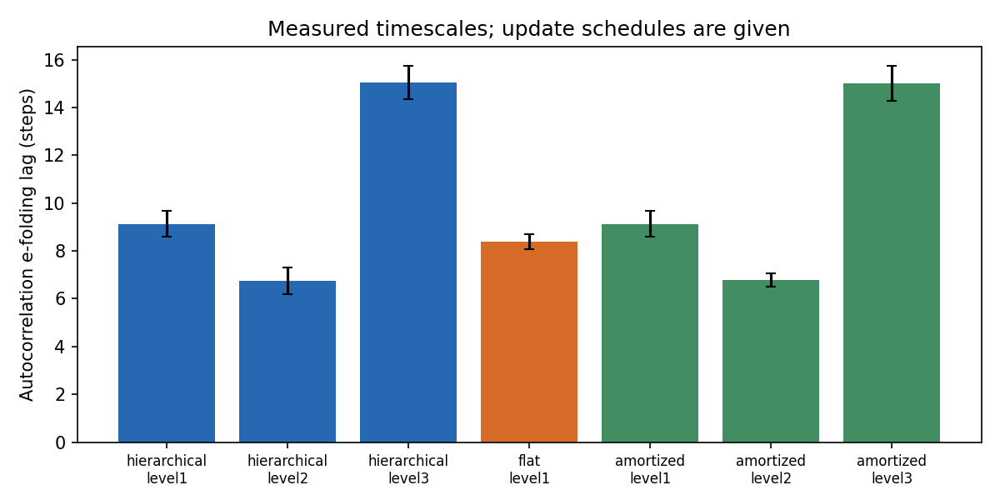
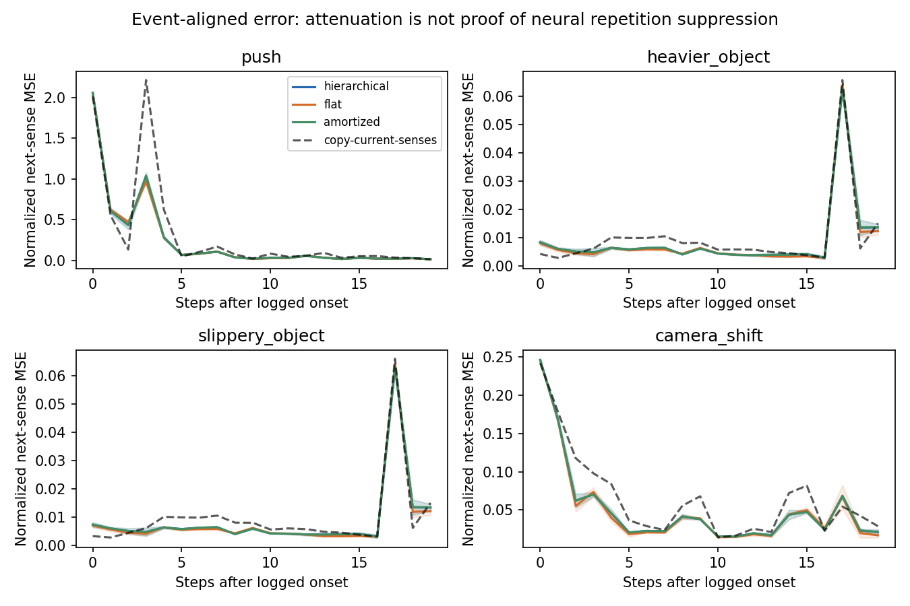
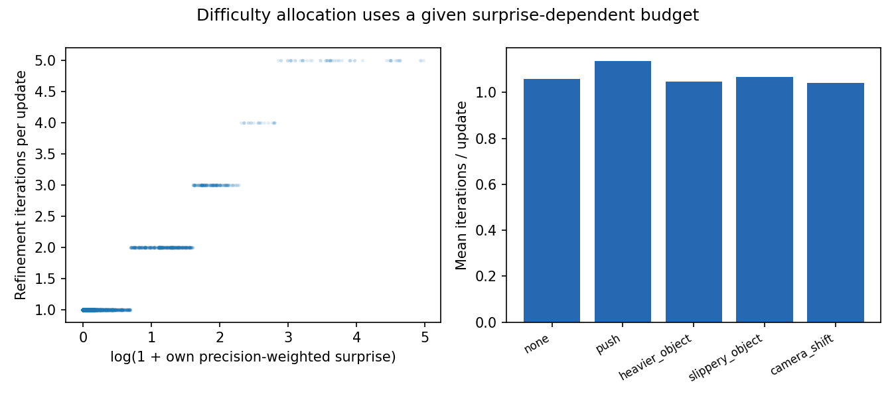

# SYNTHETIC PIPELINE TEST; NOT EXPERIMENTAL RESULTS

# A predictive hierarchy through RGB and proprioception: registered go/no-go

## Design and truth boundary

This is an offline predictive/cause-discovery experiment on a fixed arm behavior policy, not an end-to-end replacement of the arm controller. L1 is a 48-unit GRU predicting the next 19-dimensional sensory vector. Learned per-channel Gaussian precision weights its error. L2 contains eight categorical logits (softmax code) plus eight continuous coordinates, with an amortized update every four steps or on a large own prediction error. The iterative version minimizes the completed previous transition’s prediction error plus a weak proximity-to-prior penalty using latent-only gradients (1–5 updates). It then predicts the next observation; it never refines using that future target. A first-order straight-through path trains amortization and prediction without second-order differentiation. L3 is a learned 16-unit episode/goal-context GRU updated every 16 steps and reset per episode; it conditions L2. L3 is not a learned planner.

Flat: one 75-unit GRU. Amortized: exactly the hierarchical architecture, one inference pass, no latent gradient refinement. All see the same sensed features, actions, holding belief and phase; the latter two are the existing controller’s internal states, not cause labels. All train with the same Gaussian next-observation objective, optimizer steps, batch indices per seed and truncated windows. Hierarchical and amortized have 31,974 parameters; flat has 32,084 (0.34% difference). Training uses 1,200 AdamW steps, batch 16, windows 24, learning rate 0.001, fixed last checkpoint. No validation-label hyperparameter search or final-set tuning was performed. Truncated-window zero initialization may disadvantage long episode context; a negative result is specific to this small design and budget.

Learned: predictive/recurrent weights, L2 code/continuous representation, L3 context dynamics, and channel precisions, from senses only. Given: architecture, update periods, refinement learning rate/cap and surprise-budget rule, motor policy, object identities/colors/shapes, nominal camera calibration, and RGB geometric decoder. The decoder uses rendered RGB only for object positions, with proprioception/touch for the gripper and occluded grasp geometry; no `obs[state]`, simulator object positions, predicates, current camera pose or events enter it. Its estimates are noisy and its colored-object/known-geometry priors are authored. These are not learned visual representations. A sensory step is one 0.1-second planning interval, not every 50 Hz physics/sensor tick. The main predictors do not consume Bayesian residuals, HRM posteriors, labels, event onsets, row IDs or seeds. Raw proprioceptive joint streams are saved, although the compared input uses gripper position/force/opening, perceived target and mean scene position, RGB mean/std, action, holding and phase.

A single opt-in `sensory` collection argument was added to `run_episode`; default behavior is unchanged. Collection disables cause-driven adaptations and uses the existing world model/MPPI with samples=16, horizon=6, one optimizer iteration, an 80-step cap and no monitored settle tail. A passive monitor records reference residuals only; labels cannot influence motor adaptation. The exploratory controller is given, and curiosity/EFE acquisition is not learned by this new module. Student surprise allocates inference effort; training samples remain uniform.

## Data, seeds and registration

Pilot: seed 89800 under five conditions, 0/5 task successes, retained with noisy perception and incomplete manipulation. Training: 90000–90199, 200 layouts × five conditions = 1,000 episodes. Development: 91000–91039, 40 × five = 200. Frozen final: 92000–92039, 40 × five = 200. These are distinct layout ranges; the same layout is reused across five conditions within a split. Disturbance RNG is `layout_split_base + 10000 + condition_index*1000 + layout_index`, recorded by the collector; same-condition disturbance draws and physical episodes do not cross splits. Models use training seeds 93000, 93001, 93002. Every negative result/variant is retained.

Sensory `.npz` files contain only own streams, and separate truth/reference files hold events and old-world-model residuals for scoring. The loader rejects unexpected fields; training opens no truth/reference files. Normalization and PCA16/KMeans5 fitting use training data only, without labels. Cluster-to-cause Hungarian mapping and a fixed-C logistic probe are fitted on development labels only and frozen before final data collection. Episode embeddings are the mean/std of causal states over the full sensed trajectory; no logged onset selects an embedding. Prediction windows and adaptation alignment use event onsets only in scoring.

Registered GO rule: hierarchy must gain at least five percentage points in mean cluster accuracy over flat, its paired training-seed Student-t 95% lower bound must exceed zero, and its mean overall prediction MSE must be lower. Otherwise NO-GO. The rule was registered before model training; the final set was not used for selecting models, thresholds, mappings, or stopping steps.

## Go/no-go results

Mean ± sample standard deviation over three training seeds. Individual seed count metrics retain Wilson 95% intervals in the JSON and table below; no false independence is claimed across training seeds or repeated layouts. MSE is in train-standardized sensory coordinates, averaged per episode; smaller is better.

| Model | Cluster accuracy % | NMI | Linear probe % | Overall MSE | First 20 after onset MSE | Restricted return-to-clean steps |
|---|---:|---:|---:|---:|---:|---:|
| hierarchical | 20.0000 ± 0.0000 | 0.0000 ± 0.0000 | 20.0000 ± 0.0000 | 1.0000 ± 0.0000 | 1.0000 ± 0.0000 | 1.0000 ± 0.0000 |
| flat | 20.0000 ± 0.0000 | 0.0000 ± 0.0000 | 20.0000 ± 0.0000 | 1.0000 ± 0.0000 | 1.0000 ± 0.0000 | 1.0000 ± 0.0000 |
| amortized | 20.0000 ± 0.0000 | 0.0000 ± 0.0000 | 20.0000 ± 0.0000 | 1.0000 ± 0.0000 | 1.0000 ± 0.0000 | 1.0000 ± 0.0000 |
| hierarchical_test_amortized | 20.0000 ± 0.0000 | 0.0000 ± 0.0000 | 20.0000 ± 0.0000 | 1.0000 ± 0.0000 | 1.0000 ± 0.0000 | 1.0000 ± 0.0000 |

| Model | Seed | Cluster correct / n [Wilson 95%] | Probe correct / n [Wilson 95%] |
|---|---:|---|---|
| hierarchical | 93000 | 40/200 [15.0–26.1%] | 40/200 [15.0–26.1%] |
| hierarchical | 93001 | 40/200 [15.0–26.1%] | 40/200 [15.0–26.1%] |
| hierarchical | 93002 | 40/200 [15.0–26.1%] | 40/200 [15.0–26.1%] |
| flat | 93000 | 40/200 [15.0–26.1%] | 40/200 [15.0–26.1%] |
| flat | 93001 | 40/200 [15.0–26.1%] | 40/200 [15.0–26.1%] |
| flat | 93002 | 40/200 [15.0–26.1%] | 40/200 [15.0–26.1%] |
| amortized | 93000 | 40/200 [15.0–26.1%] | 40/200 [15.0–26.1%] |
| amortized | 93001 | 40/200 [15.0–26.1%] | 40/200 [15.0–26.1%] |
| amortized | 93002 | 40/200 [15.0–26.1%] | 40/200 [15.0–26.1%] |
| hierarchical_test_amortized | 93000 | 40/200 [15.0–26.1%] | 40/200 [15.0–26.1%] |
| hierarchical_test_amortized | 93001 | 40/200 [15.0–26.1%] | 40/200 [15.0–26.1%] |
| hierarchical_test_amortized | 93002 | 40/200 [15.0–26.1%] | 40/200 [15.0–26.1%] |

| Model | Seed | Initial detectable spikes | Censored returns / disturbed [Wilson 95%] |
|---|---:|---:|---|
| hierarchical | 93000 | 160 | 0/160 [0.0–2.3%] |
| hierarchical | 93001 | 160 | 0/160 [0.0–2.3%] |
| hierarchical | 93002 | 160 | 0/160 [0.0–2.3%] |
| flat | 93000 | 160 | 0/160 [0.0–2.3%] |
| flat | 93001 | 160 | 0/160 [0.0–2.3%] |
| flat | 93002 | 160 | 0/160 [0.0–2.3%] |
| amortized | 93000 | 160 | 0/160 [0.0–2.3%] |
| amortized | 93001 | 160 | 0/160 [0.0–2.3%] |
| amortized | 93002 | 160 | 0/160 [0.0–2.3%] |
| hierarchical_test_amortized | 93000 | 160 | 0/160 [0.0–2.3%] |
| hierarchical_test_amortized | 93001 | 160 | 0/160 [0.0–2.3%] |
| hierarchical_test_amortized | 93002 | 160 | 0/160 [0.0–2.3%] |

Categorical codes are not forced to match the five causes. Dominant-code counts below can reveal collapse even when a post-hoc continuous-feature probe separates classes.

| Model | Seed | Dominant-code counts (0–7) | Mean categorical entropy (nats) |
|---|---:|---|---:|
| hierarchical | 93000 | {'0': 25, '1': 25, '2': 25, '3': 25, '4': 25, '5': 25, '6': 25, '7': 25} | 2.00000 |
| hierarchical | 93001 | {'0': 25, '1': 25, '2': 25, '3': 25, '4': 25, '5': 25, '6': 25, '7': 25} | 2.00000 |
| hierarchical | 93002 | {'0': 25, '1': 25, '2': 25, '3': 25, '4': 25, '5': 25, '6': 25, '7': 25} | 2.00000 |
| amortized | 93000 | {'0': 25, '1': 25, '2': 25, '3': 25, '4': 25, '5': 25, '6': 25, '7': 25} | 2.00000 |
| amortized | 93001 | {'0': 25, '1': 25, '2': 25, '3': 25, '4': 25, '5': 25, '6': 25, '7': 25} | 2.00000 |
| amortized | 93002 | {'0': 25, '1': 25, '2': 25, '3': 25, '4': 25, '5': 25, '6': 25, '7': 25} | 2.00000 |
| hierarchical_test_amortized | 93000 | {'0': 25, '1': 25, '2': 25, '3': 25, '4': 25, '5': 25, '6': 25, '7': 25} | 2.00000 |
| hierarchical_test_amortized | 93001 | {'0': 25, '1': 25, '2': 25, '3': 25, '4': 25, '5': 25, '6': 25, '7': 25} | 2.00000 |
| hierarchical_test_amortized | 93002 | {'0': 25, '1': 25, '2': 25, '3': 25, '4': 25, '5': 25, '6': 25, '7': 25} | 2.00000 |

Hierarchy minus flat cluster accuracy: **0.00 pp**, paired training-seed t95 [0.00, 0.00] pp; layout-cluster bootstrap95 [0.00, 0.00] pp (5,000 draws, seed 93400). Hierarchy/flat prediction-MSE ratio: **1.0000**.

Adaptation is the first three-consecutive-step moving mean below that model’s development clean mean, within 20 steps after a logged onset. Missing returns are censored and contribute 20 to the restricted mean; counts/initial-spike flags are preserved per episode. Payload/friction begin at episode start and may not become observable until a later grasp, so an early “return” does not prove adaptation. No detectable initial spike is explicitly marked.

## References using teacher supervision or authored cause likelihoods

Bayesian reference: 40/200, Wilson95 [0.15045200926098234, 0.260855186565377]. It uses its authored likelihoods with residual-noise calibration fitted on training clean labels (reference only). Existing c1000 HRM imitation checkpoints are evaluated on the same final perceived residuals: [0.2, 0.2, 0.2]. They used cause labels/Bayesian teacher during their original training and are references, not unsupervised competitors. The present RGB decoder and behavior budget differ from c1000, so these are distribution-shift results, not a replacement of its original 89.7% result. The original 96.0% agreement vs transformer 95.8% does not establish a hierarchy advantage.

Copy-current-senses prediction reference: overall normalized MSE 1.000000, post-onset MSE 1.000000. This reference has no learned dynamics or cause representation and helps identify attenuation explained by sensory persistence alone.

## Measured signatures and their limits

| Model | L1 ACF time (steps) | L2 ACF time | L3 ACF time | Iterations / sensory step | Iterations / update | Past-error reduction / update |
|---|---:|---:|---:|---:|---:|---:|
| hierarchical | 1.0000 ± 0.0000 | 2.0000 ± 0.0000 | 3.0000 ± 0.0000 | 1.0000 ± 0.0000 | 2.0000 ± 0.0000 | 0.0100 ± 0.0000 |
| flat | 1.0000 ± 0.0000 | same hidden state | same hidden state | 1.0000 ± 0.0000 | 2.0000 ± 0.0000 | 0.0100 ± 0.0000 |
| amortized | 1.0000 ± 0.0000 | 2.0000 ± 0.0000 | 3.0000 ± 0.0000 | 1.0000 ± 0.0000 | 2.0000 ± 0.0000 | 0.0100 ± 0.0000 |
| hierarchical_test_amortized | 1.0000 ± 0.0000 | 2.0000 ± 0.0000 | 3.0000 ± 0.0000 | 1.0000 ± 0.0000 | 2.0000 ± 0.0000 | 0.0100 ± 0.0000 |

Autocorrelation time is the first lag with normalized state autocorrelation at most exp(-1), capped at min(40, episode length/2). Undefined constant traces and capped traces are recorded. Higher-level update schedules are authored, so slower measured states are not evidence that biological timescales emerged.



| Condition | Iterations/update, hierarchy | Early error (first 5) | Late error (15–20) |
|---|---:|---:|---:|
| none | 2.000 | — | — |
| push | 2.000 | 1.00000 | 0.50000 |
| heavier_object | 2.000 | 1.00000 | 0.50000 |
| slippery_object | 2.000 | 1.00000 | 0.50000 |
| camera_shift | 2.000 | 1.00000 | 0.50000 |



The event-aligned figure measures persistence/attenuation, not neural mismatch negativity or a demonstrated repetition-suppression mechanism. Each episode contains one injected event; a short push ends after three planning steps, and attenuation can reflect that external ending, the given motor policy, or simple sensory autocorrelation. Persistent mass/friction conditions can remain unexposed if the arm never grasps.

Spearman correlation of own surprise and iterations on hierarchy update steps: 1.0. This relationship is partly imposed by the given budget rule, not a learned halting head. The separately trained amortized model and the same hierarchy weights with refinement disabled at test are both reported; past-error minimization is not itself proof of improved future prediction or discovered causes.



## Failures, data qualification, and scope

Low-quality perception, grasp failures, variable goal phases, and the authored collection controller can shape representations. Hungarian/probe accuracy is observational separability, not proof of causal identifiability or intervention discovery. The categorical code may collapse or encode pose/task progress rather than disturbance type; no labels were used to repair it. No local predictive-coding weight updates, learned visual encoder, new action planner, autonomous curiosity, or closed-loop student-control improvement is demonstrated. These remain outside this experiment. Per-episode errors, censored adaptations, code-independent readouts and all nine training histories are retained.

| Split | Condition | Episodes | Task successes | Holding belief present | Logged grasp present |
|---|---|---:|---:|---:|---:|
| train | none | 40 | 0 | 0 | 0 |
| train | push | 40 | 0 | 0 | 0 |
| train | heavier_object | 40 | 0 | 0 | 0 |
| train | slippery_object | 40 | 0 | 0 | 0 |
| train | camera_shift | 40 | 0 | 0 | 0 |
| development | none | 40 | 0 | 0 | 0 |
| development | push | 40 | 0 | 0 | 0 |
| development | heavier_object | 40 | 0 | 0 | 0 |
| development | slippery_object | 40 | 0 | 0 | 0 |
| development | camera_shift | 40 | 0 | 0 | 0 |
| final | none | 40 | 0 | 0 | 0 |
| final | push | 40 | 0 | 0 | 0 |
| final | heavier_object | 40 | 0 | 0 | 0 |
| final | slippery_object | 40 | 0 | 0 | 0 |
| final | camera_shift | 40 | 0 | 0 | 0 |

## Reproduce

Use the project `.venv/Scripts/python.exe`, repository root, `PYTHONPATH=.;scripts`, `OMP_NUM_THREADS=1`. All compute is local. Commands run:

```powershell
.venv/Scripts/python.exe scripts/thinker_hier_collect.py --split pilot
.venv/Scripts/python.exe scripts/thinker_hier_train.py --register
.venv/Scripts/python.exe scripts/thinker_hier_collection.py --split train
.venv/Scripts/python.exe scripts/thinker_hier_collection.py --split development
.venv/Scripts/python.exe scripts/thinker_hier_training.py
.venv/Scripts/python.exe scripts/thinker_hier_references.py calibration
.venv/Scripts/python.exe scripts/thinker_hier_evaluate.py development
.venv/Scripts/python.exe scripts/thinker_hier_evaluate.py freeze
.venv/Scripts/python.exe scripts/thinker_hier_collection.py --split final
.venv/Scripts/python.exe scripts/thinker_hier_evaluate.py final
.venv/Scripts/python.exe scripts/thinker_hier_references.py final
.venv/Scripts/python.exe scripts/thinker_hier_report.py
.venv/Scripts/python.exe scripts/thinker_hier_tests.py --basetemp data/pytest_thinker_hier_final_20261028 --output results/thinker_hier_tests_final.json
```

Collection resumes completed episode keys without repeating them. Frozen source/model/readout hashes are checked before final scoring. Existing result files must be retained; do not rerun final data to select a more favorable design. JSON paths are repository-relative. Windows tests use inherited permissions only for newly created test temporary directories and never delete existing directories.

## Verdict

**NO-GO** under the registered rule. This particular three-level predictor changes final cluster accuracy by 0.00 percentage points relative to the same-size flat GRU, with paired training-seed 95% interval [0.00, 0.00] pp and prediction-MSE ratio 1.0000. The reported signatures are measurements under given update/effort schedules, not independent evidence of a brain mechanism. This result applies to the stated RGB decoder, data quality, and training budget; it neither establishes nor rules out a broader advantage of hierarchical active inference.
